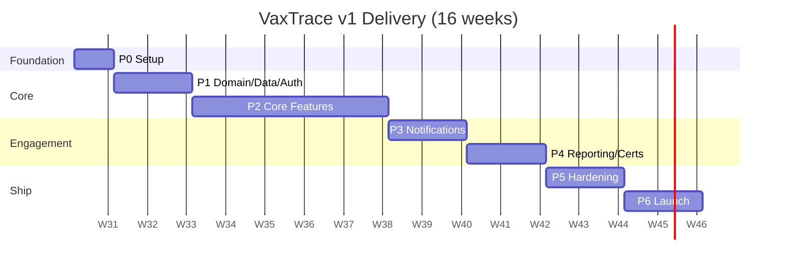
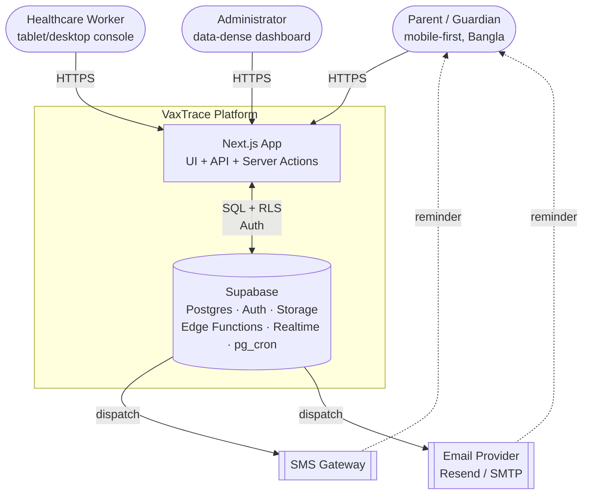
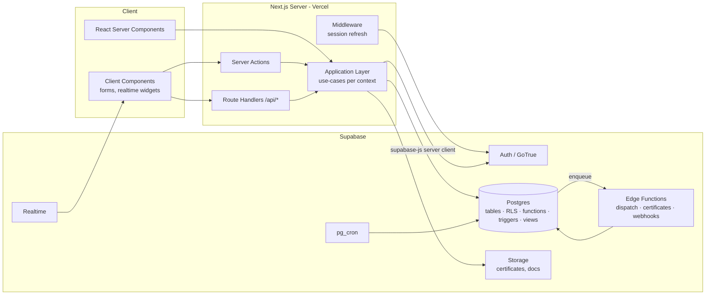
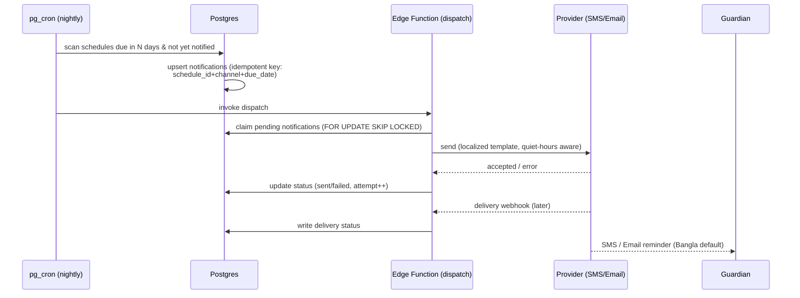
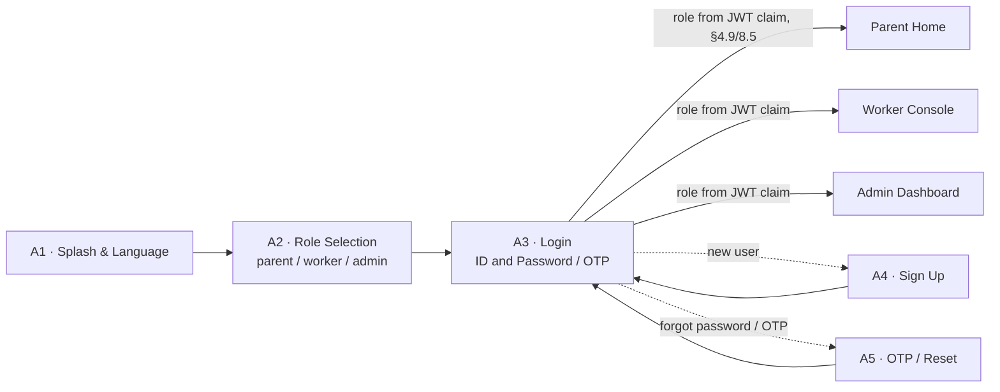
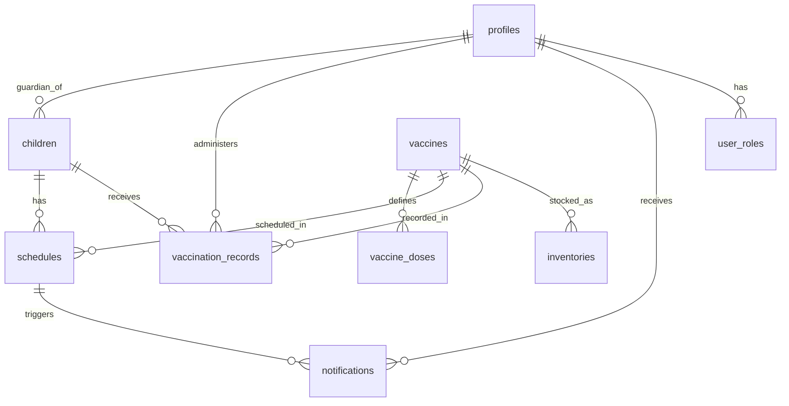
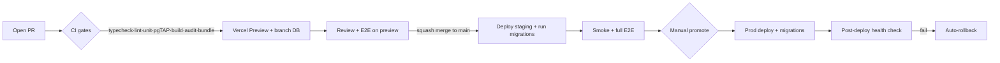

# VaxTrace — Master Engineering Handbook

> **The single source of truth for building, deploying, operating, and scaling VaxTrace.**
> Everything an engineering team needs to begin implementation without further architectural planning.

| Field | Value |
|---|---|
| **Document** | Master Engineering Handbook |
| **Product** | VaxTrace — Child Immunization Tracking & Reminder Platform |
| **Version** | 1.1 |
| **Status** | Approved for implementation |
| **Date** | 2026-07-24 |
| **Owner** | Engineering (CTO / Principal Architect) |
| **Supersedes** | Architecture sections of `VaxTrace_SRS_Final` (MongoDB/NextAuth stack → Supabase); v1.0 of this handbook (Parent native-mobile references → single Next.js web app, ADR-009) |
| **Locked stack** | Next.js · TypeScript · Supabase (Postgres, Auth, Storage, Edge Functions, Realtime) |
| **Design source of truth** | Figma — [VaxTrace UI System / Screens](https://www.figma.com/design/S1n9q5mqPNEzIks9FgUx0E/VaxTrace-%E2%80%94-UI-System---Screens) (`S1n9q5mqPNEzIks9FgUx0E`) — 29 screens, light/dark, tokenized |

### Revision History

| Version | Date | Change |
|---|---|---|
| 1.0 | 2026-07-20 | Initial handbook; Supabase stack locked; 28-screen inventory. |
| 1.1 | 2026-07-24 | **Parent role confirmed web-only** (ADR-009) — no native mobile app; added **Role Selection** screen (A2) to the auth flow: Splash → Role Selection → Login → Dashboard; screen inventory 28 → 29 (auth 4 → 5); Pre-Defense MVP scope locked to Auth + Admin modules for the 2026-08-03 defense (see `TODO.md`). |

---

## Guiding Engineering Doctrine (read this first)

This handbook is production-grade in **discipline** and pragmatic in **scale**. Those are not in tension — they are the same thing done by senior people. Three rules govern every decision in this document:

1. **Complexity is a cost paid only when a metric demands it.** We do not adopt microservices, Kafka, Kubernetes, Redis, or a separate analytics warehouse on day one. Each is documented with the *exact trigger metric* that justifies adopting it. Until that metric fires, the simpler design is the *correct* design, not a compromise.
2. **The platform does the work before we write code.** Supabase provides Postgres, Auth, Row-Level Security, Storage, Edge Functions, Realtime, and cron. Any capability the platform already offers is not re-implemented in application code. This eliminates entire subsystems the original SRS drew as custom boxes (JWT/RBAC middleware, session service, notification service, cron infrastructure).
3. **Every deferred decision leaves a seam, not a dead end.** Where we choose the simple path, we document the extension point and the trigger to activate it — so "later" is a planned, low-risk change, never a rewrite.

A vaccination registry for a national/regional health program has a specific shape: **write-light, read-moderate, correctness-critical, privacy-critical, and spiky around reminder batches** — not a high-QPS consumer social app. The architecture below is tuned to *that* reality, which is what institutional-grade engineering actually means.

> ### Pre-Defense MVP Scope (2026-08-03)
> Full v1 remains the 16-week, 7-phase plan below. For the **pre-defense demo**, scope is deliberately narrowed to what can be shown *working end-to-end*, not partially stubbed everywhere: the **entire Authentication module** (A1–A5: Splash → Role Selection → Login → Dashboard, sign-up, OTP/reset) and the **entire Admin module** (D1–D8: dashboard, inventory, reports, user & role management) are built complete — real Supabase Auth, real RLS, real data, no mocked screens. Parent (B) and Worker (C) screens exist in Figma and the file map but are **not** implementation targets for Aug 3. See `TODO.md` for the exact task list and Must/Should/Optional split.

---

## Table of Contents

1. [Executive Summary](#1-executive-summary)
2. [Complete Development Roadmap](#2-complete-development-roadmap)
3. [Software Development Methodology](#3-software-development-methodology)
4. [Complete System Architecture](#4-complete-system-architecture)
5. [Technology Stack](#5-technology-stack)
6. [Programming Languages by Development Stage](#6-programming-languages-by-development-stage)
7. [Production Folder Structure](#7-production-folder-structure)
8. [Database Design](#8-database-design)
9. [Security Architecture](#9-security-architecture)
10. [Performance Engineering](#10-performance-engineering)
11. [Scalability Strategy](#11-scalability-strategy)
12. [Quality Assurance Strategy](#12-quality-assurance-strategy)
13. [DevOps & CI/CD](#13-devops--cicd)
14. [Coding Standards](#14-coding-standards)
15. [Project Management](#15-project-management)
16. [Master Engineering To-Do List](#16-master-engineering-to-do-list)
17. [Deployment & Operations](#17-deployment--operations)
18. [Future Roadmap](#18-future-roadmap)
- [Appendix A: Architecture Decision Records (ADRs)](#appendix-a-architecture-decision-records)
- [Appendix B: Glossary](#appendix-b-glossary)

---

## 1. Executive Summary

### 1.1 Project Vision

VaxTrace is a **child immunization tracking and reminder platform** that ensures no child misses a scheduled vaccine. It connects three actors around a single, trustworthy immunization record:

- **Parents / Guardians** — register children, view immunization history, see what's due next, and receive SMS/email reminders (in **Bangla by default**, English optional).
- **Healthcare Workers** — register children at the point of care, record administered doses, and keep records accurate.
- **Administrators** — monitor vaccine inventory, generate coverage and dropout statistics, and manage users and roles.

The product's north star is **immunization coverage rate** — the percentage of enrolled children up-to-date for their age. Every feature exists to move that number.

### 1.2 Business Goals

| # | Goal | Success Signal |
|---|---|---|
| B1 | Reduce missed/late vaccinations | ↑ on-time dose rate; ↓ dropout rate between dose 1 → dose N |
| B2 | Give health programs real-time coverage visibility | Admin coverage report available on-demand, ≤ 24h data freshness |
| B3 | Cut manual reminder effort to zero | 100% of due-soon schedules trigger an automated reminder |
| B4 | Prevent stockouts and expired-stock waste | Inventory alerts before stockout/expiry |
| B5 | Be usable by low-tech-literacy parents on low-end phones | Bangla-first, mobile-first, works on 3G |

### 1.3 Technical Goals

| # | Goal | Target |
|---|---|---|
| T1 | Correctness of the immunization record | Schedule generation & dose recording covered by deterministic tests; zero data-integrity defects in prod |
| T2 | Security & privacy of child health data | RLS-enforced tenant isolation; no PII in logs; audit trail on every clinical write |
| T3 | Low operational burden | Fully managed platform (Vercel + Supabase); no servers to patch; < 1 day/month ops toil |
| T4 | Fast, cheap iteration | PR → preview env in < 5 min; trunk to prod in < 15 min |
| T5 | Scale headroom without redesign | Documented path from 100 → 1,000,000+ users on the same core architecture |

### 1.4 Production Objectives (SLOs)

| Objective | Target (v1) |
|---|---|
| Availability | 99.9% monthly (aligned to Supabase + Vercel managed SLAs) |
| API read latency (p95) | ≤ 300 ms |
| API write latency (p95) | ≤ 500 ms |
| Reminder dispatch timeliness | 100% of due reminders sent within the daily batch window |
| RPO (recovery point) | ≤ 24h (v1 daily backups); ≤ 2 min with PITR (paid tier) |
| RTO (recovery time) | ≤ 4h |
| Error budget | 0.1% / month, governs release velocity |

### 1.5 Engineering Principles

Clean Architecture · SOLID · Domain-Driven Design (bounded contexts) · Modular Monolith · Security by Design · Least Privilege · Twelve-Factor · Infrastructure & config as code · Observability as a feature · Testability first · **YAGNI as an architectural constraint** · Every shortcut leaves a documented seam.

---

## 2. Complete Development Roadmap

**Assumed team:** 2–4 engineers (1 lead/full-stack, 1–2 full-stack, 1 part-time QA/DevOps). Timeline given in **calendar weeks** for a small team; scale down proportionally for more people. Total: **~16 weeks to GA (v1)**, then continuous delivery.

The lifecycle is broken into **7 phases**, each with micro-stages in strict execution order.

### Phase 0 — Foundation & Project Setup (Week 1)

| Aspect | Detail |
|---|---|
| **Objective** | A team can commit code that is linted, tested, type-checked, and deployed to a preview URL — before any feature exists. |
| **Deliverables** | Monorepo scaffold; Supabase project (dev/staging/prod); CI/CD green on an empty app; environment/secrets management; design tokens imported from Figma; ADR log started. |
| **Micro-stages** | 0.1 Repo + tooling (pnpm, TS strict, ESLint, Prettier, Husky, commitlint) → 0.2 Next.js App Router skeleton + Tailwind + design tokens → 0.3 Supabase projects + local `supabase` CLI + migrations dir → 0.4 CI pipeline (typecheck, lint, unit, build) → 0.5 CD to Vercel preview + staging → 0.6 Secrets in Vercel/Supabase + `.env.example` → 0.7 Observability baseline (Sentry, structured logging). |
| **Team responsibilities** | Lead: repo + CI/CD + Supabase. FE: tokens + skeleton. QA/DevOps: pipeline gates + secrets. |
| **Dependencies** | Figma tokens (available); Supabase & Vercel accounts. |
| **Risks** | Env drift between local/staging/prod → mitigate with `supabase` CLI migrations as the single schema source. |
| **Success criteria** | Empty app deploys via PR preview; CI blocks a failing lint/test; `supabase db reset` reproduces schema locally. |
| **Timeline** | Week 1 |

### Phase 1 — Domain, Data & Auth Core (Weeks 2–3)

| Aspect | Detail |
|---|---|
| **Objective** | The immutable spine: schema, RLS, auth, roles. Nothing UI-facing ships before this is correct. |
| **Deliverables** | Full Postgres schema (migrations); RLS policies for all tables; Supabase Auth wired (email/password + phone OTP); role model (`parent`/`worker`/`admin`) via custom access-token hook; seed data (vaccine catalog); generated TS types. |
| **Micro-stages** | 1.1 Tables + constraints + indexes (§8) → 1.2 Role model + custom access-token hook → 1.3 RLS policies per table + policy tests → 1.4 Auth flows (splash, role selection, sign-up, sign-in, OTP, password reset) → 1.5 Vaccine catalog seed → 1.6 `supabase gen types` into `packages/db-types`. |
| **Team responsibilities** | Lead: schema, RLS, auth. FE: auth screens (from the 5 auth designs, §7.1 A1–A5). |
| **Dependencies** | Phase 0. |
| **Risks** | RLS mistakes = data leak. Mitigate: **pgTAP policy tests are a merge gate** (§12). |
| **Success criteria** | A parent cannot read another parent's child (proven by test); worker/admin scopes proven by test; auth E2E green. |
| **Timeline** | Weeks 2–3 |

### Phase 2 — Core Domain Features (Weeks 4–8)

| Aspect | Detail |
|---|---|
| **Objective** | The value loop works end-to-end for all three roles. |
| **Deliverables** | Child registration → **automatic schedule generation**; dose recording → schedule reconciliation; parent history & upcoming views; worker console; admin inventory + user management. |
| **Micro-stages (execution order)** | 2.1 `generate_schedule()` DB function + trigger → 2.2 Register Child (worker + parent) → 2.3 Record Administered Dose + schedule reconcile trigger → 2.4 Update/correct record (audited) → 2.5 Parent: View History → 2.6 Parent: View Upcoming Schedule → 2.7 Admin: Inventory monitor (stock/expiry) → 2.8 Admin: Manage Users & Roles. |
| **Team responsibilities** | Split by bounded context (Immunization, Inventory, Identity). |
| **Dependencies** | Phase 1. |
| **Risks** | Schedule-generation logic is the correctness core → TDD it first (§12), pure SQL/edge function, deterministic fixtures. |
| **Success criteria** | Registering a child with a DOB produces the correct dose schedule; recording a dose flips the right schedule row to `done` and sets `nextDueDate`. |
| **Timeline** | Weeks 4–8 |

### Phase 3 — Notifications & Scheduling Engine (Weeks 9–10)

| Aspect | Detail |
|---|---|
| **Objective** | Reminders fire automatically and reliably. |
| **Deliverables** | `pg_cron` nightly scan of due/overdue schedules → notification queue → Edge Function dispatch (SMS + email); idempotency & retry; delivery status write-back; Bangla/English templates. |
| **Micro-stages** | 3.1 Due-scan query + materialized "due soon" set → 3.2 Notification enqueue (idempotent per schedule+channel+day) → 3.3 Dispatch Edge Function (provider adapters) → 3.4 Retry + dead-letter handling → 3.5 Delivery webhook → status write-back → 3.6 Localized templates + quiet-hours. |
| **Dependencies** | Phase 2 (schedules exist). |
| **Risks** | Double-send / spam. Mitigate: idempotency key = `(schedule_id, channel, due_date)`; unique index enforces it. |
| **Success criteria** | A schedule due in N days produces exactly one reminder per channel; failed sends retry then dead-letter; parent opt-out honored. |
| **Timeline** | Weeks 9–10 |

### Phase 4 — Reporting, Analytics & Certificates (Weeks 11–12)

| Aspect | Detail |
|---|---|
| **Objective** | Admins get coverage insight; parents get a shareable immunization card. |
| **Deliverables** | Coverage rate, dropout rate, doses-over-time, missed-appointment rate (SQL views / materialized views); admin dashboard widgets; digital immunization certificate (PDF → Storage). |
| **Micro-stages** | 4.1 Reporting views + matview refresh (pg_cron) → 4.2 Admin dashboard widgets (data-dense, dark-first) → 4.3 CSV export → 4.4 Immunization certificate generation + signed-URL download. |
| **Dependencies** | Phase 2–3. |
| **Success criteria** | Coverage numbers reconcile against raw records; certificate matches history exactly. |
| **Timeline** | Weeks 11–12 |

### Phase 5 — Hardening: Security, Performance, A11y, i18n (Weeks 13–14)

| Aspect | Detail |
|---|---|
| **Objective** | Production-ready quality bar met on all non-functional axes. |
| **Deliverables** | Threat-model review + fixes; RLS red-team; load test to target scale; Lighthouse/a11y ≥ 90; full Bangla localization pass; performance budget enforced in CI. |
| **Micro-stages** | 5.1 Security review + `supabase` advisors + dependency/secret scans → 5.2 Load & soak test (k6) → 5.3 Query/index tuning from real EXPLAIN plans → 5.4 A11y (WCAG 2.1 AA) + keyboard/screen-reader pass → 5.5 i18n completeness (no hardcoded strings) → 5.6 Error-state & offline UX. |
| **Dependencies** | Phases 2–4. |
| **Success criteria** | All §9/§10/§12 gates green; no critical/high vulns; p95 within SLO under load. |
| **Timeline** | Weeks 13–14 |

### Phase 6 — Launch & Stabilization (Weeks 15–16)

| Aspect | Detail |
|---|---|
| **Objective** | Ship to real users; prove operability. |
| **Deliverables** | Prod runbooks; on-call + incident process; backup/restore drill executed; canary → GA; post-launch monitoring dashboards. |
| **Micro-stages** | 6.1 Prod checklist (§17) → 6.2 Restore drill (prove RPO/RTO) → 6.3 Canary to a pilot clinic → 6.4 GA → 6.5 30-day stabilization + bug burn-down. |
| **Success criteria** | Pilot clinic runs a full register→dose→reminder cycle in prod; restore drill passes; error budget intact. |
| **Timeline** | Weeks 15–16 |



---

## 3. Software Development Methodology

### 3.1 Decision

**Adopt: Kanban-flavored Scrum + Trunk-Based Development + DevOps (continuous delivery).** For a 2–4 person team, heavyweight ceremony is waste; a rigid Waterfall/Spiral model cannot absorb the inevitable clinical-workflow feedback.

| Methodology | Verdict for VaxTrace | Why |
|---|---|---|
| Waterfall | ✗ | Requirements will shift as clinics pilot; big-bang integration is high-risk. |
| Spiral | ✗ | Risk-driven iteration is good, but its formality is overkill at this size. |
| Agile Scrum | ◑ | Iteration cadence is right; full ceremony (separate SM, story-point theater) is too heavy for 2–4 people. |
| Kanban | ✓ | WIP limits + continuous flow fit a small team and a steady backlog. |
| DevOps | ✓ | Automation, CI/CD, observability, "you build it you run it" are mandatory. |
| GitFlow | ✗ | Long-lived branches + release/develop branches = merge pain, slow feedback. |
| **Trunk-Based Dev** | ✓ | Short-lived branches, small PRs, feature flags, always-releasable trunk. |

**Net:** lightweight Scrum cadence for planning + Kanban board for flow + trunk-based branching + DevOps automation. One-week sprints, or continuous flow with a weekly planning checkpoint.

### 3.2 Sprint / Flow Workflow

- **Cadence:** 1-week iterations. Monday: pull top of backlog to WIP. Friday: demo + retro (15 min each, async-friendly).
- **WIP limits:** max 2 in-progress items per engineer. Blocked items surface immediately.
- **Definition of Ready:** story has acceptance criteria + design reference (Figma node) + no open questions.
- **Definition of Done:** see §16.

### 3.3 Branching Strategy (Trunk-Based)

```
main (always releasable, protected)
  └── short-lived branch: feat/<ticket>-<slug>   (< 2 days, < ~400 LOC diff)
        → PR → CI gates green → 1 review → squash-merge → auto-deploy staging → promote to prod
```

- Branch protection on `main`: required status checks (typecheck, lint, unit, RLS/policy tests, build), 1 approval, linear history, no force-push.
- **Feature flags** (env-driven or a lightweight flags table) let incomplete work merge to trunk dark. No long-lived feature branches.

### 3.4 Code Review Workflow

- Every change via PR. **Small PRs** (reviewer can hold the whole diff in their head).
- Author fills the PR template (what/why/screenshots/test evidence/rollback). Reviewer checks correctness, security (RLS!), tests, and §14 standards.
- Green CI is a precondition for review, not a result of it.

### 3.5 Versioning Strategy

- **App:** Semantic-ish release tags `vMAJOR.MINOR.PATCH`; trunk is continuously deployed, tags mark notable releases.
- **Database:** timestamped, forward-only migrations (`supabase migration new`). Never edit a shipped migration; roll forward.
- **API:** internal API is co-versioned with the app (single deployable). Any future public API is versioned by URL prefix (`/api/v1`).
- **Commits:** Conventional Commits → drives changelog.

### 3.6 Release & Deployment Workflow

`Merge to main → CI → deploy to staging → automated smoke + E2E → manual promote (button) → prod (Vercel) + migrations (Supabase) → post-deploy health check → auto-rollback on health failure`. Full pipeline in §13.

---

## 4. Complete System Architecture

### 4.1 Architectural Style — Modular Monolith on a Managed Platform

**Decision:** A **modular monolith**: one Next.js deployable (UI + API routes/route handlers + server actions) organized into **DDD bounded contexts**, backed by **Supabase** (Postgres + Auth + Storage + Edge Functions + Realtime). Business rules that are pure data operations live **in the database** (functions, triggers, RLS); orchestration and IO-bound async work live in **Edge Functions**; everything user-facing lives in **Next.js**.

Why not microservices now: at VaxTrace's scale and team size, microservices add network hops, distributed-transaction complexity, and ops burden with zero benefit. The modules below are separated by **clear internal boundaries** so any one can later be extracted into its own service *if and only if* its scaling or team-ownership profile diverges (trigger in §11). This is microservice-*ready* without paying the microservice tax.

### 4.2 Bounded Contexts (Domain Architecture)

| Context | Owns | Key entities | Notes |
|---|---|---|---|
| **Identity & Access** | Auth, roles, profiles | `users`/`profiles`, roles | Backed by Supabase Auth; role in JWT claim. |
| **Immunization** (core) | Children, schedules, records, the scheduling engine | `children`, `schedules`, `vaccination_records`, `vaccines` | The heart of the product; strongest invariants. |
| **Inventory** | Vaccine stock, batches, expiry | `inventories`, `vaccines` | Alerts on low stock / near expiry. |
| **Notifications** | Reminder generation & delivery | `notifications` | Async, provider-adapter isolated. |
| **Reporting** | Coverage/dropout/stock analytics, certificates | views/matviews | Read model over the others; never writes domain data. |

Contexts communicate **in-process** through a typed service layer (application layer), and **through the database** for async flows (schedule → notification). No context reaches into another's tables directly except through the read-model in Reporting.

### 4.3 System Context (C4 — Level 1)



### 4.4 Container / Layered Architecture (C4 — Level 2)



**Clean Architecture mapping (dependencies point inward):**

| Layer | Contains | May depend on |
|---|---|---|
| **Domain** | Entities, value objects, invariants, domain types (pure TS + DB constraints) | nothing |
| **Application** | Use-cases (register child, record dose, enqueue reminder), ports/interfaces | Domain |
| **Interface/Adapters** | Next.js server actions & route handlers, supabase-js repositories, provider adapters (SMS/email) | Application |
| **Infrastructure/Frameworks** | Next.js, Supabase, Vercel, Edge runtime, external gateways | Interface |

The database is an **adapter**, not the domain. Invariants that *must* hold regardless of caller (a dose number can't exceed a vaccine's total doses; a schedule belongs to exactly one child) are enforced **both** in the domain/application layer *and* by DB constraints — defense in depth, since RLS and constraints are the last line even if app code has a bug.

### 4.5 Frontend Architecture

- **Next.js App Router**, React Server Components by default; client components only where interactivity/realtime is needed (forms, live dashboard widgets).
- **Rendering strategy per surface:**
  - Parent history/upcoming: **server-rendered**, data fetched in RSC with the user's RLS-scoped session — no client-side secret handling.
  - Worker console: server-rendered shell + client forms with optimistic updates.
  - Admin dashboard: server-rendered + **Realtime** subscriptions for live counters.
- **State:** server state via RSC + React Query (TanStack) only where client caching/optimistic UI is needed; **no global client store** unless a measured need appears (YAGNI). UI/ephemeral state stays local.
- **Design system:** tokens imported from the finalized Figma (light/dark, violet-tinted dark); component library per the 29-screen inventory (auth ×5, parent ×6, worker ×6, admin ×8, shared ×4).
- **i18n:** `next-intl`, **Bangla default**, English switchable — first-class, not a future item (see §4.16). All copy in message catalogs; zero hardcoded user-facing strings (lint-enforced).
- **Forms & validation:** React Hook Form + **Zod** schemas shared with the server (single source of validation truth).

### 4.6 Backend Architecture

- **No separate backend service.** Server-side logic lives in Next.js **Server Actions** (mutations) and **Route Handlers** (`/api/*` for webhooks and any machine-to-machine endpoints), calling a **typed application/use-case layer**.
- The use-case layer talks to Postgres via **`supabase-js` server clients** using the **request's user session** (so RLS applies), except for a small set of explicitly-audited privileged operations that use the service role inside Edge Functions.
- **Async / scheduled work** runs in **Supabase Edge Functions** (Deno/TS) triggered by `pg_cron` or DB events: reminder dispatch, certificate generation, provider webhooks, matview refresh.

### 4.7 API Architecture

- **Primary interface:** typed Server Actions + RSC data access (no hand-written REST layer for first-party UI — the network boundary is generated/typed, not bespoke).
- **Route Handlers** exist for: provider **webhooks** (SMS/email delivery receipts), health checks, and a small, **RLS-safe** public surface if needed later.
- **Contracts:** end-to-end types from `supabase gen types` + Zod at the edges. Errors follow a single typed `Result`/problem-details shape (§14).
- **Idempotency:** all externally-triggered writes (webhooks, dispatch) carry idempotency keys.
- **Future public API** (§18): versioned `/api/v1`, OpenAPI-documented, rate-limited — introduced only when a third party needs it.

### 4.8 Database Architecture

Postgres (Supabase) is the system of record **and** the enforcement point. See §8 for the full schema. Principles:
- **RLS on every table**, deny-by-default. Authorization is data, enforced by the database.
- **Business invariants as constraints** (FKs, checks, unique, exclusion) — the DB refuses invalid states.
- **Domain logic that is pure data** lives in SQL functions + triggers (schedule generation, dose reconciliation) — deterministic, testable, and impossible to bypass from any caller.
- **Read models** (views/materialized views) for reporting keep OLTP tables clean.

### 4.9 Authentication Architecture

- **Supabase Auth (GoTrue).** Email/password **and phone OTP** (phone is the primary identifier for many parents). Optional magic link.
- Sessions via secure, `HttpOnly` cookies managed by `@supabase/ssr`; middleware refreshes tokens. **No custom JWT/session service** (supersedes the SRS's NextAuth + custom-JWT boxes).
- JWTs carry a **custom `user_role` claim** injected by a **Custom Access Token Hook** reading a `user_roles` table — so RLS policies authorize from the token without extra round-trips.

### 4.10 Authorization Architecture (RBAC via RLS)

- **Three roles:** `parent`, `worker`, `admin`.
- Enforced **in Postgres via RLS**, not middleware. The JWT `user_role` claim + ownership columns drive every policy. Example intent:
  - Parent: `SELECT/UPDATE` only rows linked to their `guardian_id`.
  - Worker: `INSERT/UPDATE` clinical rows; read children they register/serve.
  - Admin: full read; user/role and inventory management.
- Full policy set and the role matrix are in §8.5 and §9.
- **Least privilege:** the anon/public role can do almost nothing; the service role is used only inside audited Edge Functions.

### 4.11 Storage Architecture

- **Supabase Storage** buckets: `certificates` (private, signed-URL access), `documents` (optional batch/consent docs), `avatars` (optional). Bucket policies mirror RLS ownership. No public buckets for anything containing PII.

### 4.12 Caching Strategy (deliberately minimal)

| Layer | v1 approach | Add when |
|---|---|---|
| CDN/static | Vercel edge cache for static assets & public pages | always on |
| Data cache | Next.js Data Cache / `revalidate` for reference data (vaccine catalog) | always on |
| Query cache | React Query on the client for interactive views | always on |
| Reporting | **materialized views** refreshed by pg_cron | reports get heavy |
| **Redis / KV** | **Not used** | *Trigger:* a proven hot-key or cross-request shared-cache need that Next/Postgres cache can't serve (measured), e.g. rate-limit counters at high QPS. |

### 4.13 Queue & Background Jobs

- **v1:** `pg_cron` scheduled scans + a `notifications` table acting as a durable work list; Edge Functions drain it with retry/backoff and a dead-letter status. This *is* a queue, using tools already present.
- **Add a real queue** (`pgmq` / Supabase Queues) **when:** dispatch volume or fan-out makes the table-scan pattern hot, or you need strict ordering/visibility-timeout semantics. Documented seam, not built now.

### 4.14 Notification System



- **Channels:** SMS (local gateway adapter; Twilio as a global fallback) + Email (Resend or Supabase SMTP).
- **Guarantees:** at-least-once with idempotency → effectively once per `(schedule, channel, day)`; retry with backoff; dead-letter after N attempts; **opt-out & quiet-hours** honored.
- **Provider adapter** interface isolates the gateway so switching providers is a one-file change.

### 4.15 Observability (Logging · Monitoring · Analytics · Error Handling)

| Concern | Tool | What |
|---|---|---|
| **Errors** | Sentry | Client + server + Edge Function exceptions, releases, source maps. |
| **Logs** | Structured JSON (pino) + Supabase/Vercel logs | Correlation ID per request; **never** log PII/PHI. |
| **Metrics/health** | Vercel Analytics + Supabase dashboards + `/api/health` | Latency, error rate, DB health; uptime check on health endpoint. |
| **DB advisors** | `supabase` advisors | Security & performance lints in CI and periodically. |
| **Product analytics** | Privacy-respecting, self-hostable (e.g. PostHog) or none in v1 | Coverage funnel, reminder→visit conversion; consented, no PHI. |
| **Error handling** | Typed `Result` + global error boundaries + problem-details API errors | User sees localized friendly errors; engineers get correlation IDs. |

### 4.16 Internationalization (core, not future)

Bangla is the **default** locale; English is switchable. `next-intl` with message catalogs; locale in a cookie + URL segment; dates/numbers via `Intl`; **content data** that is inherently bilingual (vaccine display names, notification templates) stored with `_bn`/`_en` columns or a `translations` JSONB. RTL not required (both languages LTR). Localization completeness is a release gate (§12).

### 4.17 Infrastructure & Deployment

- **Next.js → Vercel** (managed, edge network, preview envs per PR).
- **Supabase** managed (dev/staging/prod projects; or branch DBs for previews).
- **Everything as code:** migrations (`supabase/migrations`), Edge Functions (`supabase/functions`), config, CI/CD in the repo. No click-ops for anything reproducible.

### 4.18 High Availability, Disaster Recovery & Future Migration

- **HA:** Vercel (multi-region edge) + Supabase managed Postgres with the platform's HA/replication on paid tiers. App servers are **stateless** → horizontal scale is automatic.
- **DR:** daily backups (v1) → **Point-in-Time Recovery** on paid tier (RPO ≤ 2 min); documented + **drilled** restore (§17). Backups tested, not assumed.
- **Future migration strategy:** because business logic is in the DB + a typed application layer (not scattered), the escape hatches are clean: (a) extract a context to its own service via the existing module boundary; (b) if ever leaving Supabase, it's standard Postgres — `pg_dump`/logical replication out, and Auth/Storage are the only platform-specific pieces to re-home (documented as the lock-in surface in ADR-001).

---

## 5. Technology Stack

Every choice is justified, with the alternative considered and why it lost. **Locked** items are non-negotiable constraints; **selected** items are our recommendations completing the stack.

### 5.1 Core (locked)

| Concern | Choice | Alternatives considered | Why this |
|---|---|---|---|
| Framework | **Next.js (App Router)** | Remix, SvelteKit | Locked. RSC + server actions collapse the client/server boundary; best-in-class Vercel deploy; huge ecosystem. |
| Language | **TypeScript (strict)** | JavaScript | Locked. Type safety end-to-end; catches whole defect classes at compile time. |
| Platform | **Supabase** | Firebase, custom Node+Postgres, PlanetScale+Auth0 | Locked. Postgres (real SQL, RLS), Auth, Storage, Edge Functions, Realtime, cron in one managed platform — collapses 4 custom subsystems from the SRS. |

### 5.2 Frontend (selected)

| Concern | Choice | Alternatives | Why |
|---|---|---|---|
| Styling | **Tailwind CSS** + design tokens | CSS Modules, styled-components | Token-driven, matches Figma variables, zero runtime cost, fast to build 29 screens. |
| Components | **shadcn/ui** (Radix primitives) | MUI, Chakra | Own the code (no black-box lib), accessible primitives, themeable to the violet-tinted dark system. |
| Forms | **React Hook Form + Zod** | Formik | Performant uncontrolled forms; Zod schema shared client↔server. |
| Client data | **TanStack Query** (where needed) | SWR, Redux | Caching/optimistic UI only where interactivity needs it; not global by default. |
| i18n | **next-intl** | react-i18next, next-i18next | App Router-native, server+client, Bangla-default routing. |
| Charts | **Recharts** (admin) | visx, Chart.js | Declarative, sufficient for coverage/stock dashboards; light. |
| Icons | **lucide-react** | — | Matches shadcn, tree-shakeable. |

### 5.3 Backend / Data (selected around the locked platform)

| Concern | Choice | Alternatives | Why |
|---|---|---|---|
| DB access | **supabase-js** + generated types | Prisma, Drizzle | Native RLS-aware client; generated types keep app↔DB in sync. *(Drizzle is the seam if we later want a typed query builder for complex reads — see ADR-004.)* |
| Migrations | **Supabase CLI** (SQL migrations) | Prisma Migrate | Forward-only SQL, matches platform, reviewable diffs. |
| Async/jobs | **Edge Functions (Deno/TS)** + **pg_cron** | External worker, Vercel Cron | In-platform, no extra infra; cron already present. |
| Validation | **Zod** (shared) | Yup, io-ts | One schema, client + server + edge. |
| Email | **Resend** | SendGrid, SES | Clean DX, React email templates, generous tier. |
| SMS | **Local BD gateway adapter** (Twilio fallback) | Twilio-only | Cost & deliverability in Bangladesh; adapter isolates provider. |

### 5.4 Quality, DevOps & Observability (selected)

| Concern | Choice | Alternatives | Why |
|---|---|---|---|
| Unit/integration tests | **Vitest** | Jest | Faster, ESM-native, Vite-aligned. |
| E2E | **Playwright** | Cypress | Multi-browser, fast, great CI story, mobile emulation for parent flows. |
| DB/policy tests | **pgTAP** | manual | Proves RLS policies in SQL — the security-critical gate. |
| Load testing | **k6** | Artillery, JMeter | Scriptable in JS, CI-friendly. |
| CI/CD | **GitHub Actions** + **Vercel** | GitLab CI, CircleCI | Where the code lives; Vercel-native previews. |
| Errors | **Sentry** | Bugsnag, Rollbar | Full-stack + source maps + releases. |
| Package mgr | **pnpm** | npm, yarn | Fast, disk-efficient, strict, great monorepo support. |
| Lint/format | **ESLint + Prettier** | Biome | Mature plugin ecosystem (a11y, import rules). *(Biome is a viable single-tool swap later.)* |
| Git hooks | **Husky + lint-staged + commitlint** | — | Fast local gates, conventional commits. |

**Deliberately NOT in the stack (with the trigger to add):** Redis/KV (add on a measured hot-key/rate-limit need) · Kafka/RabbitMQ (add if pg-based queue becomes a bottleneck) · Kubernetes/Docker-in-prod (never needed with Vercel+Supabase managed) · a separate API/backend service (add when a context's scale profile diverges) · GraphQL (add only if client over/under-fetching becomes a real problem; Supabase's PostgREST already covers most).

---

## 6. Programming Languages by Development Stage

| Stage | Language(s) | Why |
|---|---|---|
| **Schema, migrations, RLS, domain functions/triggers** | **SQL (PostgreSQL)** | The DB is the enforcement point; pure-data domain logic (schedule generation, dose reconciliation) belongs here — deterministic, testable, un-bypassable. |
| **Application & UI (client + server actions + route handlers)** | **TypeScript** | One language across the whole app; strict types end-to-end. |
| **Async / scheduled functions** | **TypeScript on Deno** (Edge Functions) | Platform runtime for jobs, dispatch, webhooks, certificate generation. |
| **Test suites** | **TypeScript** (Vitest/Playwright), **SQL** (pgTAP), **JS** (k6) | Test in the language of the thing under test. |
| **DB/policy tests** | **SQL (pgTAP)** | RLS must be proven in the database's own terms. |
| **CI/CD & scripts** | **YAML** (Actions) + **TypeScript/Bash** (tooling scripts) | Declarative pipelines; TS for anything non-trivial (avoid fragile shell). |
| **IaC / config** | **TOML/JSON** (`supabase/config.toml`, `vercel.json`), **SQL** migrations | Config as code, reviewed like code. |

Principle: **TypeScript for behavior, SQL for truth, YAML for pipelines.** No additional languages — adding one is a cost that must be justified by a capability the above can't provide.

---

## 7. Production Folder Structure

A **pnpm + Turborepo monorepo**. One app, shared packages, Supabase and infra as first-class citizens. Structure enforces the Clean Architecture layering and DDD contexts from §4.

```text
vaxtrace/
├─ apps/
│  └─ web/                          # The Next.js application (UI + API + server actions)
│     ├─ src/
│     │  ├─ app/                    # App Router — ONE FOLDER PER SCREEN (vertical slice)
│     │  │  ├─ [locale]/            # bn (default) | en  — next-intl segment
│     │  │  │  ├─ (worker)/         # C. Healthcare Worker — 6 screens (console)
│     │  │  │  │  └─ record-dose/            # ── ONE SCREEN = ONE SLICE ──
│     │  │  │  │     ├─ page.tsx             # FRONTEND: the screen UI (RSC)
│     │  │  │  │     ├─ _components/         # FRONTEND: parts used only by this screen
│     │  │  │  │     ├─ actions.ts           # BACKEND : server actions / use-case calls
│     │  │  │  │     ├─ data.ts              # DATABASE: this screen's supabase queries
│     │  │  │  │     └─ schema.ts            # shared Zod validation for this screen
│     │  │  │  ├─ (auth)/           # A. Auth & Onboarding — 4 screens (same trio each)
│     │  │  │  ├─ (parent)/         # B. Parent/Guardian — 6 screens (mobile-first, light)
│     │  │  │  ├─ (admin)/          # D. Administrator — 8 screens (data-dense, dark-first)
│     │  │  │  └─ (shared)/         # E. Shared/System — 4 screens
│     │  │  ├─ api/                 # Route handlers: webhooks, health, machine endpoints
│     │  │  └─ globals.css
│     │  ├─ components/             # Presentational components (design system consumers)
│     │  │  ├─ ui/                  # shadcn/ui primitives (themed to Figma tokens)
│     │  │  └─ domain/              # VaxTrace primitives (DoseChip, ScheduleTimeline, ...)
│     │  ├─ features/               # Feature slices = bounded contexts (Clean Arch inside each)
│     │  │  ├─ immunization/        #   ├─ ui/  application/  (use-cases)  ports/
│     │  │  ├─ identity/
│     │  │  ├─ inventory/
│     │  │  ├─ notifications/
│     │  │  └─ reporting/
│     │  ├─ server/                 # Server-only: supabase server client, auth, middleware helpers
│     │  ├─ lib/                    # Cross-cutting: result type, logger, env parsing, i18n config
│     │  └─ middleware.ts           # Session refresh
│     ├─ messages/                  # i18n catalogs: bn.json (default), en.json
│     ├─ tests/                     # Component + integration (Vitest), a11y
│     ├─ e2e/                       # Playwright specs (per role journey)
│     └─ next.config.ts
├─ packages/
│  ├─ domain/                       # Pure domain types, value objects, invariants (no framework)
│  ├─ db-types/                     # `supabase gen types` output (generated, committed)
│  ├─ validation/                   # Zod schemas shared client/server/edge
│  ├─ config/                       # tsconfig, eslint, prettier, tailwind preset (shared)
│  └─ ui-tokens/                    # Design tokens exported from Figma (light/dark)
├─ supabase/
│  ├─ migrations/                   # Forward-only SQL migrations (schema, RLS, functions, triggers)
│  ├─ functions/                    # Edge Functions (Deno/TS): dispatch, certificate, webhooks
│  ├─ tests/                        # pgTAP policy & function tests
│  ├─ seed.sql                      # Vaccine catalog + dev fixtures
│  └─ config.toml
├─ infra/                           # vercel.json, cron defs, provider config, runbooks-as-code
├─ docs/
│  ├─ adr/                          # Architecture Decision Records
│  ├─ runbooks/                     # Incident, restore, on-call
│  └─ engineering-handbook.md       # (this document)
├─ .github/workflows/               # CI/CD pipelines
├─ turbo.json
├─ pnpm-workspace.yaml
└─ package.json
```

**Rules the structure enforces:** a `feature/` slice may not import another feature's internals (only its public `index.ts`); `components/ui` never imports from `features/`; `packages/domain` imports nothing framework-specific; all DB truth lives under `supabase/`. Import boundaries are lint-enforced (`eslint-plugin-boundaries`).

### 7.1 Per-screen file separation (frontend · backend · database)

**Every screen is a self-contained vertical slice.** Its three layers live in three separate, co-located files, so any screen can be opened, understood, reviewed, and demoed on its own:

| Layer | File | Responsibility | Imports |
|---|---|---|---|
| **Frontend** | `page.tsx` (+ `_components/`) | Renders the screen; server component by default, client parts only where interactive. | design-system `components/ui`, its own `data.ts` |
| **Backend** | `actions.ts` (or `app/api/<screen>/route.ts` for webhooks) | Server actions = this screen's write operations & orchestration; validates input, calls shared domain use-cases. | `packages/domain`, `packages/validation`, its own `data.ts` |
| **Database** | `data.ts` | This screen's **data-access layer** — the exact typed supabase queries it runs (reads/writes), RLS-scoped by the user session. | `server/supabase`, `packages/db-types` |

Why a *data-access file* per screen and not a *schema* per screen: there is **one** Postgres schema — all screens share the same `children`, `schedules`, `vaccination_records`, … tables (§8). "Separate database file per screen" therefore means each screen owns the **queries it issues**, not its own database. Shared domain rules (schedule generation, dose reconciliation) live **once** in the DB and `packages/domain` — screens call them, never re-implement them. This gives per-screen separation *without* duplicating truth (the one thing that would make the codebase rot).

```text
Example — "Record Administered Dose" screen (worker):
(worker)/record-dose/
├─ page.tsx        →  FRONTEND  UI: child search, vaccine/dose picker, confirm
├─ actions.ts      →  BACKEND   recordDoseAction(): validate → domain.recordDose() → audit
├─ data.ts         →  DATABASE  insertVaccinationRecord(), findChildById(), listPendingDoses()
└─ schema.ts       →  shared Zod schema (client + server validation)
```

### 7.0a Auth & Onboarding user flow

Every actor (parent, worker, admin) enters through the **same** web app and the **same** four-step flow — the app is a single Next.js deployable (§4.5); "Role Selection" is a UX router, not a security boundary:



> **Security note:** the role tapped on A2 only pre-selects which login variant to render (e.g. phone+OTP for parent, email+password for worker/admin) and pre-fills the intended role on A4 Sign Up. It is **never trusted as the authorization decision** — actual role comes from the `user_role` JWT claim stamped server-side by the Custom Access Token Hook (§8.5) and enforced by RLS. A parent tapping "Admin" on A2 and successfully logging in with parent credentials still lands in the parent experience, gated by RLS, not by client-side routing.

**Full 29-screen → file map** (screen names align to Figma nodes in the [design file](https://www.figma.com/design/S1n9q5mqPNEzIks9FgUx0E/VaxTrace-%E2%80%94-UI-System---Screens); every screen owns `page.tsx`/`actions.ts`/`data.ts` unless noted):

| # | Screen | Route (under `[locale]/`) | Backend `actions.ts` | Database `data.ts` (key queries) |
|---|---|---|---|---|
| **A. Auth & Onboarding (5)** |||||
| A1 | Splash & Language | `(auth)/` | — *(presentational; no backend/db file)* | — |
| A2 | **Role Selection** | `(auth)/role/` | — *(presentational; sets `role` cookie/query param consumed by A3/A4; no backend/db file)* | — |
| A3 | Login (ID & Password / OTP) | `(auth)/sign-in/` | `signInAction` | `supabase.auth` (platform) |
| A4 | Sign Up | `(auth)/sign-up/` | `signUpAction` | `insertProfile` |
| A5 | OTP / Reset Password | `(auth)/verify/` | `verifyOtpAction`, `resetPwAction` | `supabase.auth` (platform) |
| **B. Parent / Guardian (6)** |||||
| B1 | Parent Home | `(parent)/` | — | `getChildrenSummary`, `getNextDue` |
| B2 | My Children | `(parent)/children/` | `addChildAction` | `listChildren`, `insertChild` |
| B3 | Child Vaccination History | `(parent)/children/[id]/history/` | — | `getChildRecords`, `getChild` |
| B4 | Upcoming Schedule | `(parent)/schedule/` | — | `listUpcomingSchedules` |
| B5 | Notifications / Reminders | `(parent)/notifications/` | `updatePrefsAction` | `listNotifications`, `upsertPrefs` |
| B6 | Profile & Language | `(parent)/profile/` | `updateProfileAction` | `getProfile`, `updateProfile` |
| **C. Healthcare Worker (6)** |||||
| C1 | Worker Console | `(worker)/` | — | `getWorkerQueue`, `getTodayStats` |
| C2 | Register Child | `(worker)/register-child/` | `registerChildAction` | `insertChild` (→ schedule auto-gen) |
| C3 | Search Child | `(worker)/search/` | — | `searchChildren` |
| C4 | Record Administered Dose | `(worker)/record-dose/` | `recordDoseAction` | `insertVaccinationRecord`, `listPendingDoses` |
| C5 | Update / Correct Record | `(worker)/records/[id]/edit/` | `correctRecordAction` | `getRecord`, `updateRecord` (audited) |
| C6 | Child Record Detail | `(worker)/children/[id]/` | — | `getChild`, `getChildRecords`, `getSchedules` |
| **D. Administrator (8)** |||||
| D1 | Admin Dashboard | `(admin)/` | — | `getKpis` (realtime) |
| D2 | Vaccine Inventory | `(admin)/inventory/` | `adjustStockAction` | `listInventory`, `upsertBatch` |
| D3 | Batch / Stock Detail | `(admin)/inventory/[id]/` | `editBatchAction` | `getBatch`, `getExpiryAlerts` |
| D4 | Reports & Statistics | `(admin)/reports/` | `exportCsvAction` | `getCoverage`, `getDailyDoses` (views) |
| D5 | Coverage Analytics | `(admin)/reports/coverage/` | — | `v_coverage`, `v_dropout` |
| D6 | User Management | `(admin)/users/` | `inviteUserAction` | `listUsers`, `insertProfile` |
| D7 | Role Assignment | `(admin)/users/[id]/roles/` | `setRoleAction` | `upsertUserRole` (audited) |
| D8 | Vaccine Catalog | `(admin)/catalog/` | `upsertVaccineAction` | `listVaccines`, `upsertVaccineDoses` |
| **E. Shared / System (4)** |||||
| E1 | Settings | `(shared)/settings/` | `updateSettingsAction` | `getProfile`, `updateProfile` |
| E2 | Notifications Center | `(shared)/inbox/` | `markReadAction` | `listNotifications` |
| E3 | Error & Empty States | `(shared)/error.tsx`, `not-found.tsx` | — *(presentational)* | — |
| E4 | Help / About | `(shared)/help/` | — *(presentational)* | — |

> **Ponytail note (deliberate, not laziness):** purely presentational screens (A1, A2, E3, E4) get **no** `actions.ts`/`data.ts` — creating empty backend/database files to force uniformity is pure boilerplate that rots. The rule is "each screen that *does* backend or data work owns separate files for it," which is the separation you asked for without dead files.

---

## 8. Database Design

Postgres on Supabase. This section is implementation-ready: enums, tables, constraints, indexes, the domain functions that are the correctness core, RLS, and the reporting read-model.

### 8.0 Entity-relationship overview



### 8.1 Model notes & deliberate improvements over the SRS ERD

The SRS ERD is honored, with three production-grade corrections (each a small, justified change — not scope creep):

1. **Credentials move to Supabase Auth.** `USERS.passwordHash` is deleted; identity lives in `auth.users`. We keep a `profiles` table (1:1) for domain fields and a `user_roles` table driving RBAC. *Why: never store password hashes ourselves when the platform does it correctly.*
2. **Per-dose ages are normalized.** The SRS put `recommendedAgeDays`/`totalDoses` on `vaccines` (flat). Real schedules (e.g. Pentavalent at 6/10/14 weeks) need a **`vaccine_doses`** table (`vaccine_id, dose_number, recommended_age_days, min_interval_days`). *Why: the flat model can't express real immunization calendars.*
3. **Audit log added.** Every clinical write (dose recorded/corrected, role changed) is appended to `audit_log`. *Why: child health data is correctness- and compliance-critical; who-changed-what is non-negotiable.*

**Documented seam (not built in v1): `facilities`/multi-clinic scoping.** The SRS scopes `worker` as a flat role. The #1 extension is a `facilities` table with `facility_id` on workers, children, and inventory, and facility-scoped RLS. *Trigger to build: the second clinic onboards.* Until then, workers share one logical facility. (See §18 + ADR-005.)

### 8.2 Enums & extensions

```sql
create extension if not exists pgcrypto;   -- gen_random_uuid()
create extension if not exists pg_cron;    -- scheduled scans (Supabase-managed)

create type user_role            as enum ('parent', 'worker', 'admin');
create type child_gender         as enum ('male', 'female', 'other');
create type schedule_status      as enum ('pending', 'done', 'missed');
create type notification_channel as enum ('sms', 'email');
create type notification_status  as enum ('queued', 'sent', 'failed', 'dead');
```

### 8.3 Tables, constraints & indexes

```sql
-- IDENTITY ---------------------------------------------------------------
create table profiles (
  id           uuid primary key references auth.users(id) on delete cascade,
  full_name    text not null check (length(full_name) between 1 and 120),
  contact      text,                       -- phone (E.164) or email display
  locale       text not null default 'bn' check (locale in ('bn','en')),
  created_at   timestamptz not null default now(),
  updated_at   timestamptz not null default now()
);

create table user_roles (
  user_id  uuid not null references auth.users(id) on delete cascade,
  role     user_role not null,
  primary key (user_id, role)
);
-- Read by the Custom Access Token Hook to stamp the JWT `user_role` claim.

-- CATALOG ----------------------------------------------------------------
create table vaccines (
  id            uuid primary key default gen_random_uuid(),
  code          text not null unique,      -- e.g. 'BCG','PENTA','OPV'
  name_bn       text not null,
  name_en       text not null,
  total_doses   int not null check (total_doses between 1 and 10),
  is_active     boolean not null default true,
  created_at    timestamptz not null default now()
);

create table vaccine_doses (
  vaccine_id           uuid not null references vaccines(id) on delete cascade,
  dose_number          int  not null check (dose_number >= 1),
  recommended_age_days int  not null check (recommended_age_days >= 0),
  min_interval_days    int  not null default 0 check (min_interval_days >= 0),
  primary key (vaccine_id, dose_number)
);

-- CHILDREN ---------------------------------------------------------------
create table children (
  id               uuid primary key default gen_random_uuid(),
  full_name        text not null check (length(full_name) between 1 and 120),
  date_of_birth    date not null check (date_of_birth <= current_date),
  gender           child_gender not null,
  guardian_id      uuid not null references profiles(id) on delete restrict,
  guardian_contact text,
  created_by       uuid references profiles(id),   -- worker or guardian who registered
  created_at       timestamptz not null default now()
);
create index on children (guardian_id);

-- SCHEDULES (generated from catalog at registration) ---------------------
create table schedules (
  id           uuid primary key default gen_random_uuid(),
  child_id     uuid not null references children(id) on delete cascade,
  vaccine_id   uuid not null references vaccines(id),
  dose_number  int  not null check (dose_number >= 1),
  due_date     date not null,
  status       schedule_status not null default 'pending',
  created_at   timestamptz not null default now(),
  unique (child_id, vaccine_id, dose_number)      -- one schedule row per dose per child
);
create index on schedules (status, due_date);      -- the reminder-scan index
create index on schedules (child_id);

-- ADMINISTERED DOSES -----------------------------------------------------
create table vaccination_records (
  id                uuid primary key default gen_random_uuid(),
  child_id          uuid not null references children(id) on delete restrict,
  vaccine_id        uuid not null references vaccines(id),
  dose_number       int  not null check (dose_number >= 1),
  administered_by   uuid not null references profiles(id),
  administered_date date not null default current_date check (administered_date <= current_date),
  next_due_date     date,
  batch_number      text,
  created_at        timestamptz not null default now(),
  unique (child_id, vaccine_id, dose_number)       -- a dose is administered at most once
);
create index on vaccination_records (child_id);

-- INVENTORY --------------------------------------------------------------
create table inventories (
  id             uuid primary key default gen_random_uuid(),
  vaccine_id     uuid not null references vaccines(id),
  batch_number   text not null,
  stock_quantity int  not null check (stock_quantity >= 0),
  expiry_date    date not null,
  updated_at     timestamptz not null default now(),
  unique (vaccine_id, batch_number)
);
create index on inventories (vaccine_id, expiry_date);

-- NOTIFICATIONS (durable work list = queue) ------------------------------
create table notifications (
  id            uuid primary key default gen_random_uuid(),
  schedule_id   uuid not null references schedules(id) on delete cascade,
  recipient_id  uuid not null references profiles(id),
  channel       notification_channel not null,
  status        notification_status not null default 'queued',
  attempts      int not null default 0,
  due_date      date not null,
  scheduled_for timestamptz not null default now(),
  sent_at       timestamptz,
  provider_ref  text,
  last_error    text,
  unique (schedule_id, channel, due_date)          -- IDEMPOTENCY: at most one per day per channel
);
create index on notifications (status, scheduled_for);

-- AUDIT ------------------------------------------------------------------
create table audit_log (
  id         bigint generated always as identity primary key,
  actor_id   uuid,
  action     text not null,             -- 'dose.record','dose.correct','role.grant',...
  entity     text not null,
  entity_id  uuid,
  before     jsonb,
  after      jsonb,
  at         timestamptz not null default now()
);
create index on audit_log (entity, entity_id);
```

**Normalization:** 3NF for OLTP tables (no derived/duplicated data; `status` is the one intentional denormalization for scan performance, kept consistent by triggers). **Constraints do the enforcing:** FKs for integrity, `unique` for idempotency & "at most once" dose semantics, `check` for domain ranges. The DB refuses invalid states even if application code has a bug.

### 8.4 Domain logic in the database (the correctness core)

**Schedule generation** — when a child is registered, generate their full immunization schedule from the catalog. Pure data → lives in SQL, invoked by trigger. Deterministic and impossible to bypass.

```sql
create or replace function generate_schedule(p_child_id uuid)
returns void language sql as $$
  insert into schedules (child_id, vaccine_id, dose_number, due_date)
  select c.id, vd.vaccine_id, vd.dose_number,
         c.date_of_birth + (vd.recommended_age_days || ' days')::interval
    from children c
    join vaccine_doses vd on true
    join vaccines v on v.id = vd.vaccine_id and v.is_active
   where c.id = p_child_id
  on conflict (child_id, vaccine_id, dose_number) do nothing;
$$;

create or replace function trg_child_after_insert() returns trigger
language plpgsql as $$
begin
  perform generate_schedule(new.id);
  return new;
end $$;

create trigger child_after_insert
  after insert on children
  for each row execute function trg_child_after_insert();
```

**Dose reconciliation** — recording an administered dose flips the matching schedule row to `done` and sets the next dose's `next_due_date`. One trigger, all callers covered.

```sql
create or replace function trg_record_after_insert() returns trigger
language plpgsql as $$
declare v_next_due date;
begin
  update schedules
     set status = 'done'
   where child_id = new.child_id
     and vaccine_id = new.vaccine_id
     and dose_number = new.dose_number;

  select s.due_date into v_next_due
    from schedules s
   where s.child_id = new.child_id
     and s.vaccine_id = new.vaccine_id
     and s.dose_number = new.dose_number + 1
     and s.status = 'pending';

  update vaccination_records set next_due_date = v_next_due where id = new.id;

  insert into audit_log(actor_id, action, entity, entity_id, after)
  values (new.administered_by, 'dose.record', 'vaccination_records', new.id, to_jsonb(new));
  return new;
end $$;

create trigger record_after_insert
  after insert on vaccination_records
  for each row execute function trg_record_after_insert();
```

**Missed-dose sweep** — a daily `pg_cron` job marks overdue pending schedules `missed` (grace window configurable):

```sql
select cron.schedule('mark-missed', '0 1 * * *', $$
  update schedules set status = 'missed'
   where status = 'pending' and due_date < current_date - interval '14 days';
$$);
```

### 8.5 Row-Level Security (authorization lives here)

RLS is enabled on **every** table, deny-by-default. Policies read the role from the JWT claim (`auth.jwt() ->> 'user_role'`) and ownership from columns.

**First, the piece that makes it all work — the Custom Access Token Hook.** RLS reads `user_role` from the JWT; something has to *put* it there. Without this hook every policy silently falls back to deny. This is the single most load-bearing function in the security design:

```sql
-- Runs on every token issue/refresh; stamps the user's role into JWT claims.
create or replace function public.custom_access_token_hook(event jsonb)
returns jsonb language plpgsql stable as $$
declare v_role user_role; claims jsonb;
begin
  select role into v_role from public.user_roles
   where user_id = (event->>'user_id')::uuid
   order by role limit 1;                      -- if multi-role later, pick highest
  claims := coalesce(event->'claims', '{}'::jsonb);
  claims := jsonb_set(claims, '{user_role}', to_jsonb(coalesce(v_role::text,'parent')));
  return jsonb_set(event, '{claims}', claims);
end $$;

grant execute on function public.custom_access_token_hook(jsonb) to supabase_auth_admin;
-- Enable in supabase/config.toml:  [auth.hook.custom_access_token] enabled = true
--   uri = "pg-functions://postgres/public/custom_access_token_hook"
```

Representative policies (full set in migrations):

```sql
alter table children enable row level security;
alter table schedules enable row level security;
alter table vaccination_records enable row level security;
-- ...enabled on all tables...

-- Helper: current role from JWT claim
create or replace function auth_role() returns user_role
language sql stable as $$ select (auth.jwt() ->> 'user_role')::user_role $$;

-- CHILDREN: parents see only their own; workers & admins see all (v1, pre-facility)
create policy children_select on children for select using (
  guardian_id = auth.uid()
  or auth_role() in ('worker','admin')
);
create policy children_insert on children for insert with check (
  auth_role() in ('worker','admin')
  or guardian_id = auth.uid()              -- a parent may self-register their child
);
create policy children_update on children for update using (
  auth_role() in ('worker','admin')
) with check (auth_role() in ('worker','admin'));

-- SCHEDULES: parent sees rows for their children; worker/admin see all
create policy schedules_select on schedules for select using (
  auth_role() in ('worker','admin')
  or exists (select 1 from children c
              where c.id = schedules.child_id and c.guardian_id = auth.uid())
);
-- schedules are system-generated: no direct client insert/update policy (deny by default)

-- VACCINATION_RECORDS: only workers/admins write; parents read their child's
create policy vr_select on vaccination_records for select using (
  auth_role() in ('worker','admin')
  or exists (select 1 from children c
              where c.id = vaccination_records.child_id and c.guardian_id = auth.uid())
);
create policy vr_insert on vaccination_records for insert with check (
  auth_role() in ('worker','admin') and administered_by = auth.uid()
);

-- CATALOG: everyone authenticated can read; only admin writes
create policy vaccines_select on vaccines for select using (auth.role() = 'authenticated');
create policy vaccines_admin  on vaccines for all using (auth_role() = 'admin') with check (auth_role() = 'admin');

-- INVENTORY & USER_ROLES: admin only
create policy inv_all   on inventories for all using (auth_role() in ('worker','admin')) with check (auth_role() in ('worker','admin'));
create policy roles_all on user_roles for all using (auth_role() = 'admin') with check (auth_role() = 'admin');
```

> **RLS is the security spine and is proven by pgTAP tests that are a merge gate (§12).** A missing or wrong policy is a data breach, so "a parent cannot read another parent's child" is an executable test, not a hope.

### 8.6 Reporting read-model

Admin analytics read from views/materialized views — never touching OLTP write paths:

```sql
-- Coverage: % of due-or-past doses that are done, per vaccine
create view v_coverage as
select v.code, v.name_en, v.name_bn,
       count(*) filter (where s.status = 'done')::numeric
         / nullif(count(*) filter (where s.due_date <= current_date), 0) as coverage_rate
  from schedules s join vaccines v on v.id = s.vaccine_id
 group by v.code, v.name_en, v.name_bn;

-- Dropout: children who got dose 1 of a vaccine but not the last dose
create view v_dropout as
select v.code,
       count(distinct r1.child_id) filter (where r1.dose_number = 1)                as started,
       count(distinct rl.child_id) filter (where rl.dose_number = v.total_doses)    as completed
  from vaccines v
  left join vaccination_records r1 on r1.vaccine_id = v.id
  left join vaccination_records rl on rl.vaccine_id = v.id
 group by v.code, v.total_doses;

-- Heavy aggregates → materialized view refreshed nightly by pg_cron
create materialized view mv_daily_doses as
select administered_date, count(*) as doses
  from vaccination_records group by administered_date;
-- select cron.schedule('refresh-doses','30 1 * * *',$$refresh materialized view mv_daily_doses$$);
```

### 8.7 Indexing, backup, migration, retention

| Concern | Policy |
|---|---|
| **Indexing** | FK columns indexed; `schedules(status, due_date)` for the reminder scan; `notifications(status, scheduled_for)` for the dispatcher; `inventories(vaccine_id, expiry_date)` for expiry alerts. Add indexes from real `EXPLAIN (ANALYZE, BUFFERS)` in Phase 5 — never speculatively. |
| **Backups** | v1: Supabase daily automated backups. Paid: **PITR** (RPO ≤ 2 min). Restore is **drilled** in Phase 6, not assumed. |
| **Migrations** | Forward-only SQL via Supabase CLI; every change reviewed as code; never edit a shipped migration; expand-then-contract for breaking changes (add column → backfill → switch reads → drop old) so deploys are zero-downtime. |
| **Performance** | Connection pooling via **Supavisor** (transaction mode) for serverless; slow-query log reviewed; matviews for heavy reads. |
| **Audit logging** | `audit_log` append-only (no update/delete policy); every clinical write recorded via trigger. |
| **Data retention** | Child health records: retained per health-program policy (long-lived; never silently purged). Notifications/logs: 12–24 months then archived/pruned by a pg_cron job. PII minimized; retention documented per table in the data-classification register (§9). |

---

## 9. Security Architecture

Child health data is the most sensitive data class this system touches. Security is designed in, enforced by the platform, and *tested*, not asserted.

### 9.1 Data classification

| Class | Examples | Handling |
|---|---|---|
| **PHI/PII (highest)** | Child name, DOB, guardian contact, immunization records | RLS-isolated; encrypted at rest (platform) + in transit (TLS); never logged; retention per health policy; access audited. |
| **Sensitive** | User roles, inventory, coverage stats | RLS-restricted; admin/worker scoped. |
| **Internal** | Vaccine catalog, aggregate counts | Authenticated read. |
| **Public** | Marketing/help pages | Cacheable, no auth. |

### 9.2 Authentication

- **Supabase Auth (GoTrue).** Email/password + **phone OTP** (primary for parents) + optional magic link. Password policy: min length + breach check; OTP rate-limited.
- Sessions: short-lived access JWT + rotating refresh token in **`HttpOnly`, `Secure`, `SameSite=Lax` cookies** via `@supabase/ssr`. Middleware refreshes; no tokens in `localStorage`.
- MFA available for admin accounts (TOTP) — enforced for admins in production.

### 9.3 Authorization (RBAC via RLS) — the role × permission matrix

| Capability | Parent | Worker | Admin |
|---|:--:|:--:|:--:|
| Register child | own only | ✓ | ✓ |
| View child history | own children | ✓ | ✓ |
| View upcoming schedule | own children | ✓ | ✓ |
| Record administered dose | ✗ | ✓ | ✓ |
| Correct a record | ✗ | ✓ (audited) | ✓ (audited) |
| Manage inventory | ✗ | ✓ | ✓ |
| Manage vaccine catalog | ✗ | ✗ | ✓ |
| View reports/coverage | ✗ | limited | ✓ |
| Manage users & roles | ✗ | ✗ | ✓ |
| Receive reminders | ✓ | — | — |

Enforced by RLS policies (§8.5). **Every policy is a pgTAP test and a merge gate.** Deny-by-default: no policy → no access.

### 9.4 Secrets, encryption, transport

- **Secrets** in Vercel/Supabase encrypted env stores; never in the repo. `.env.example` documents keys only. Service-role key used *only* server-side/in Edge Functions, never shipped to the client. Pre-commit + CI secret scanning (gitleaks).
- **Encryption:** TLS 1.2+ everywhere (HSTS); at-rest encryption by the platform; column-level `pgcrypto` for any future extra-sensitive field if required.
- **Client/server key discipline:** browser gets only the anon/publishable key; all privileged operations run server-side under RLS or in audited Edge Functions.

### 9.5 Input validation, API security, rate limiting

- **Validation:** Zod at every trust boundary (server actions, route handlers, Edge Functions). Parameterized queries only (supabase-js/PostgREST) → SQL injection foreclosed. Output encoding by React → XSS foreclosed; strict CSP header.
- **Rate limiting:** auth endpoints and OTP throttled (platform + app-level per-IP/user limiter on sensitive actions). Webhooks verify provider signatures + idempotency keys.
- **CSRF:** server actions use same-site cookies + origin checks; state-changing route handlers verify origin/token.
- **Headers:** CSP, HSTS, X-Content-Type-Options, Referrer-Policy, Permissions-Policy set globally.

### 9.6 OWASP Top 10 — control mapping

| OWASP (2021) | Control in VaxTrace |
|---|---|
| A01 Broken Access Control | RLS deny-by-default + pgTAP tests; server-side authz only. |
| A02 Cryptographic Failures | TLS + platform at-rest encryption; no self-rolled crypto; secrets vaulted. |
| A03 Injection | Parameterized queries; Zod validation; React output encoding. |
| A04 Insecure Design | Threat model (§9.7); security in Definition of Done. |
| A05 Security Misconfiguration | IaC + `supabase` security advisors in CI; hardened headers. |
| A06 Vulnerable Components | Dependabot/Renovate + `pnpm audit` + SCA in CI. |
| A07 Auth Failures | Supabase Auth, MFA for admins, rate limits, secure cookies. |
| A08 Integrity Failures | Signed webhooks, idempotency, audit log, pinned deps + lockfile. |
| A09 Logging/Monitoring Failures | Sentry + structured logs + audit trail; alerting on auth anomalies. |
| A10 SSRF | No user-controlled outbound fetches; provider allowlist in Edge Functions. |

### 9.7 Threat model (STRIDE, abbreviated)

| Threat | Vector | Mitigation |
|---|---|---|
| **Spoofing** | Stolen session | Short-lived JWT + rotating refresh + secure cookies + MFA (admin). |
| **Tampering** | Forged dose record | Server-side authz, audit log, DB constraints, signed webhooks. |
| **Repudiation** | "I didn't change that" | Append-only `audit_log` on every clinical/role write. |
| **Information disclosure** | Cross-parent data leak | RLS + policy tests; no PII in logs; signed URLs for certificates. |
| **Denial of service** | OTP/reminder abuse | Rate limits, idempotency, platform DDoS protection (Vercel/Supabase). |
| **Elevation of privilege** | Parent → admin | Role in server-issued JWT only (never client-set); role changes admin-only + audited. |

### 9.8 Secure deployment & lifecycle

Least-privilege CI tokens; environment isolation (dev/staging/prod projects); migrations reviewed as code; dependency + secret + SAST scans block merge; `supabase` advisors run pre-release; incident response + responsible-disclosure path documented (§17). Security review is a checklist item in every PR touching auth, RLS, or PII.

---

## 10. Performance Engineering

**Philosophy:** measure, then optimize the proven hot path. No speculative caching or premature optimization — but the fast defaults below are on from day one because they cost nothing.

### 10.1 Targets (budgets, enforced in CI)

| Metric | Target |
|---|---|
| LCP (mobile, 3G/low-end) | ≤ 2.5 s |
| INP | ≤ 200 ms |
| CLS | ≤ 0.1 |
| API read p95 | ≤ 300 ms |
| API write p95 | ≤ 500 ms |
| JS shipped to parent screens (initial) | ≤ 130 KB gzip |
| Lighthouse (perf/a11y/best-practices) | ≥ 90 |

Lighthouse-CI + bundle-size check are **merge gates**; regressions fail the build.

### 10.2 Frontend performance

- **RSC-first:** parent/worker read screens render on the server, ship minimal JS. Client components only where interactive.
- **Code splitting** per route (App Router default) + dynamic import for heavy admin charts.
- **Images:** `next/image` (AVIF/WebP, responsive, lazy). Icons tree-shaken.
- **Fonts:** `next/font` self-hosted, subset for Bangla + Latin, `display: swap`.
- **Data:** stream with Suspense; prefetch upcoming-schedule on parent home; cache the vaccine catalog (rarely changes).

### 10.3 Backend & database performance

- **Indexes for real access paths** (§8.7); every new query checked with `EXPLAIN (ANALYZE, BUFFERS)` before merge if it touches a large table.
- **Connection pooling** via **Supavisor** (transaction mode) — mandatory for serverless to avoid connection exhaustion.
- **Avoid N+1:** fetch with joins/embedded selects (PostgREST resource embedding) in one round-trip.
- **Reporting** reads from views/matviews, never live-aggregating on OLTP tables under load.
- **Pagination** (keyset) on all unbounded lists (children, records, notifications).

### 10.4 Async & perceived performance

- Optimistic UI on dose recording and child registration (server action + rollback on error).
- Heavy work (certificate PDF, CSV export, reminder dispatch) is **off the request path** in Edge Functions.

### 10.5 Method

Establish baselines in Phase 5 with k6 + real device testing; keep a perf dashboard; only add caching layers (Redis, more matviews) when a metric here is missed and a profile proves the cause.

---

## 11. Scalability Strategy

VaxTrace's load shape: **write-light, read-moderate, correctness-critical, spiky at reminder batches.** The same core architecture carries it from a pilot clinic to a national registry; the levers below are pulled in order, each with a trigger.

### 11.1 Scaling ladder

| Stage | Users / children | What changes | Trigger to act |
|---|---|---|---|
| **100** | 1 clinic | Baseline: Vercel + Supabase free/small; nightly cron. | — (default) |
| **1,000** | few clinics | Supavisor pooling on; matviews for reports; nothing else. | — |
| **10,000** | regional | Bump Supabase compute tier; tune indexes from prod EXPLAIN; batch reminder dispatch. | DB CPU > 60% sustained, or report p95 > target |
| **100,000** | multi-region program | **Read replica** for reporting/read traffic; move dispatch to `pgmq`/Supabase Queues; CDN caching of public/reference data. | read latency p95 breach, or dispatch backlog grows |
| **1,000,000+** | national | Partition/table-shard hottest tables (records/schedules by time/region); consider extracting **Notifications** and **Reporting** into their own services (module boundaries already exist); dedicated analytics store if reporting contends with OLTP. | OLTP/analytics contention; a single context's scaling profile diverges from the rest |

### 11.2 What makes this scale without redesign

- **Stateless app tier** (Vercel) → horizontal scale is automatic; no sticky sessions.
- **Authorization is in the data** (RLS) → adding read replicas or extracting services doesn't fork authz logic.
- **Domain logic in the DB + typed application layer** → a context can be lifted into its own service through its existing public interface (microservice-*ready*, not microservice-*now*).
- **Idempotent, queue-shaped notifications** → dispatch scales from a table scan to a real queue by swapping the drainer, not rewriting producers.

### 11.3 Explicitly deferred (with trigger)

Sharding, multi-region active-active, a data warehouse, and service extraction are **documented seams**, not v1 work. Building them now would add cost and risk with zero present benefit — the definition of over-engineering. Each is activated only by its trigger above.

### 11.4 Indicative run-cost by stage

Order-of-magnitude only — **verify against current Supabase/Vercel/SMS pricing before budgeting.** SMS dominates cost at scale and is per-message, not per-user, so it tracks reminder volume.

| Stage | Supabase | Vercel | SMS + email | Indicative total/mo |
|---|---|---|---|---|
| 100 (1 clinic) | Free/Pro | Hobby/Pro | pay-per-msg (~low) | **$0–30** |
| 1,000 | Pro (~$25) | Pro (~$20) | ~low $10s | **~$60–90** |
| 10,000 | Pro + compute add-on | Pro | $10s–100s | **~$150–400** |
| 100,000 | Team + larger compute + read replica | Pro/Team | SMS is the driver ($100s–$1k+) | **~$1k–3k** (SMS-led) |
| 1,000,000+ | Enterprise / dedicated + replicas | Enterprise | SMS-led, negotiate gateway rates | **volume-negotiated** |

**Cost lever:** the largest saving at scale is not infrastructure — it's shifting reminders from SMS to free/cheap channels (push/WhatsApp/email) where reachable (§18). Compute stays modest because the app is stateless and the workload is write-light.

---

## 12. Quality Assurance Strategy

**Testing pyramid, weighted to where VaxTrace's risk actually lives:** correctness of the immunization record and the security of RLS. We do not chase a vanity coverage number; we cover the things that hurt if they break.

### 12.1 Test layers

| Layer | Tool | Scope | Gate |
|---|---|---|---|
| **Static** | TS strict, ESLint, Zod | Types, lint, a11y-lint, import boundaries | Merge |
| **Unit** | Vitest | Domain logic (schedule math, dose reconciliation), utils, validation | Merge |
| **DB / RLS** | **pgTAP** | Every RLS policy + DB functions/triggers (schedule gen, reconcile) | **Merge (security-critical)** |
| **Integration** | Vitest + Supabase local | Server actions ↔ DB ↔ RLS with seeded users per role | Merge |
| **E2E** | Playwright | The 3 role journeys end-to-end (register→dose→reminder→history) | Pre-deploy |
| **API/webhook** | Vitest/Playwright | Route handlers, provider webhooks, idempotency | Merge |
| **Accessibility** | axe + Playwright + manual | WCAG 2.1 AA, keyboard, screen reader, Bangla | Pre-release |
| **Performance/Load** | k6 + Lighthouse-CI | Budgets (§10), soak at target scale | Pre-release |
| **Security** | gitleaks, `pnpm audit`, SCA, supabase advisors | Secrets, deps, config, RLS lints | Merge/Pre-release |

### 12.2 Quality gates & coverage targets

- **Coverage:** ≥ 85% on `packages/domain` and all DB functions/triggers (the correctness core); ≥ 70% overall. Coverage on *critical paths* (auth, RLS, schedule gen, dose recording, reminder idempotency) is effectively **100% by requirement**, expressed as explicit tests, not a percentage.
- **Merge gate (CI):** typecheck + lint + unit + integration + **pgTAP RLS** + build all green; no high/critical vulns; bundle within budget.
- **Pre-deploy:** E2E smoke on the three journeys.
- **Pre-release:** full E2E + a11y + load + security advisors.
- **Flaky tests** are quarantined and fixed, never ignored.

### 12.3 The two tests that matter most

1. **"A parent cannot read another parent's child."** pgTAP, non-negotiable, blocks merge.
2. **"Registering a child with DOB X produces exactly the correct dose schedule; recording dose N flips schedule row N to done and sets next_due_date."** Deterministic fixtures; the product is wrong if this is wrong.

Test #1 as executable pgTAP (runs in CI via `supabase test db`) — this is the merge gate, not a slide:

```sql
-- supabase/tests/rls_children_isolation.sql
begin;
select plan(1);
-- fixtures seeded by service role: parent_a owns child_a, parent_b owns child_b
select set_config('request.jwt.claims',
  json_build_object('sub', :'parent_a_id', 'role','authenticated',
                    'user_role','parent')::text, true);
set local role authenticated;
select is(
  (select count(*) from children where guardian_id = :'parent_b_id')::int, 0,
  'parent A cannot see parent B''s child'
);
select finish();
rollback;
```

---

## 13. DevOps & CI/CD

Fully managed targets (Vercel + Supabase) → the pipeline's job is **gates + safe promotion**, not server wrangling.

### 13.1 Pipeline overview



### 13.2 CI stages (GitHub Actions, on every PR)

```yaml
# .github/workflows/ci.yml (essence)
jobs:
  quality:
    steps:
      - uses: actions/checkout@v4
      - uses: pnpm/action-setup@v4
      - run: pnpm install --frozen-lockfile
      - run: pnpm typecheck
      - run: pnpm lint            # eslint + a11y + import-boundaries
      - run: pnpm test            # vitest unit + integration
      - run: pnpm test:db         # pgTAP against `supabase start` (RLS gate)
      - run: pnpm build           # next build
      - run: pnpm size            # bundle budget gate
      - run: pnpm audit --prod    # dependency vulns
      - run: npx gitleaks detect  # secret scan
  # Preview deploy handled by Vercel Git integration; branch DB via supabase branching.
```

- **Turborepo remote cache** → only changed packages rebuild/test; CI stays fast as the repo grows.
- **Dependency automation:** Renovate/Dependabot PRs, auto-merged when CI is green for patch/minor.

### 13.3 CD & release management

| Concern | Approach |
|---|---|
| **Deploy** | Vercel Git integration: PR→preview, main→staging, manual promote→prod. |
| **Migrations** | `supabase db push` in the deploy job, gated; forward-only; expand→contract for zero-downtime. |
| **Rollback** | App: Vercel instant rollback to previous immutable deployment. DB: forward-fix migration (never destructive down-migrations in prod). |
| **Progressive delivery** | Canary via a pilot-clinic cohort behind a feature flag; widen after health holds. Vercel skew protection during rollout. |
| **Blue-green** | Vercel's immutable deployments + alias switch give blue-green semantics natively; no custom infra. |
| **Release notes** | Auto-generated from Conventional Commits; tag notable releases. |
| **Post-deploy** | `/api/health` check + Sentry release health; auto-rollback trigger on error-rate spike. |

**On blue-green/canary:** we use the platform's built-in immutable-deploy + alias mechanism rather than standing up duplicate environments. Building bespoke blue-green infra here would be effort spent re-creating what Vercel already gives us.

### 13.4 Environment configuration (the EPIC 0 checklist)

`.env.example` documents every key (names only, never values). **Server/edge-only secrets must never carry the `NEXT_PUBLIC_` prefix** — that prefix ships the value to the browser.

| Variable | Scope | Purpose |
|---|---|---|
| `NEXT_PUBLIC_SUPABASE_URL` | client + server | Supabase project URL |
| `NEXT_PUBLIC_SUPABASE_ANON_KEY` | client + server | Publishable (anon) key — RLS still applies |
| `SUPABASE_SERVICE_ROLE_KEY` | **server/edge only** | Privileged ops in audited Edge Functions; bypasses RLS — guard with care |
| `SUPABASE_DB_URL` | CI/migrations | `supabase db push`, pgTAP |
| `RESEND_API_KEY` | edge only | Email dispatch |
| `SMS_GATEWAY_URL` / `SMS_GATEWAY_KEY` | edge only | SMS provider adapter |
| `CRON_SECRET` | server/edge | Authenticates cron→function invocation |
| `SENTRY_DSN` / `SENTRY_AUTH_TOKEN` | client+server / CI | Error reporting + source-map upload |
| `NEXT_PUBLIC_DEFAULT_LOCALE` | client | `bn` (default) |

Stored in Vercel + Supabase encrypted env stores per environment (dev/staging/prod); CI reads them from GitHub Actions secrets. Rule: the browser bundle may contain **only** `NEXT_PUBLIC_*` — a CI grep asserts no service-role/API key leaks into the client build.

---

## 14. Coding Standards

Consistency is enforced by tools, not by reviewer willpower. If a rule can be a linter rule, it is one.

### 14.1 Conventions

| Area | Standard |
|---|---|
| **Naming** | `camelCase` vars/functions; `PascalCase` types/components; `SCREAMING_SNAKE` consts; `kebab-case` files/routes; SQL `snake_case`. Names say intent (`generateSchedule`, not `gen`). |
| **Types** | TS `strict`; no `any` (lint error) — use `unknown` + narrowing; domain types in `packages/domain`; DB types generated, never hand-written. |
| **Structure** | Vertical slice per screen (§7.1); Clean Architecture layering; no cross-feature internal imports. |
| **Error handling** | Typed `Result<T,E>` for expected failures; throw only for programmer errors; every server action returns a typed, localized error; never swallow errors. |
| **Logging** | Structured (pino), correlation ID per request, levels used consistently; **never log PII/PHI/secrets** (lint rule + review). |
| **Comments** | Explain *why*, not *what*; JSDoc on public package APIs; TODOs reference a ticket. |
| **Functions** | Small, single-responsibility; pure where possible (domain layer is pure); guard clauses over deep nesting. |

### 14.2 Git & review standards

- **Commits:** Conventional Commits (`feat:`, `fix:`, `chore:`, `refactor:`, `test:`, `docs:`). Imperative, scoped.
- **Branches:** `feat/<ticket>-<slug>`, short-lived.
- **PRs:** small; template requires *what/why*, screenshots for UI, test evidence, rollback note, and a security checkbox for auth/RLS/PII changes.
- **Reviews:** ≥1 approval; reviewer verifies correctness, security (RLS!), tests, standards. CI green is a precondition, not an outcome.
- **DoD:** see §16.

### 14.3 Tooling (the enforcers)

ESLint (+ `jsx-a11y`, `import`, `boundaries`, `no-restricted-syntax` for PII logging) · Prettier · TS strict · Husky pre-commit (lint-staged + typecheck on staged) · commitlint · EditorConfig. A violation fails locally before it ever reaches CI.

---

## 15. Project Management

### 15.1 Framework

Lightweight Scrum cadence (§3) on a **Kanban board** (GitHub Projects) with columns: `Backlog → Ready → In Progress (WIP≤2/person) → In Review → In QA → Done`. Issues are the unit of work; Epics group them; Milestones map to the 7 phases (§2).

### 15.2 Milestones (map to roadmap phases)

| Milestone | Phase | Exit criteria |
|---|---|---|
| M0 Foundation | P0 | CI/CD green on empty app; previews work |
| M1 Data & Auth spine | P1 | Schema + RLS + auth proven by tests |
| M2 Core value loop | P2 | register→schedule→dose→history works for all roles |
| M3 Reminders live | P3 | idempotent SMS/email reminders fire |
| M4 Insight & certs | P4 | coverage reports + certificate download |
| M5 Hardened | P5 | security/perf/a11y/i18n gates green |
| M6 GA | P6 | pilot clinic in prod; restore drilled |

### 15.3 Risk register

| # | Risk | L×I | Mitigation | Owner |
|---|---|---|---|---|
| R1 | RLS misconfig → data leak | Low×High | pgTAP gate; security review on PII PRs | Lead |
| R2 | Schedule-generation logic wrong | Med×High | TDD-first, deterministic fixtures, DB-enforced | Domain owner |
| R3 | SMS deliverability/cost in BD | Med×Med | Provider adapter; pilot with local gateway; email fallback | Notif owner |
| R4 | Scope creep vs 16-wk plan | Med×Med | Locked v1 scope = the 10 use cases; extras → §18 backlog | PM/Lead |
| R5 | Bangla localization gaps | Med×Med | i18n completeness gate; native-speaker QA | FE |
| R6 | Platform lock-in (Supabase) | Low×Med | Standard Postgres; lock-in surface documented (ADR-001) | Lead |
| R7 | Solo/small-team bus factor | Med×High | ADRs, runbooks, this handbook; pairing on core | All |

### 15.4 Resource & dependency planning

- **People:** 1 lead/full-stack (auth, DB, RLS, CI), 1–2 full-stack (features by context), part-time QA/DevOps + native-Bangla tester.
- **External dependencies:** Supabase + Vercel accounts (P0); SMS gateway contract (before P3); Figma tokens (available). Critical path: P1 (data/auth) blocks everything — staff it first.
- **Cadence:** weekly planning + demo + retro; async standup; monthly stakeholder review of coverage metrics once live.

---

## 16. Master Engineering To-Do List

A hierarchical, **execution-ordered** backlog: Epics → Features → User Stories (with acceptance criteria) → Technical Tasks → Subtasks. Priorities: **P0** (blocker/critical path), **P1** (core value), **P2** (important, not blocking). Work **top to bottom** — later epics assume earlier ones are done.

### 16.0 Global Definition of Done (applies to every story)

> Code merged to `main` · types/lint/unit/integration/**pgTAP** green · E2E for the journey passes · a11y checked · **Bangla + English** strings present · RLS verified for touched tables · no PII in logs · docs/ADR updated if a decision was made · feature flag set appropriately · reviewed & approved · deployed to staging and smoke-passed.

---

### EPIC 0 — Foundation & Platform (P0, Phase 0) — *depends on: nothing*

- **F0.1 Monorepo & tooling**
  - TASK: pnpm + Turborepo workspace; TS strict; ESLint/Prettier/Husky/commitlint; shared `packages/config`.
  - TASK: Next.js App Router app; Tailwind + design tokens from Figma; shadcn/ui init.
  - *AC:* `pnpm dev` runs; lint/typecheck pass; a sample component renders with tokens.
- **F0.2 Supabase environments**
  - TASK: dev/staging/prod projects; local `supabase` CLI; `migrations/`, `functions/`, `seed.sql`, `config.toml`.
  - *AC:* `supabase start` + `supabase db reset` reproduce schema locally.
- **F0.3 CI/CD & observability baseline**
  - TASK: GitHub Actions CI (§13.2); Vercel preview/staging; secrets stores; Sentry + structured logging; `/api/health`.
  - *AC:* empty app deploys via PR preview; a failing test blocks merge.

### EPIC 1 — Data Model, Auth & RLS Spine (P0, Phase 1) — *depends on: E0*

- **F1.1 Schema & constraints** — TASK: all tables/enums/indexes (§8.3); TASK: `generate_schedule()` + triggers (§8.4); TASK: seed vaccine catalog + `vaccine_doses`. *AC:* migrations apply clean; inserting a child auto-creates correct schedule rows (test).
- **F1.2 Roles & JWT claim** — TASK: `user_roles` + Custom Access Token Hook stamping `user_role`. *AC:* a signed-in user's JWT carries their role (test).
- **F1.3 RLS policies + tests** — TASK: policies for every table (§8.5); TASK: **pgTAP** suite. *AC (P0):* "parent cannot read another parent's child" and full role matrix proven green in CI.
- **F1.4 Auth flows** — STORY: *As a user I land on Splash, pick my role, sign in with my role-appropriate credentials (or sign up / reset), and reach my dashboard.* TASK: `@supabase/ssr` client + middleware; auth screens A1–A5 (Splash → Role Selection → Login → Dashboard, §7.0a). *AC:* E2E splash→role-select→login→role-correct-dashboard→logout; session persists via secure cookie; role selection never bypasses the server-issued `user_role` claim (§8.5 RLS proves it).
- **F1.5 Generated types** — TASK: `supabase gen types` → `packages/db-types` in CI. *AC:* app compiles against generated types.

### EPIC 2 — Immunization Core (P0/P1, Phase 2) — *depends on: E1*

- **F2.1 Register Child** — STORY: *As a worker/guardian I register a child so their immunization schedule is created.* Screens B2/C2. *AC:* valid child persists; schedule auto-generated; RLS scopes visibility; audit entry written.
- **F2.2 Record Administered Dose** — STORY: *As a worker I record a dose so records and schedule stay accurate.* Screen C4. TASK: `recordDoseAction` → `insertVaccinationRecord` → reconcile trigger. *AC:* dose recorded once (unique enforced); matching schedule row → `done`; `next_due_date` set; audited.
- **F2.3 Correct a Record** — STORY: *As a worker I correct a mistaken record (audited).* Screen C5. *AC:* change written to `audit_log` with before/after; only worker/admin.
- **F2.4 Parent: View History** — STORY: *As a guardian I view my child's full immunization history.* Screen B3. *AC:* shows only own child's records; Bangla default.
- **F2.5 Parent: Upcoming Schedule** — STORY: *As a guardian I see what's due next.* Screen B4. *AC:* lists pending schedules by due date; overdue flagged.
- **F2.6 Admin: Inventory** — STORY: *As an admin I monitor stock & expiry.* Screens D2/D3. *AC:* low-stock/near-expiry alerts; adjustments audited.
- **F2.7 Admin: Manage Users & Roles** — STORY: *As an admin I manage users and assign roles.* Screens D6/D7. *AC:* role change updates JWT on next session; audited; admin-only (RLS).

### EPIC 3 — Notifications & Scheduling Engine (P1, Phase 3) — *depends on: E2*

- **F3.1 Due-scan job** — TASK: `pg_cron` nightly scan of schedules due within N days & not yet notified → upsert `notifications` (idempotent key). *AC:* exactly one notification row per `(schedule, channel, due_date)`.
- **F3.2 Dispatch Edge Function** — TASK: claim `FOR UPDATE SKIP LOCKED`; provider adapters (SMS/email); retry+backoff; dead-letter. *AC:* transient failures retry then dead-letter; no double-send.
- **F3.3 Delivery status & prefs** — TASK: provider webhook → status write-back; opt-out + quiet-hours + locale templates. Screen B5. *AC:* opt-out honored; status visible; Bangla/English templates.

### EPIC 4 — Reporting, Analytics & Certificates (P1/P2, Phase 4) — *depends on: E2 (E3 for reminder stats)*

- **F4.1 Coverage & dropout reports** — TASK: `v_coverage`, `v_dropout`, `mv_daily_doses` + matview refresh. Screens D4/D5. *AC:* numbers reconcile vs raw records; CSV export.
- **F4.2 Admin dashboard widgets** — STORY: *As an admin I see live KPIs.* Screen D1 with Realtime. *AC:* counters update without reload.
- **F4.3 Immunization certificate** — STORY: *As a guardian I download my child's immunization card (PDF).* TASK: Edge Function → PDF → Storage → signed URL. *AC:* certificate matches history; access restricted to owner/worker/admin.

### EPIC 5 — Hardening (P0 quality, Phase 5) — *depends on: E2–E4*

- **F5.1 Security pass** — TASK: threat-model review + fixes; `supabase` advisors; SCA/secret scans; admin MFA. *AC:* no high/critical; advisors clean.
- **F5.2 Performance** — TASK: k6 load to target; EXPLAIN-driven index tuning; bundle budget. *AC:* p95 within §10 SLOs under load.
- **F5.3 Accessibility** — TASK: WCAG 2.1 AA; keyboard + screen reader; Bangla. *AC:* axe clean; Lighthouse a11y ≥ 90.
- **F5.4 i18n completeness** — TASK: extract all strings; native-Bangla QA. *AC:* zero hardcoded UI strings (lint); both locales complete.

### EPIC 6 — Launch (P0, Phase 6) — *depends on: E5*

- **F6.1 Prod readiness** — TASK: prod checklist (§17); runbooks; on-call/incident process. *AC:* checklist signed off.
- **F6.2 DR drill** — TASK: execute restore from backup/PITR. *AC:* RPO/RTO targets met in a real drill.
- **F6.3 Canary → GA** — TASK: pilot clinic behind flag → widen. *AC:* full register→dose→reminder→history cycle in prod; error budget intact.

### 16.1 Critical path (build in this order)

`E0 → E1 (data+auth+RLS) → E2 (core loop) → E3 (reminders) → E4 (reports/certs) → E5 (hardening) → E6 (launch)`. Within E1, **F1.1→F1.3 (RLS tests) gate everything** — no feature ships against an unproven security spine. Nothing in E2+ starts until E1 is green.

---

## 17. Deployment & Operations

### 17.1 Deployment process

`Merge to main → CI gates → staging deploy (app + migrations) → smoke + E2E → manual promote → prod deploy (immutable) → migrations (expand→contract) → /api/health check → Sentry release health`. All artifacts immutable; every deploy traceable to a commit.

### 17.2 Production readiness checklist (sign off before GA)

- [ ] All §12 gates green; E2E on 3 role journeys pass in staging
- [ ] RLS pgTAP suite green; `supabase` security advisors clean
- [ ] Secrets in vault; service-role key server-only; no secrets in bundle
- [ ] Backups enabled (+ PITR on paid tier); **restore drill executed**
- [ ] Monitoring + alerts wired (error rate, latency, DB health, cron success, dispatch backlog)
- [ ] Rate limits on auth/OTP; hardened security headers live
- [ ] Perf budgets met under load (k6); Lighthouse ≥ 90
- [ ] Bangla + English complete; a11y AA
- [ ] Runbooks published; on-call rota set; incident + disclosure process documented
- [ ] Rollback verified (app instant-rollback + forward-fix migration path)
- [ ] Data retention & audit logging confirmed on all PII tables

### 17.3 Monitoring & alerting

| Signal | Source | Alert when |
|---|---|---|
| Error rate | Sentry | > 1% of requests over 5 min |
| API latency p95 | Vercel/logs | > SLO for 10 min |
| DB health | Supabase | CPU > 80% / connections near pool limit |
| Cron success | job status table | nightly scan didn't run / failed |
| Dispatch backlog | `notifications` queued count | backlog grows over N hours |
| Auth anomalies | logs | OTP/login failure spike (possible attack) |
| Cert/storage errors | Edge Function logs | generation failures |

### 17.4 Incident response

Severity levels (SEV1 data exposure/outage → SEV3 minor). Flow: **detect (alert) → acknowledge → mitigate (rollback/flag off) → communicate → resolve → blameless post-mortem within 48h** with action items tracked as backlog issues. On-call owns first response; runbooks in `docs/runbooks/`.

### 17.5 DR, backup & maintenance

- **Backups:** daily automated (v1) → PITR (paid). Restore is **drilled quarterly**, not assumed.
- **RPO ≤ 24h (v1) / ≤ 2 min (PITR); RTO ≤ 4h.**
- **DR scenarios documented:** region outage (platform-managed failover), accidental data mutation (PITR to timestamp), provider outage (dispatch retries/backlog drains on recovery).
- **Maintenance:** dependency updates via Renovate (weekly); quarterly restore + security review; migrations always forward-only; capacity reviewed against the §11 triggers.

---

## 18. Future Roadmap (3–5 years)

Sequenced by value and by the triggers defined earlier — nothing here is built before its trigger fires.

| Horizon | Initiative | Trigger / rationale |
|---|---|---|
| **6–12 mo** | **Multi-facility / multi-tenancy** (`facilities` table, facility-scoped RLS) | The 2nd clinic onboards (ADR-005 seam). |
| 6–12 mo | **Offline-first PWA** for workers in low-connectivity clinics | Field reports of connectivity gaps; sync queue for dose recording. |
| 6–12 mo | Native reminder channels: **WhatsApp / push** | SMS cost or reach limits observed. |
| **12–24 mo** | **Public/partner API** (`/api/v1`, OpenAPI, rate-limited) | A third party (govt health system, EHR) needs integration. |
| 12–24 mo | **AI/ML**: dropout-risk prediction to prioritize outreach; NLP chatbot (Bangla) for parent Q&A | Enough historical data to train; measurable outreach ROI. Uses latest Claude models via server-side calls, PHI-safe. |
| 12–24 mo | Advanced analytics store (dbt + warehouse) | Reporting queries contend with OLTP (the §11 trigger). |
| **24–36 mo** | **Service extraction** (Notifications, Reporting) from the modular monolith | A context's scaling/ownership profile diverges (§11). Boundaries already exist. |
| 24–36 mo | Table partitioning / regional sharding of `schedules`/`vaccination_records` | 1M+ records causing query pressure. |
| 24–60 mo | Interoperability standards (**HL7 FHIR** immunization resources) | National/EHR integration mandate. |
| Ongoing | Internationalization beyond bn/en; enterprise SSO for org admins; deeper audit/compliance certifications | Market/regulatory demand. |

**Infrastructure evolution stays lazy-by-default:** the platform (Vercel + Supabase) carries VaxTrace to national scale. We migrate *off* managed services only if a hard ceiling or cost inversion is proven — never preemptively.

---

## Appendix A: Architecture Decision Records

Short, immutable records of *why*. Full ADRs live in `docs/adr/`.

| ADR | Decision | Status | Rationale (one line) |
|---|---|---|---|
| ADR-001 | Supabase over MongoDB/NextAuth (SRS) | Accepted | Postgres+RLS+Auth+Storage+cron in one platform collapses 4 custom subsystems; lock-in surface = Auth/Storage only, DB is standard Postgres. |
| ADR-002 | Authorization via **RLS**, not app middleware | Accepted | Enforced by the DB for every caller; testable; impossible to bypass. |
| ADR-003 | **Modular monolith**, not microservices | Accepted | Team/scale don't justify distributed complexity; module boundaries keep extraction cheap later. |
| ADR-004 | `supabase-js` + generated types (Drizzle deferred) | Accepted | Native RLS-aware access; add a query builder only if complex reads demand it. |
| ADR-005 | Single logical facility in v1; `facilities` deferred | Accepted | SRS scope; seam documented; build when clinic #2 arrives. |
| ADR-006 | pg_cron + `notifications` table as the queue (no broker) | Accepted | Durable, idempotent, already present; swap to `pgmq` on measured need. |
| ADR-007 | Bangla-default i18n via next-intl (core, not future) | Accepted | Primary user base; release-gated completeness. |
| ADR-008 | Vertical slice (frontend/backend/data) per screen | Accepted | Per-screen separation & demoability without duplicating shared domain logic. |
| ADR-009 | **Parent role is a responsive web experience (Next.js), never a native mobile app** | Accepted | One codebase/one deploy for all three roles (§4.1, §4.5) instead of a separate React Native/Flutter app + app-store distribution; Bangla-first, mobile-first responsive UI already meets low-end/3G phone usability (B5) without native-app build, signing, and store-review overhead. Superseded any earlier native-app framing; formalizes what §4.5 already implemented. |
| ADR-010 | Explicit **Role Selection** screen (A2) before Login | Accepted | Splash → Role Selection → Login → Dashboard (§7.0a) lets Login render the right credential form per role (parent phone/OTP vs worker/admin email+password) without guessing from input shape. Selection is a UX router only — the JWT `user_role` claim (§4.9, §8.5) is the sole authorization source, so a wrong tap on A2 cannot grant access to another role's data. |

## Appendix B: Glossary

| Term | Meaning |
|---|---|
| **RLS** | Row-Level Security — Postgres row-level access rules; VaxTrace's authorization layer. |
| **Bounded context** | A DDD module with its own model & invariants (Immunization, Identity, Inventory, Notifications, Reporting). |
| **Vertical slice** | One screen's frontend + backend + data-access co-located (§7.1). |
| **Schedule generation** | Deriving a child's dose schedule from the vaccine catalog at registration (§8.4). |
| **Dose reconciliation** | Flipping the schedule row to `done` + setting next due date when a dose is recorded. |
| **Idempotency key** | `(schedule_id, channel, due_date)` — guarantees one reminder per channel per day. |
| **Supavisor** | Supabase's connection pooler; mandatory for serverless. |
| **PITR** | Point-In-Time Recovery — restore the DB to any moment; RPO ≤ 2 min. |
| **Expand→contract** | Zero-downtime migration pattern: add new → backfill → switch → drop old. |
| **Seam** | A documented extension point with a trigger, so deferred work is planned, not a rewrite. |

---

### Document self-review (final quality gate)

This handbook was checked against its own bar: all 18 required chapters present and decisioned (no placeholders); stack is Next.js + TypeScript + Supabase throughout with consistent terminology; **Parent is a single web experience alongside Worker and Admin — no native-app branch anywhere in this document (ADR-009)**; security-first (RLS spine + threat model + OWASP mapping + pgTAP gate); scalability path 100→1M+ documented with triggers; per-screen frontend/backend/database separation specified with a full 29-screen map including the Role Selection screen (ADR-010); every deferred choice carries an explicit trigger. It is ready for a team to begin implementation at EPIC 0 without further architectural planning.

**— End of Master Engineering Handbook —**
