# VaxTrace — Comprehensive System Analysis, Requirements & Architecture Research Report

**Document ID:** VXT-SAR-001
**Version:** 1.1
**Date:** 2026-07-25 (review) · 2026-07-26 (delivery round 1)
**Classification:** Internal — Academic (Final-Year Capstone) / Engineering
**Prepared by:** Architecture Review Board — CTO · Principal Architect · Solution Architect · Security Architect · DevOps/Cloud Architect · Database Architect · UI Architecture Lead · Technical PM · Senior Staff Engineer
**Supersedes:** nothing. **Complements:** `VaxTrace_SRS_Final.docx`, `VaxTrace_Engineering_Handbook.md`, `docs/admin-uiux-audit.md`, `TODO.md`

| Version | Date | Change |
|---|---|---|
| 1.0 | 2026-07-25 | Initial review: §1–§20, 76 FRs, 20 NFRs, 16 gaps, 13 blind spots, 12 verified defects |
| 1.1 | 2026-07-26 | **§21 Delivery Log** added. Round 1 (authorization + geography) built and recorded; statuses, §18 checklist and §1.2 scores updated against shipped evidence; `BUG-12` severity corrected on re-verification |

> **Reading §1–§20 after v1.1.** The review text is deliberately left in its original wording and tense — it is dated evidence, not a living description. Where a finding has since been closed, the closure is recorded next to it and in §21, never by rewriting the finding. §1.1's verdict in particular ("the system cannot say where anything happened") was true on 2026-07-25 and is no longer true; that is the point of keeping it.

---

## How to read this document

This is a **review**, not a rewrite. It assumes the SRS and the Engineering Handbook and argues with them where the evidence in the codebase says they are wrong or incomplete.

Every finding is tagged and traceable:

| Tag | Meaning |
|---|---|
| `GAP-nn` | Something specified but not built, or built incompletely |
| `BS-nn` | **Blind spot** — not in the SRS, not in the handbook, not in Figma, not in code, and materially wrong to omit |
| `BUG-nn` | A defect verified by reading the committed code |
| `FR-nn` / `NFR-nn` | Proposed new or corrected requirement |
| `REC-nn` | Recommendation with a priority and an effort estimate |
| `RISK-nn` | Risk register entry |

**Evidence discipline.** Where a claim is about VaxTrace, it cites a file and line. Where a claim is about an external health system (Co-WIN, eVIN, DHIS2, …), it is stated at the level of confidence the review team actually holds, and §8.6 lists which claims you must cite properly before this text goes into a thesis. Do not put an uncited external claim in front of an examiner.

---

## Table of Contents

1. [Executive Summary](#1-executive-summary)
2. [Current System Analysis](#2-current-system-analysis)
3. [Requirements Analysis Method](#3-requirements-analysis-method)
4. [Functional Requirements](#4-functional-requirements)
5. [Non-Functional Requirements](#5-non-functional-requirements)
6. [Gap Analysis](#6-gap-analysis)
7. [Blind Spot Analysis](#7-blind-spot-analysis)
8. [Healthcare Domain Research](#8-healthcare-domain-research)
9. [Stakeholder Analysis](#9-stakeholder-analysis)
10. [User Roles and Permissions](#10-user-roles-and-permissions)
11. [Geographic Hierarchy Design](#11-geographic-hierarchy-design)
12. [Database Improvement Recommendations](#12-database-improvement-recommendations)
13. [System Workflow Analysis & Diagrams](#13-system-workflow-analysis--diagrams)
14. [Architecture Recommendations](#14-architecture-recommendations)
15. [Security Recommendations](#15-security-recommendations)
16. [UI/UX Improvement Plan](#16-uiux-improvement-plan)
17. [Future Roadmap](#17-future-roadmap)
18. [Production Readiness Checklist](#18-production-readiness-checklist)
19. [Risk Assessment](#19-risk-assessment)
20. [Final Recommendations](#20-final-recommendations)
21. [Delivery Log](#21-delivery-log)
- [Appendix A — Diagram Index](#appendix-a--diagram-index)
- [Appendix B — Proposed Full ERD](#appendix-b--proposed-full-erd)
- [Appendix C — Requirements Traceability Matrix](#appendix-c--requirements-traceability-matrix)
- [Appendix D — Glossary](#appendix-d--glossary)

---

## 1. Executive Summary

### 1.1 Verdict

VaxTrace, as built, is a **well-engineered single-clinic immunization registry**. It is not yet an immunization *information system*, and the distance between the two is one missing dimension: **place**.

The engineering quality of what exists is genuinely high and unusual for a capstone. Row-Level Security is deny-by-default on every table with policy tests as a merge gate ([`20260724115100_rls.sql`](../supabase/migrations/20260724115100_rls.sql)). Domain invariants live in the database where no caller can bypass them ([`20260724115000_domain_logic.sql`](../supabase/migrations/20260724115000_domain_logic.sql)). Identifiers are server-minted, immutable, and Luhn-checked ([`20260725100000_identity_ids.sql`](../supabase/migrations/20260725100000_identity_ids.sql)). The reminder queue is idempotent by a unique constraint rather than by hope. Migrations carry the *reasoning*, not just the DDL. That standard should be preserved, and it is the reason this review can be blunt about the rest.

The rest is this: **the system cannot say where anything happened.** No table carries a location. Not `children`, not `vaccination_records`, not `inventories`, not `profiles`. As a consequence, VaxTrace can currently answer *"has this registered child had their doses?"* but cannot answer any of the questions an immunization programme actually exists to answer:

- What is the Penta-3 coverage in **Kaliakair Upazila** this quarter?
- Which **union** has the worst dropout, so we can move a session team there?
- Which children in **Ward 5** are overdue and who is walking to their house tomorrow?
- How many children in this catchment have received **no dose at all** — the *zero-dose* children, the flagship global immunization indicator?
- Which **facility** administered the doses from batch `BCG-2211`, now under recall?

None of these are answerable, and none become answerable by adding screens. They are all one schema change away, and that change is the single highest-value thing this project can do before defense.

### 1.2 Scoring

Two columns: the score at review (2026-07-25) and after the first delivery round (2026-07-26, §21). Dimensions that have not been worked on are unchanged, deliberately — a score that moves without work behind it is not a score.

| Dimension | At review | Now | One-line justification |
|---|:--:|:--:|---|
| Code & migration craftsmanship | 88 | 88 | Reasoned migrations, DB-enforced invariants, RLS-first, honest `ponytail:` seams |
| Security (within its stated scope) | 78 | **90** | Scope-aware RLS with a negative test, MFA on the privileged surfaces, rate limiting, break-glass logged and reviewed. Still no consent, no tamper-evident audit chain |
| Domain correctness (immunization) | 45 | **68** | `min_interval_days` now drives due dates, schedules re-derive on catalog change and after each dose, clinically invalid doses are rejected, void exists. Still no child lifecycle |
| Data model completeness | 40 | **62** | Geography, facilities, catchments, denominator and assignments all landed. Still no session, no stock ledger, no guardians entity, no dedup/merge |
| Workflow completeness | 42 | 42 | Untouched this round: no defaulter tracing, no dose recording in worker UI, no AEFI workflow, no supervisory escalation |
| Reporting & analytics validity | 38 | **50** | `v_dropout` is one pass and emits the WHO indicator; `v_coverage` is labelled *registry* coverage and excludes voided doses and campaign rows. Population coverage by area still to build |
| UI/UX system maturity | 55 | **60** | Five new admin surfaces (geography, facilities, denominator, assignments, break-glass) plus account security. Parent is still a stub; no shared component kit; no offline |
| Production/DevOps readiness | 50 | **57** | In-product job health closes the biggest operational blind spot. Still no staging split, no E2E, no load test, no DR drill, no alerting |
| **Overall (weighted)** | **≈ 54/100** | **≈ 68/100** | *No longer the wrong scope — now an incomplete implementation of the right one, which is a far better problem to have.* |

### 1.3 The five decisions that change the grade

| # | Decision | Why it is decisive | Effort |
|---|---|---|---|
| **D1** | Add the **geographic hierarchy** (`locations` with `ltree`) and stamp `location_id` on children, facilities, users, stock and dose records | Unlocks scoped RBAC, catchment reporting, worker assignment, defaulter lists, GIS. Every other high-value feature is downstream of it. | 4–6 days |
| **D2** | Add **`facilities` + `sessions`** and put `facility_id` / `session_id` on every dose | Answers *where* a dose happened; makes worker assignment and stock issuance real; closes the ADR-005 seam the handbook already documented | 2–3 days |
| **D3** | Add **`population_estimates`** (the denominator) and rewrite coverage against it, with a **zero-dose** indicator | Turns a decorative percentage into a public-health statistic; single biggest credibility jump in the defense | 2 days |
| **D4** | Replace `role` with **`role × scope`** assignments (`user_assignments`) and make RLS scope-aware | Fixes the fact that a union-level operator currently sees the whole country; directly answers the "who administers each level" question | 3–4 days |
| **D5** | Add the **stock ledger** (`stock_transactions`) and link dose → batch by FK | Enables wastage rate, FEFO, recall traceability, reconciliation; removes a lost-update race | 3 days |

Total ≈ **3 focused weeks**. Everything else in this report is optional next to those five.

### 1.4 What we recommend you do *not* build

Refusing scope is an architectural act. Do not build, and say so out loud in the defense with the reason:

blockchain-backed records · IoT cold-chain sensor hardware · a native mobile app (contradicts ADR-009) · an LLM chatbot for parents in v1 · facial/biometric child identification · a microservice split · real-time video consultation · a custom auth service.

---

## 2. Current System Analysis

### 2.1 What is actually built (verified, 2026-07-25)

| Layer | State | Evidence |
|---|---|---|
| **Monorepo** | pnpm + Turborepo; `apps/web`, `packages/{config,db-types,ui-tokens}` | [`package.json`](../package.json), [`pnpm-workspace.yaml`](../pnpm-workspace.yaml) |
| **Schema** | 13 migrations, 12 tables, 6 enums, 4 views/matviews | [`supabase/migrations/`](../supabase/migrations/) |
| **Auth** | Supabase Auth, email+password, custom access-token hook stamping `user_role` + `user_status` | [`20260725110000_settings_status_reminders.sql:99`](../supabase/migrations/20260725110000_settings_status_reminders.sql) |
| **AuthZ** | RLS on all tables, deny-by-default, `auth_role()` helper, 3 pgTAP suites | [`20260724115100_rls.sql`](../supabase/migrations/20260724115100_rls.sql), [`supabase/tests/`](../supabase/tests/) |
| **Admin module** | 9 screens: dashboard, children, users, catalog, inventory, reports, analytics, audit, notifications, settings | `apps/web/src/app/(admin)/` |
| **Worker module** | Console + child registration only | `apps/web/src/app/(worker)/` |
| **Parent module** | **Stub page** | [`(parent)/parent/page.tsx`](<../apps/web/src/app/(parent)/parent/page.tsx>) |
| **Account module** | Self-service profile, address, avatar, password | `apps/web/src/app/(account)/` |
| **Reminders** | `enqueue_reminders()` via pg_cron + `dispatch-reminders` Edge Function (Resend / generic SMS) | [`supabase/functions/dispatch-reminders/index.ts`](../supabase/functions/dispatch-reminders/index.ts) |
| **Identity** | 10-digit Luhn Child ID; `ADM-/WKR-/PAR-nnnnnn` staff codes; both immutable by trigger | [`20260725100000_identity_ids.sql`](../supabase/migrations/20260725100000_identity_ids.sql) |
| **Audit** | `audit_log` + triggers on children, profiles, records, settings, admin writes | [`20260724130000_admin_audit.sql`](../supabase/migrations/20260724130000_admin_audit.sql) |
| **CI** | `.github/workflows/ci.yml` — typecheck, lint, unit, build | [`.github/workflows/ci.yml`](../.github/workflows/ci.yml) |
| **Tests** | 3 pgTAP files, 2 Vitest files | `supabase/tests/`, `apps/web/tests/` |

### 2.2 Domain model as built

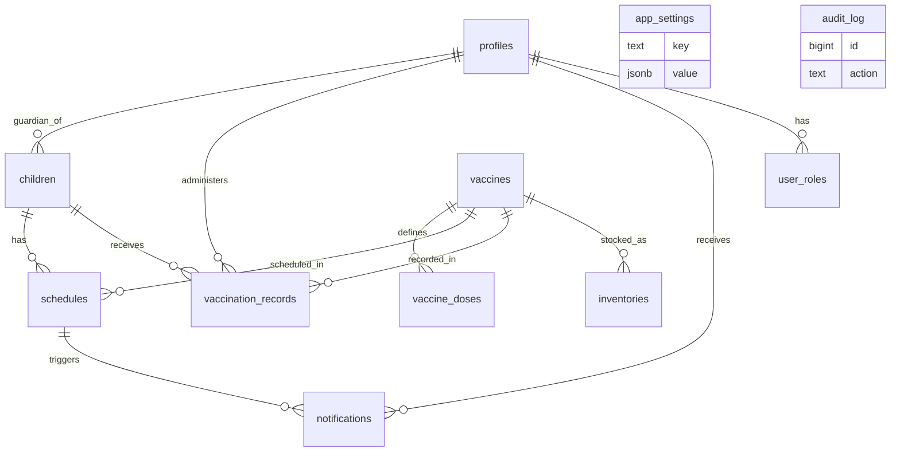

Read that diagram again and notice what is **not** in it: no place, no facility, no session, no stock movement, no population, no guardian who lacks an account. Those five absences generate most of §6 and §7.

### 2.3 Architectural posture — assessed

The handbook's core bets are **correct and should be defended, not revisited**:

| Bet | Assessment |
|---|---|
| Modular monolith on Vercel + Supabase (ADR-003) | ✅ Right for the team size and the scale. Microservices here would be a self-inflicted wound. |
| Authorization in RLS, not middleware (ADR-002) | ✅ Right, and unusually well executed. Keep it — and extend it to scope (§11.6). |
| Domain invariants in the database (§8.4) | ✅ Right. This is what makes the record trustworthy regardless of caller. |
| Postgres over MongoDB (ADR-001, supersedes SRS) | ✅ Right. Hierarchical geography, referential integrity and coverage aggregation are all Postgres strengths. Document the SRS deviation formally. |
| Responsive web, not native (ADR-009) | ⚠️ Right for parents. **Wrong for workers** once offline field sessions matter — but the fix is a PWA with a sync queue, not a native app. See `REC-21`. |
| Single logical facility in v1 (ADR-005) | ❌ **This is the seam that has now torn.** The trigger the handbook set ("the 2nd clinic onboards") was too conservative; without facility and geography the reporting layer produces numbers that cannot be interpreted. Pull it forward. |

### 2.4 Documentation drift

| Drift | Handbook says | Code does |
|---|---|---|
| i18n | §4.16/ADR-007: `next-intl`, message catalogs, "zero hardcoded user-facing strings (lint-enforced)" | No `next-intl` dependency; Bangla string literals inline in source, e.g. [`worker/_actions.ts:11`](<../apps/web/src/app/(worker)/worker/_actions.ts>) |
| Bilingual | §1.1 "Bangla by default, English optional"; `profiles.locale check (locale in ('bn','en'))` | Bangla-only decision taken 2026-07-20; no locale switcher |
| Multi-role | Hook comment: "if multi-role later, pick highest" | Picks the **lowest** — see `BUG-01` |
| Charting | §5.2 selects Recharts | Hand-rolled dependency-free CSS bars (a *good* deviation — record it as an ADR) |
| Parent module | §7.1 lists B1–B6 | One stub page |

**REC-01 (P1, 0.5 day):** reconcile the handbook to reality with an errata section and two new ADRs (ADR-011 Bangla-only, ADR-012 no charting library). Examiners read documents and code side by side; unexplained drift reads as carelessness, explained drift reads as engineering judgement.

---

## 3. Requirements Analysis Method

To keep this defensible rather than opinionated, requirements were derived through five passes:

1. **Document archaeology** — SRS, handbook §1–§18, ADRs, `TODO.md`, prior UI/UX audit.
2. **Code truth pass** — read every migration, every RLS policy, every server action, the Edge Function. Where document and code disagree, **code wins** and the disagreement is logged as drift.
3. **Domain conformance pass** — compare against WHO/EPI programme practice and the operating model of comparable national systems (§8). This is where most blind spots surfaced.
4. **Adversarial pass** — for each entity: who can corrupt it, who is denied by it, what happens at 100× volume, what happens when the network is gone, what happens when the same child is entered twice.
5. **Defense-simulation pass** — for each screen, the question an examiner is most likely to ask, and whether the system can answer it.

Requirement priority uses MoSCoW, and each carries a **verification method** (T = automated test, D = demo, I = inspection, A = analysis) because a requirement no one can check is decoration.

---

## 4. Functional Requirements

Existing requirements are restated compactly; **new or corrected ones are bold**. IDs are stable and used by the traceability matrix (Appendix C).

### 4.1 Identity & Access (IAM)

| ID | Requirement | Pri | Status | Verify |
|---|---|:--:|---|:--:|
| FR-01 | Sign up / sign in with email+password (staff) and phone+OTP (guardians) | M | Partial — OTP path still blocked on an SMS provider (§21.3) | T |
| FR-02 | Role stamped into JWT server-side; client role selection is never trusted | M | ✅ Done | T |
| FR-03 | Account status lifecycle `invited → active → inactive` denying access when not active | M | ✅ Done | T |
| FR-04 | Staff invitation by an administrator | M | ✅ Done | D |
| FR-05 | Self-service profile, address, avatar, password change | S | ✅ Done | D |
| **FR-06** | **A user MUST hold one or more `(role, scope)` assignments; scope is a node in the location hierarchy and/or a facility** | **M** | ✅ **Done** — `user_assignments` + [`/admin/users/[id]`](<../apps/web/src/app/(admin)/admin/users/[id]/page.tsx>) | T |
| **FR-07** | **Role resolution MUST select the highest-privilege active assignment, deterministically** | **M** | ✅ **Done** — `role_rank()` / `top_app_role()`; `BUG-01` closed | T |
| **FR-08** | **MFA (TOTP) MUST be enforced for any assignment at district scope or above** | **S** | ✅ **Done** — `mfa_satisfied()` on the privileged surfaces + [enrolment screen](<../apps/web/src/app/(account)/account/security/page.tsx>) | D |
| **FR-09** | **Assignments MUST be time-bounded (`valid_from`/`valid_to`) so transfers and secondments expire automatically** | **S** | ✅ **Done** — enforced in `auth_scopes()`, revocation closes rather than deletes | T |
| **FR-10** | **A user MUST be able to act in more than one capacity (e.g. a worker who is also a parent) without privilege confusion** | **S** | ✅ **Done** — highest live assignment wins; regression-tested both directions | T |

### 4.2 Child Registration & Identity

| ID | Requirement | Pri | Status | Verify |
|---|---|:--:|---|:--:|
| FR-11 | Register a child with name, DOB, sex, guardian | M | ✅ Done | D |
| FR-12 | Immutable, server-generated, check-digited Child ID | M | ✅ Done | T |
| FR-13 | Registration auto-generates the full dose schedule | M | ✅ Done | T |
| **FR-14** | **A child MUST be registerable when the guardian has no user account** (guardian as a domain record, not a login) | **M** | ❌ `BS-02` | T |
| **FR-15** | **A guardian MUST be able to claim a child registered on their behalf, via Child ID + OTP to the recorded phone** | **M** | ❌ Missing | D |
| **FR-16** | **Registration MUST run a duplicate check on (name-normalised, DOB, guardian phone) and warn before insert** | **M** | ❌ `BS-05` | T |
| **FR-17** | **Two child records MUST be mergeable by an authorised user, preserving both IDs and all doses, with full audit** | **S** | ❌ `BS-05` | T |
| **FR-18** | **A child MUST carry a lifecycle status: `active · moved_out · transferred · refused · deceased · aged_out`** | **M** | ❌ `BS-06` | T |
| **FR-19** | **A child MUST carry a location (down to ward/village) and an assigned facility/catchment** | **M** | ✅ **Done** — `children.location_id` NOT NULL + trigger-maintained `location_path`; `facility_id` added | T |
| **FR-20** | **Optional national identifiers: Birth Registration Number for the child, guardian NID — captured, validated for format, never mandatory** | **S** | ❌ Missing | I |
| **FR-21** | **Registration MUST support a "newborn at facility" fast path and a "catch-up child" path (child registered late, past doses back-entered)** | **S** | ❌ Missing | D |

### 4.3 Scheduling & Dose Administration

| ID | Requirement | Pri | Status | Verify |
|---|---|:--:|---|:--:|
| FR-22 | Schedule generated from catalog per dose | M | ✅ Done | T |
| FR-23 | Recording a dose flips the schedule row to `done` and sets `next_due_date` | M | ✅ Done | T |
| FR-24 | Overdue pending doses swept to `missed` | M | ✅ Done | T |
| FR-25 | Record carries notes and adverse-event text, amendable; clinical fields append-only | M | ✅ Done | T |
| **FR-26** | **Dose recording MUST exist in the worker UI** (currently registration only) | **M** | ❌ `GAP-01` | D |
| **FR-27** | **Schedules MUST be re-derived when the catalog changes** (a new vaccine or dose added must appear for already-registered, still-eligible children) | **M** | ✅ **Done** — `rederive_schedules()` + statement triggers on the catalog; `BUG-02` closed | T |
| **FR-28** | **The scheduler MUST honour `min_interval_days` against the actual administration date**, not only `date_of_birth + recommended_age_days` | **M** | ✅ **Done** — `dose_due_date()` takes the later of the two constraints; `BUG-03` closed | T |
| **FR-29** | **A dose MUST record where it was given: `facility_id` and, for outreach, `session_id`** | **M** | Partial — `facility_id` + `location_path` land with facilities; `session_id` waits on §21.2 | T |
| **FR-30** | **A dose MUST reference the stock batch by foreign key, not free text** | **M** | ✅ **Done** — `inventory_id` FK, back-filled, `batch_number` stamped from it; `BUG-05` closed | T |
| **FR-31** | **The system MUST reject or warn on a clinically invalid dose: below minimum age, below minimum interval, out of dose order, duplicate on the same day** | **M** | ✅ **Done** — `trg_record_validate()`, with an audited `override_reason` escape hatch | T |
| **FR-32** | **A dose MUST be correctable and voidable (`void` with reason, never hard-deleted), fully audited** | **M** | ✅ **Done** — void columns + guard, partial unique index frees the slot, schedule reopens | T |
| **FR-33** | **Doses administered elsewhere MUST be recordable as historical entries, flagged by source (`card_transcribed`, `other_facility`)** | **S** | ✅ **Done** — `dose_source` enum on every record | D |

### 4.4 Defaulter Tracing & Outreach — *entirely missing capability*

| ID | Requirement | Pri | Status | Verify |
|---|---|:--:|---|:--:|
| **FR-34** | **The system MUST produce a defaulter line-list per catchment: every child with a dose overdue beyond the grace period, with guardian contact and address** | **M** | ❌ `BS-04` | D |
| **FR-35** | **Defaulters MUST be assignable to a worker as a follow-up task with an outcome** (`traced_vaccinated · refused · moved · unreachable · deceased`) | **M** | ❌ `BS-04` | T |
| **FR-36** | **Follow-up outcome MUST write back to the child's lifecycle status where applicable** (moved/deceased stop reminders and leave the denominator) | **M** | ❌ `BS-06` | T |
| **FR-37** | **A "zero-dose" list MUST be available: children with no administered dose past the age of the first scheduled dose** | **M** | ❌ Missing | D |
| **FR-38** | **Escalation: a defaulter untraced after N days MUST appear on the supervisor's queue at the next level up** | **S** | ❌ Missing | D |

### 4.5 Vaccine Stock, Cold Chain & Distribution

| ID | Requirement | Pri | Status | Verify |
|---|---|:--:|---|:--:|
| FR-39 | Batch with quantity and expiry; low-stock and near-expiry status | M | ✅ Done | D |
| **FR-40** | **Stock MUST be held per store/facility, not globally** | **M** | ❌ `BS-03` | T |
| **FR-41** | **Every stock movement MUST be an immutable ledger entry** (`receipt · issue · return · administered · wastage · adjustment · transfer_in · transfer_out`); `stock_quantity` becomes a derived balance | **M** | ❌ `BUG-04` | T |
| **FR-42** | **Issuance MUST default to FEFO (first-expiry-first-out) and warn when overridden** | **S** | ❌ Missing | T |
| **FR-43** | **Wastage MUST be recorded with a reason** (`expired · vvm_stage_3_4 · frozen · broken · open_vial_timeout · unused_doses`) **and reported as a wastage rate** | **M** | ❌ Missing | D |
| **FR-44** | **Open-vial handling MUST be modelled: doses per vial, vial opened at, discard-by time per WHO multi-dose-vial policy** | **S** | ❌ Missing | T |
| **FR-45** | **Cold-chain temperature excursions MUST be recordable (manual twice-daily log per equipment) with an alert on out-of-range** | **S** | ❌ Missing | D |
| **FR-46** | **A recall MUST be executable: given a batch, list every child who received a dose from it and every store still holding it** | **M** | ❌ `BUG-05` | T |
| **FR-47** | **Requisition & distribution flow between levels: national → division → district → upazila → facility, with request, approve, dispatch, receive** | **S** | ❌ Missing | D |

### 4.6 Notifications & Communication

| ID | Requirement | Pri | Status | Verify |
|---|---|:--:|---|:--:|
| FR-48 | Idempotent reminder enqueue with lead-time, quiet hours, channel toggles | M | ✅ Done | T |
| FR-49 | Dispatcher with retry budget and dead-letter | M | ✅ Done | T |
| **FR-50** | **Channel MUST be routed by contact type** — SMS to a phone, email to an email address | **M** | ❌ `BUG-06` | T |
| **FR-51** | **Per-guardian notification preferences and opt-out MUST be honoured** | **M** | ❌ `BUG-07` | T |
| **FR-52** | **Reminders MUST be batched per child per day** — one message listing all doses due, not one per dose per channel | **M** | ❌ `BUG-08` | T |
| **FR-53** | **Delivery receipts from the provider MUST be ingested via webhook and written back to status** | **S** | ❌ Missing | T |
| **FR-54** | **A missed-dose (overdue) reminder MUST exist, distinct from the due-soon reminder, with its own cadence** | **S** | ❌ Missing | D |
| **FR-55** | **All message bodies MUST be templates with versioned Bangla text, not string literals in a Deno function** | **S** | ❌ Partial | I |
| **FR-56** | **Reminders MUST stop immediately when a child's status is `deceased`, `moved_out` or `refused`** | **M** | ❌ `BS-06` | T |

> **FR-56 is not a nicety.** A system that texts a bereaved family "your child's next vaccine is due" has failed in a way no coverage metric captures. Say this in the defense; it demonstrates that you thought about the human on the other end of the SMS.

### 4.7 Reporting, Analytics & Certificates

| ID | Requirement | Pri | Status | Verify |
|---|---|:--:|---|:--:|
| FR-57 | Coverage and dropout views; CSV export; audit export | M | ✅ Done | D |
| **FR-58** | **Coverage MUST be computed against a population denominator (target children in the catchment), with the registry-based rate shown separately and labelled** | **M** | Partial — `population_estimates` + [admin screen](<../apps/web/src/app/(admin)/admin/population/page.tsx>) exist and `v_coverage` is now explicitly labelled *registry* coverage; `v_coverage_by_area` waits on §21.2 | A |
| **FR-59** | **Dropout MUST follow the WHO formula on a single cohort: `(dose1 − doseN) / dose1`, computed in one pass** | **M** | ✅ **Done** — one-pass conditional aggregation, emits `dropout_rate`; `BUG-09` closed | T |
| **FR-60** | **Every report MUST be filterable by geography, facility, period and vaccine, and MUST display its N** | **M** | ❌ Missing | D |
| **FR-61** | **Left-and-right comparison: this period vs last, this union vs district average** | **S** | ❌ Missing | D |
| **FR-62** | **A digital immunization certificate/card MUST be generatable as PDF with a verifiable QR code** | **S** | ❌ Missing | D |
| **FR-63** | **QR verification MUST work without the verifier logging in and SHOULD work offline** (signed payload, not a database lookup) | **S** | ❌ Missing | T |
| **FR-64** | **Worker performance analytics: sessions held, doses given, defaulters traced, data timeliness — per worker, per catchment** | **S** | ❌ Missing | D |
| **FR-65** | **A geographic coverage map (choropleth by union/ward) MUST be available to district and above** | **C** | ❌ Missing | D |

### 4.8 Campaigns & Sessions

| ID | Requirement | Pri | Status | Verify |
|---|---|:--:|---|:--:|
| **FR-66** | **Immunization sessions MUST be plannable: date, facility or outreach site, catchment, assigned workers, expected children** | **S** | ❌ Missing | D |
| **FR-67** | **A session MUST produce a tally: children attended, doses by antigen, vials opened, doses wasted** | **S** | ❌ Missing | D |
| **FR-68** | **Campaign mode (e.g. a measles-rubella catch-up round) MUST support recording doses outside the routine schedule without corrupting routine coverage** | **C** | ❌ Missing | A |

### 4.9 Offline Field Operation

| ID | Requirement | Pri | Status | Verify |
|---|---|:--:|---|:--:|
| **FR-69** | **The worker console MUST function offline for the session workflow: view the assigned child list, record doses, register children** | **M** | ❌ `BS-08` | D |
| **FR-70** | **Offline writes MUST queue locally, carry a client-generated idempotency key, and sync when connectivity returns** | **M** | ❌ `BS-08` | T |
| **FR-71** | **Sync conflicts MUST resolve by a stated rule** (clinical records are append-only, so last-writer-wins is acceptable for amendments; duplicates are prevented by the idempotency key) **and surface anything unresolvable to a human queue** | **M** | ❌ `BS-08` | T |
| **FR-72** | **The offline cache MUST be scoped to the worker's catchment and MUST be wiped on sign-out** | **M** | ❌ Missing | T |

### 4.10 Governance, Consent & Data Rights

| ID | Requirement | Pri | Status | Verify |
|---|---|:--:|---|:--:|
| **FR-73** | **Guardian consent for data processing and for SMS contact MUST be captured with timestamp, and withdrawable** | **S** | ❌ `BS-09` | I |
| **FR-74** | **A guardian MUST be able to export their child's full record** | **C** | ❌ Missing | D |
| **FR-75** | **A retention schedule MUST exist and be executed** (audit log archival, notification body purge) | **S** | ❌ Missing | I |
| **FR-76** | **Every read of a child record by staff outside the child's catchment MUST be logged as a break-glass access event** | **C** | ✅ **Done** — `break_glass_access` (reason required, 4-hour expiry, rate-limited) + [review screen](<../apps/web/src/app/(admin)/admin/break-glass/page.tsx>) | T |

---

## 5. Non-Functional Requirements

### 5.1 Corrected and added NFRs

| ID | Category | Requirement | Target | Status |
|---|---|---|---|---|
| NFR-01 | Availability | Managed-platform SLO | 99.9% monthly | Claimed, unmeasured |
| NFR-02 | Latency | p95 read / write | ≤300 ms / ≤500 ms | Unmeasured |
| **NFR-03** | **Latency (field)** | **Worker dose-record round trip on 3G** | **≤ 2 s perceived; ∞ tolerated offline via queue** | ❌ |
| **NFR-04** | **Payload** | **Worker console initial JS on 3G** | **≤ 150 KB gzip, ≤ 3 s TTI on a 2019 mid-range Android** | ❌ |
| NFR-05 | Scalability | Path 100 → 1M users documented | §11 handbook | ✅ Documented |
| **NFR-06** | **Scalability (real)** | **Reporting must hold at national volume: ~3.6M annual births × 11 doses ≈ 40M schedule rows/yr** | **Coverage query ≤ 2 s at 40M rows** | ❌ `BUG-09` blocks this |
| **NFR-07** | **Data integrity** | **Zero orphan doses; zero duplicate active children per (BRN) or per (name, DOB, guardian phone) without an explicit merge decision** | **0** | ❌ |
| **NFR-08** | **Auditability** | **100% of clinical and privileged writes audited; audit chain tamper-evident** | **100% + hash chain** | Partial — coverage extended to assignments, denominator, break-glass and contact changes; hash chain outstanding |
| NFR-09 | Security | RLS deny-by-default, every policy pgTAP-tested | 100% | ✅ |
| **NFR-10** | **Security (scope)** | **No user may read a child outside their assigned scope** | **Proven by pgTAP** | ✅ **Done** — [`rls_scope.test.sql`](../supabase/tests/rls_scope.test.sql), 9 assertions, negative case first |
| **NFR-11** | **Privacy** | **No PHI in logs, error messages, URLs, or analytics; Sentry PII scrubbing on** | **0 incidents** | Unverified |
| NFR-12 | Accessibility | WCAG 2.1 AA | AA | Partial (contrast fixed; SR labels unverified) |
| **NFR-13** | **Accessibility (Bangla)** | **Bengali screen-reader pronunciation verified; Bengali numerals in all user-facing numbers; `lang="bn"` set** | **Audited once per release** | Partial |
| **NFR-14** | **Localisation** | **Zero user-facing string literals in code; all copy in one catalog** | **Lint-enforced** | ❌ drift |
| NFR-15 | Maintainability | TS strict, ESLint, commitlint, ADRs | ✅ | ✅ |
| **NFR-16** | **Testability** | **Coverage ≥70% on domain logic; every RLS policy has a negative test; one E2E per role journey** | **≥70% / 100% / 3** | Partial |
| **NFR-17** | **Recoverability** | **PITR enabled; a restore drill executed and documented at least once** | **RPO ≤ 2 min, RTO ≤ 4 h, drill evidence** | ❌ |
| **NFR-18** | **Observability** | **Structured logs with correlation id; Sentry; alert on auth-failure spike, dispatcher dead-letter growth, cron non-execution** | **3 alerts live** | ❌ |
| **NFR-19** | **Operability** | **Every scheduled job MUST report last-run and last-success; a job that silently stops MUST raise an alert** | **Dashboard + alert** | Partial — `job_runs` + `v_job_health` + settings card done (`REC-02`); external alerting outstanding |
| **NFR-20** | **Sustainability/cost** | **Per-1,000-children monthly run cost modelled, SMS cost dominant, documented** | **Model exists** | ❌ |

### 5.2 The NFR the project is furthest from

**NFR-19, job observability.** The entire reminder system depends on three `pg_cron` jobs (`mark-missed`, `refresh-doses`, `enqueue-reminders`). If any silently stops — and pg_cron jobs do stop, on plan changes, restores, and extension upgrades — nothing in the product notices. The prior audit deliberately removed the `admin_cron_jobs()` RPC for a sound security reason ([`20260725100100_accounts_and_records.sql:98`](../supabase/migrations/20260725100100_accounts_and_records.sql)). That reasoning was right; the resulting blind spot still needs closing. **REC-02:** a `job_runs` table written by each job as its last statement, read by the settings screen under normal RLS — no definer function, no RPC surface, full visibility.

> **REC-02 delivered (2026-07-26).** [`20260726120000_auth_hardening_and_ops.sql`](../supabase/migrations/20260726120000_auth_hardening_and_ops.sql) adds `job_runs`, a `job_begin`/`job_end` wrapper around each scheduled job, and the `v_job_health` view (`is_stale` = no success within twice the expected interval — one missed run is a blip, two is a stopped job). The settings screen reads the view under ordinary RLS, so the constraint the prior audit set is respected: no definer function, no RPC surface. What remains for NFR-19 is the *alert* — the dashboard now shows a stopped job, but nothing yet pages a human about it.

---

## 6. Gap Analysis

Specified-but-not-built, ranked by the damage each does to a defense.

| ID | Gap | Specified in | Impact | Effort |
|---|---|---|---|:--:|
| **GAP-01** | **Dose recording is missing from the worker UI.** Registration ships; the actual clinical act does not. | Handbook §7.1 C4; TODO §4 | **Severe.** The product's core verb is unimplemented in the role that performs it. An examiner will ask to see a dose being recorded. | 1 d |
| GAP-02 | Parent module B1–B6 is a stub | §7.1 B1–B6 | **Severe.** One of three stated actors has no experience; the reminder loop has no receiving end. | 3–4 d |
| GAP-03 | Correct/void a record (C5) missing | §7.1 C5 | High — corrections are routine in the field | 1 d |
| GAP-04 | Child search (C3) missing | §7.1 C3 | High — a worker cannot find a returning child | 0.5 d |
| GAP-05 | Immunization certificate (Phase 4) missing | §2 Phase 4, §16 EPIC 4 | Medium-high — the most demo-friendly missing feature | 1.5 d |
| GAP-06 | Delivery webhook write-back missing | §2 Phase 3.5 | Medium — "sent" currently means "handed to a provider" | 0.5 d |
| GAP-07 | Notification preferences / opt-out missing | §2 Phase 3 "parent opt-out honored"; §7.1 B5 | **High — a stated requirement contradicted by the code** | 1 d |
| ~~GAP-08~~ | ~~MFA for admins not enforced~~ **CLOSED 2026-07-26** — TOTP enrolment screen + `mfa_satisfied()` on role grants, settings, denominator and the full audit trail; gated by the `require_mfa_elevated` setting so switching it on is an operational act, not a deploy | §9.2 "enforced for admins in production" | Medium | 0.5 d |
| GAP-09 | E2E tests absent | §12.1 | Medium — CI proves compilation, not journeys | 1 d |
| GAP-10 | Staging environment absent (single Supabase project) | §13.4, TODO 0.10 | Medium — migrations are tested in production | 0.5 d |
| ~~GAP-11~~ | ~~Rate limiting on sensitive actions not implemented~~ **CLOSED 2026-07-26** — `rate_limits` + `consume_rate_limit()`, applied to the manual reminder run (the SMS-cost amplifier) and break-glass. Sign-in and OTP issuance are left to GoTrue's own limiter rather than re-implemented, and that division is stated in the migration | §9.5 | Medium — OTP abuse and SMS cost exposure | 0.5 d |
| GAP-12 | i18n catalog absent; strings inline | §4.16 ADR-007 | Medium — contradicts a stated lint-enforced rule | 1 d |
| GAP-13 | Sentry / structured logging absent | §4.15, TODO 0.9 | Medium — no production diagnosis capability | 0.5 d |
| GAP-14 | `mv_daily_doses` access control relies on application discipline | §8.6 comment | Low-medium — **verify the PostgREST grant explicitly**; if `authenticated` holds `SELECT`, this is a PHI-adjacent leak of daily dose volumes | 0.25 d |
| GAP-15 | Retention & archival unimplemented | §9.1 | Low now, compliance-relevant later | 0.5 d |
| GAP-16 | Facilities deferred (ADR-005) | §8.1 seam | **Severe** — see `BS-03` | 2–3 d |

---

## 7. Blind Spot Analysis

Blind spots are worse than gaps: nobody wrote them down, so nobody is tracking them. These are the findings that will most distinguish this report in a defense.

### BS-01 — Geography does not exist *(critical)*

**Finding.** No table in the schema carries any location field. `children`, `profiles`, `inventories`, `vaccination_records` — none. `profiles.address` is free text added for account management, unusable for aggregation.

**Consequences, in order of severity:**
1. **Authorization is nationwide-flat.** `auth_role() = 'admin'` grants every administrator read access to every child in the system ([`20260724115100_rls.sql:41`](../supabase/migrations/20260724115100_rls.sql)). A hypothetical union-level operator would see the whole country. This is both a privacy failure and an audit failure.
2. **No catchment reporting.** Coverage is a single national number. Programme management is a *comparison between places*; without place there is no management.
3. **No worker assignment.** A worker's queue cannot be "the children in your ward" because wards do not exist.
4. **No defaulter tracing.** A tracing list is inherently geographic — you walk a route.
5. **No GIS, no microplanning, no equity analysis.** All downstream of the same absence.

**Verdict.** This is correctly identified by the project owner as the primary blind spot. It is also the *cheapest* of the critical fixes, because Postgres has first-class support for hierarchies (§11).

### BS-02 — A child cannot exist without a registered guardian account *(critical)*

**Finding.** `children.guardian_id uuid not null references profiles(id)` ([`20260724114900_schema.sql:55`](../supabase/migrations/20260724114900_schema.sql)), and the worker registration form requires a guardian UUID chosen from existing profiles ([`worker/_actions.ts:14`](<../apps/web/src/app/(worker)/worker/_actions.ts>)).

**Why this breaks in the field.** The overwhelming majority of children are registered by a health worker at a session, from a guardian who has no smartphone, no email, and no account. The current model forces the worker to either (a) create an auth account on the guardian's behalf — requiring an email or a verified phone the worker does not control — or (b) attach the child to some other profile. Option (b) is what actually happens in production systems, and it silently destroys ownership: RLS then shows that child to the wrong person, and reminders go to the wrong number.

**Fix.** Split *guardian* (a domain entity: name, phone, relationship, address, NID optional) from *user account* (an auth identity). `children.guardian_id → guardians.id NOT NULL`; `guardians.user_id → profiles.id NULL`. A guardian later claims their account with Child ID + OTP to the recorded phone, which sets `user_id` and switches on parent access. This is the standard pattern in every registry that works at scale, and it converts parent onboarding from a prerequisite into a growth loop.

### BS-03 — No facility, no session, no service delivery point *(critical)*

**Finding.** A `vaccination_record` knows *who* administered (`administered_by`) and *when* (`administered_date`). It does not know *where*. Inventory is a single global pool.

**Consequences.** Facility-level coverage is impossible. Stock cannot be issued to a place. Session tally sheets — the primary paper artefact of every EPI programme — have no digital equivalent. Wastage cannot be attributed. Supervision cannot be targeted. Handbook §8.1 documents this as a deliberate seam with the trigger "the second clinic onboards"; the correct trigger was always "the first report is read by someone who must act on it."

### BS-04 — No defaulter tracing workflow *(critical)*

**Finding.** The system marks schedules `missed` after 14 days ([`20260724115000_domain_logic.sql:64`](../supabase/migrations/20260724115000_domain_logic.sql)) and then does nothing with that fact. There is no list, no assignment, no outcome, no closure.

**Why it matters.** Sending an SMS is the cheap half of the intervention and the half that fails for exactly the families most likely to default — no phone, changed number, low literacy. The half that works is a worker visiting the house. Marking a row `missed` and stopping is the system equivalent of noticing a fire and writing it down. This is the single most valuable *feature* (as opposed to structural fix) missing from VaxTrace, and it is the feature that most clearly demonstrates domain understanding to an examiner.

### BS-05 — No duplicate detection, no merge *(high)*

**Finding.** Nothing prevents the same child being registered twice. Child ID is unique per *row*, not per *child*. A duplicate produces two schedules, two coverage contributions, doubled reminders, and a permanently wrong denominator.

**Why it is inevitable here.** A child registered at a facility in January and again at an outreach session in March by a worker who cannot find the first record (no search screen — `GAP-04`) *will* be duplicated. The absence of search actively manufactures duplicates.

**Fix.** A soft duplicate check at registration (normalised name + DOB + guardian phone, plus BRN exact match), a `potential_duplicates` review queue, and a merge operation writing `merged_into_id` on the loser, moving all doses, and preserving both IDs so a printed card with the old number still resolves.

### BS-06 — Children have no lifecycle *(high)*

**Finding.** A child, once inserted, is `active` forever. There is no `moved_out`, no `deceased`, no `refused`, no `aged_out`.

**Consequences.** Reminders never stop. Coverage denominators inflate with children who have left the catchment or died. Dropout rate is permanently overstated. And the human consequence in `FR-56`.

### BS-07 — The coverage denominator is wrong *(high)*

**Finding.** `v_coverage` computes `done / due` over `schedules` ([`20260724115200_reporting_views.sql:8`](../supabase/migrations/20260724115200_reporting_views.sql), refined in [`20260725120000_coverage_denominator.sql`](../supabase/migrations/20260725120000_coverage_denominator.sql)). Schedules exist only for **registered** children.

**Why it is wrong.** This measures *"of the children we know about, what fraction are up to date"* — a data-quality metric. Public-health coverage is *"of the children who exist in this catchment, what fraction are vaccinated"* — doses over an estimated target population. The two diverge exactly where it matters: a catchment that registers only the easy-to-reach children reports near-100% while missing the marginalised. **A registry that only measures itself is congratulatory by construction.**

The prior audit already caught the cosmetic half of this — adding `done_count` / `due_count` so a rate is never shown without its N, with an excellent commit rationale ("a rate without its N is not a statistic, it is a decoration"). That instinct was right and should now be followed to its conclusion: the N itself is the wrong N.

**Fix.** A `population_estimates` table (location, year, age band, count, source) and two clearly labelled metrics side by side: **registry coverage** and **administrative/population coverage**. Then **zero-dose children** — the number of children in the catchment estimated to have received no dose at all — becomes computable, and that is the flagship indicator of global immunization policy today.

### BS-08 — No offline capability *(high)*

**Finding.** The worker console is server-rendered Next.js with server actions. It requires connectivity for every read and every write.

**Why it matters.** Routine immunization in Bangladesh is delivered substantially through **outreach sessions** — a worker walks to a site in a union or ward with a vaccine carrier and a register. That is where the data is created, and that is where connectivity is worst. A worker console that only works on Wi-Fi is a console that gets used from memory, at the end of the day, in the office — which is exactly how paper registers already fail.

**Scoped fix (not a rewrite).** A PWA service worker + IndexedDB queue covering **three** operations only: read my assigned child list, register a child, record a dose. Every queued write carries a client-generated UUID used as an idempotency key, so replay is safe. This is a well-bounded 3–4 day piece of work and it is the most impressive single thing on this list to demonstrate live (turn off Wi-Fi mid-demo, record a dose, turn it back on, watch it sync).

### BS-09 — No consent, no data-protection posture *(medium-high)*

**Finding.** The system stores identified child health data — among the most sensitive categories that exist — with no consent capture, no retention schedule, no subject access mechanism, no DPIA, and no data-classification enforcement beyond a table in the handbook.

**For a healthcare capstone this is a question you will be asked.** Have an answer: a consent record at registration, a stated retention period, an export path, and a one-page DPIA. The engineering is trivial; the omission is what looks careless.

### BS-10 — Reporting has no time dimension *(medium)*

**Finding.** `v_coverage` is computed as of *now*. There is no "coverage as of Q1", no month-over-month trend, no cohort view. `mv_daily_doses` gives raw daily counts only.

**Why it matters.** Every real programme report is *periodic* — monthly coverage by antigen by area, compared to target. A system that can only report "now" cannot show whether anything is improving, which is the only question management actually asks.

### BS-11 — No supervision or data-quality layer *(medium)*

**Finding.** No concept of a supervisor reviewing a subordinate's data. No data-quality indicators (timeliness of entry, records with missing fields, implausible values, sessions with no tally).

**Why it matters.** WHO's own data-quality guidance treats *verification* as part of the information system, not an afterthought. A "Data Quality" screen showing timeliness, completeness and internal consistency per area is cheap to build from data you already have and immediately reads as professional.

### BS-12 — AEFI is a text box, not a workflow *(medium)*

**Finding.** `vaccination_records.adverse_event text` with a partial index ([`20260725100100_accounts_and_records.sql:42`](../supabase/migrations/20260725100100_accounts_and_records.sql)). No severity, no onset time, no outcome, no notification to a supervisor, no case status, no link to the batch.

**Why it matters.** Adverse Events Following Immunization are the single most safety-critical, politically sensitive data class in an immunization programme, and the one where a delayed signal kills a national programme's public trust. A minimal AEFI case record (severity, onset, outcome, reporter, batch, status) plus an automatic alert to the next supervisory level is half a day of work and enormous credibility.

### BS-13 — Verified defects in committed code

> **Status, 2026-07-26.** Nine of the twelve are closed by [`20260726100000_defect_sweep.sql`](../supabase/migrations/20260726100000_defect_sweep.sql) and [`20260726110000_geography_and_scope.sql`](../supabase/migrations/20260726110000_geography_and_scope.sql). The three that remain — `BUG-04`, `BUG-06`, `BUG-07`, `BUG-08`, `BUG-11` — are structural rather than local and land with the entities they belong to (the stock ledger, and the guardians/notifications rebuild); see §21.2. The findings below are kept in their original wording, with the fix appended, because a defect register that quietly rewrites itself is not evidence of anything.
>
> **One finding was down-rated on re-verification.** `BUG-12` claimed a child could be hard-deleted. Re-reading the policy set shows `children` has no `DELETE` policy at all, and RLS is deny-by-default — so the delete was already denied to every client role, and the exposure was to the service role and direct SQL only. The real gap was the absence of *any* deregistration path, which is what the fix provides. Recorded here rather than silently corrected: the review was wrong about the severity, and saying so is cheaper than being caught.

| ID | Defect | Evidence | Severity |
|---|---|---|:--:|
| **BUG-01** | **Access-token hook selects the LOWEST-privilege role, not the highest.** `select role ... order by role limit 1` with `create type user_role as enum ('parent','worker','admin')`. Postgres orders enums by declaration, so `parent < worker < admin` and `limit 1` returns `parent`. The inline comment states the opposite intent ("if multi-role later, pick highest"). `user_roles` PK is `(user_id, role)`, so multi-role is representable today. A worker who is also the parent of their own child is silently demoted to `parent` on their next token refresh. | [`20260724115100_rls.sql:15`](../supabase/migrations/20260724115100_rls.sql), [`20260724114900_schema.sql:7`](../supabase/migrations/20260724114900_schema.sql) | **High** |
| **BUG-02** | **Schedules are never re-derived.** `generate_schedule()` runs only in an `after insert` trigger on `children`. Adding a vaccine or a dose to the catalog produces schedule rows for *future* registrations only; every existing child is invisibly excluded. There is no backfill path. | [`20260724115000_domain_logic.sql:26`](../supabase/migrations/20260724115000_domain_logic.sql) | **High** |
| **BUG-03** | **`min_interval_days` is stored and never used.** Due dates are `date_of_birth + recommended_age_days` only. A child who receives Penta-1 eight weeks late still has Penta-2 due on the birth-derived date — possibly *before* the minimum interval has elapsed, producing a clinically invalid due date the system will then mark `missed`. | [`20260724115000_domain_logic.sql:8`](../supabase/migrations/20260724115000_domain_logic.sql) vs [`20260724114900_schema.sql:45`](../supabase/migrations/20260724114900_schema.sql) | **High** |
| **BUG-04** | **Inventory is a mutable counter with no ledger.** `stock_quantity` is updated in place by `adjustStockAction`. Read-modify-write over HTTP with no optimistic concurrency ⇒ two concurrent adjustments lose one. No history ⇒ no wastage, no reconciliation, no answer to "where did 200 doses go". | [`20260724114900_schema.sql:92`](../supabase/migrations/20260724114900_schema.sql), `admin/inventory/_actions.ts` | **High** |
| **BUG-05** | **Dose→batch link is unenforced free text.** `vaccination_records.batch_number text` with no FK. A recall cannot be executed reliably; administering a dose does not decrement stock, so the clinical record and the stock record describe two different universes. | [`20260724114900_schema.sql:85`](../supabase/migrations/20260724114900_schema.sql) | **High** |
| **BUG-06** | **The dispatcher sends email to phone numbers.** `enqueue_reminders()` fans every pending schedule out to *both* `sms` and `email` channels, gated only by global toggles. The dispatcher then resolves one field, `profiles.contact`, and passes it to Resend or the SMS gateway indifferently. For a parent whose `contact` is `+8801710000011`, every `email` row fails five times and lands in `dead`. Seed data confirms parents carry phone numbers in `contact`. | [`...settings_status_reminders.sql:184`](../supabase/migrations/20260725110000_settings_status_reminders.sql), [`dispatch-reminders/index.ts:138`](../supabase/functions/dispatch-reminders/index.ts), [`seed.sql`](../supabase/seed.sql) | **High** |
| **BUG-07** | **No opt-out exists**, contradicting handbook Phase 3 success criterion "parent opt-out honored". Every guardian of every pending schedule is enqueued unconditionally. | [`...settings_status_reminders.sql:174`](../supabase/migrations/20260725110000_settings_status_reminders.sql) | **Medium-high** |
| **BUG-08** | **Message storm per child.** Idempotency is `(schedule_id, channel, due_date)`. A 6-week-old child has Penta-1, PCV-1 and OPV-2 due the same day ⇒ 3 schedules × 2 channels = **6 messages in one evening** to one guardian. At 14 weeks it is worse. | [`20260724114900_schema.sql:116`](../supabase/migrations/20260724114900_schema.sql) | **Medium-high** |
| **BUG-09** | **`v_dropout` is a cartesian self-join.** `from vaccines v left join vaccination_records r1 on r1.vaccine_id = v.id left join vaccination_records rl on rl.vaccine_id = v.id` produces \|records\|² rows per vaccine before `count(distinct …)` reduces them. At 100k records for one antigen that is 10¹⁰ intermediate rows. It is correct on seed data and unrunnable at any real volume. It also does not compute the WHO dropout formula, only its two inputs. | [`20260724115200_reporting_views.sql:17`](../supabase/migrations/20260724115200_reporting_views.sql) | **High (perf)** |
| **BUG-10** | **Missed-dose grace is a hardcoded 14 days for every antigen** and is not a programme-configurable policy, despite `app_settings` existing for exactly this purpose. | [`20260724115000_domain_logic.sql:64`](../supabase/migrations/20260724115000_domain_logic.sql) | Medium |
| **BUG-11** | **`children.created_by` is nullable and unconstrained**; `guardian_contact` duplicates `profiles.contact` with no rule about which wins when they disagree. The dispatcher uses `profiles.contact`; the UI displays `guardian_contact`. Two sources of truth for the number that reminders are sent to. | [`20260724114900_schema.sql:56`](../supabase/migrations/20260724114900_schema.sql) | Medium |
| **BUG-12** | **No soft delete anywhere.** `children` has no `deleted_at`; deleting a child cascades their schedules and notifications away. `vaccination_records` blocks the delete via `on delete restrict`, which accidentally saves the day for vaccinated children — but an erroneously-registered child with no doses can be hard-deleted, taking their audit context with them. | [`20260724114900_schema.sql:50`](../supabase/migrations/20260724114900_schema.sql) | Medium |

**Fix effort for all twelve: ≈ 4 days.** `BUG-01`, `BUG-06` and `BUG-09` are one-line-ish changes with outsized impact and should be done this week regardless of what else is decided.

**Closure record.**

| ID | Status | How |
|---|---|---|
| `BUG-01` | ✅ Closed | `role_rank()` states the privilege ladder as data and the hook orders by it descending. Ordering by the enum in the *other* direction was rejected: that is what caused the bug, and the next person to insert a role mid-enum would re-create it. |
| `BUG-02` | ✅ Closed | `rederive_schedules()` inserts missing rows and refreshes un-administered due dates; statement-level triggers on `vaccines`/`vaccine_doses` fire it on any catalog edit. Back-fill is bounded by `vaccines.max_age_days`, so catalogued MR does not hand every four-year-old an instantly-overdue dose. |
| `BUG-03` | ✅ Closed | `dose_due_date()` returns the later of `dob + recommended_age_days` and `previous dose administered + min_interval_days`. Recording a dose re-derives the child's remaining schedule before reading `next_due_date`. |
| `BUG-04` | ⏳ Open | Stock ledger — §21.2. |
| `BUG-05` | ✅ Closed | `vaccination_records.inventory_id` FK, back-filled from the matching batch text; the validation trigger stamps `batch_number` from the FK so the two can never disagree again, and rejects a batch of the wrong antigen or one expired on the day. |
| `BUG-06` | ⏳ Open (half done) | `profiles.phone` / `profiles.email` now exist as typed, separately-validated columns with a shape-based backfill; the dispatcher rewrite that routes on them is §21.2. |
| `BUG-07` | ⏳ Open | Opt-out — §21.2. |
| `BUG-08` | ⏳ Open | Batching key — §21.2. |
| `BUG-09` | ✅ Closed | `v_dropout` rewritten as one pass of conditional aggregation over `vaccination_records`, excluding voided doses, and now emitting `dropout_rate` rather than only its two inputs. |
| `BUG-10` | ✅ Closed | `app_settings.missed_grace_days` with a per-antigen `vaccines.grace_period_days` override. The sweep resolves grace once per call and joins, rather than calling a settings-reading function per schedule row. |
| `BUG-11` | ⏳ Open (half done) | `children.created_by` is now `NOT NULL`; the `guardian_contact` vs `profiles.contact` duplication resolves when `guardians` lands — §21.2. |
| `BUG-12` | ✅ Closed (down-rated) | `deleted_at`/`deleted_by`/`delete_reason` with an admin-only guard; deregistered children leave every worker and guardian surface but stay visible to a manager in scope. See the severity correction above. |

---

## 8. Healthcare Domain Research

### 8.1 The reference operating model: how routine immunization actually runs

Every national immunization programme, whatever the country, is built from the same six moving parts. VaxTrace currently implements two of them.

| # | Programme function | What it means operationally | VaxTrace today |
|---|---|---|---|
| 1 | **Target population estimation** (denominator) | Estimate surviving infants per catchment per year from census/birth data; this is the divisor of every coverage number and the basis of the vaccine forecast | ❌ absent |
| 2 | **Microplanning** | Map every catchment to sessions: where, when, by whom, expected children, vaccine and logistics needed | ❌ absent |
| 3 | **Session delivery & recording** | Fixed-site and outreach sessions; child register + tally sheet + home-based card | ⚠️ record model exists, session/facility do not |
| 4 | **Defaulter tracing** | Line-list overdue children, assign, visit, record outcome | ❌ absent |
| 5 | **Vaccine & cold-chain logistics** | Forecast, requisition, distribute, store, monitor temperature, count wastage | ⚠️ a stock counter only |
| 6 | **Monitoring, reporting & data quality** | Monthly coverage & dropout by area against target; verify the data before believing it | ⚠️ registry-only, no time dimension, no geography |

**This table is the strongest single artefact in this report for defense purposes.** It reframes "missing features" as "unimplemented programme functions", which is the language a health-informatics examiner uses.

### 8.2 Comparable systems and what is worth stealing

> **Confidence note.** The descriptions below reflect the review team's working knowledge of these systems' *design patterns*. Treat them as leads to cite, not as citations. See §8.6.

| System / country | Pattern worth stealing | Applicability to VaxTrace |
|---|---|---|
| **DHIS2 Tracker** (used for HMIS in Bangladesh and ~70 countries) | Individual-level tracker over an **organisation-unit hierarchy** with a mobile **Android Capture** client that works fully offline and syncs; every data value is owned by an org unit | **Highest relevance.** The org-unit hierarchy is precisely the `locations` model recommended in §11, and offline-capture is `BS-08`. If you cite one system in the defense, cite this one. |
| **eVIN** (India, vaccine logistics) | Real-time stock and temperature visibility per cold-chain point, with a simple app used by storekeepers; makes stockouts visible up the chain | Model for `FR-40…FR-47`. Note it is deliberately *logistics-only* — separating logistics from the clinical registry is a legitimate architecture. |
| **Co-WIN → U-WIN** (India) | A COVID platform generalised to routine child immunization: appointment slots, session sites, QR-verifiable certificates, beneficiary self-service | Model for sessions (`FR-66`), certificates (`FR-62`) and parent self-service. Also a cautionary tale: appointment-slot booking assumes a smartphone-owning population — do not make it the primary path. |
| **eVaccs** (Punjab, Pakistan) | Vaccinator smartphone app with GPS- and time-stamped dose entry feeding a manager dashboard; made worker attendance and session-holding visible for the first time | Model for `FR-64` worker performance analytics. **Ethical caveat worth raising in the defense:** GPS-tracking field staff is surveillance; capture *session location* rather than *worker location*, and say why. |
| **DIVOC** (open-source; adopted by several countries) | Verifiable digital certificates: signed payload in a QR that a verifier can validate **offline**, no lookup of the citizen's record required | Model for `FR-62/FR-63`. The key idea — verify a signature, not a database row — is what makes offline verification privacy-preserving. |
| **National immunization registries** (Australia's AIR, US state IIS, UK CHIS) | Lifelong individual record; standardised message exchange between providers (HL7 v2 VXU / FHIR `Immunization`); consolidated "best record" across sources | Model for `FR-33` (doses given elsewhere) and long-run interoperability (§17). Also the source of the **deduplication/merge** discipline in `BS-05` — every one of these registries has a dedicated identity-resolution subsystem. |
| **Community-health platforms** (OpenSRP, CommCare, OpenMRS) | Household-and-catchment-centric data model; a worker's work list is "my area", not "search the country"; strong offline-first heritage | Model for the worker console redesign (§16.4) and for the guardian-without-account pattern (`BS-02`). |
| **WHO / global policy layer** | Standard indicator definitions — dropout `(dose1 − doseN)/dose1`; **zero-dose** children defined as those who never received a first dose of DTP-containing vaccine; multi-dose-vial policy governing how long an opened vial may be used | Adopt the definitions verbatim. Using the standard formula and naming it is worth more in a defense than inventing a metric. |

### 8.3 Bangladesh-specific realities the design must respect

| Reality | Design implication |
|---|---|
| The routine EPI schedule the seed encodes (BCG at birth; Penta/PCV/OPV at 6/10/14 weeks; IPV; MR at 9 and 15 months) matches national practice at the time of writing | Keep the catalog **data-driven** (`vaccines` + `vaccine_doses` already are — this was the right call) so a schedule change is a data edit, not a migration. Verify current national schedule before the defense. |
| Immunization is delivered largely at **outreach sessions**, not only at fixed facilities | `sessions` and `outreach_sites` are first-class, not an afterthought (`FR-66`) |
| The field workforce is not one homogeneous "worker" role, and spans more than one directorate | Do not model job titles as roles; model `role × scope` (§10) so any workforce structure maps onto it |
| Urban areas are **not** organised as upazilas — city corporations and municipalities have wards and their own health administration | **Never hardcode "upazila" as the operational unit.** Use a generic level with a code (§11.3). This is the single most common modelling error in Bangladeshi civic software. |
| Connectivity at outreach sites is intermittent 2G/3G; devices are low-end Android | `BS-08` offline + `NFR-04` payload budget |
| The home-based **vaccination card** is the artefact families actually keep and trust | The digital record must *complement* the card: print the Child ID on it, and design the certificate (`FR-62`) to look like a card, not a report |
| Birth registration coverage is incomplete; many children have no BRN at first contact | BRN is **optional and verifiable-later**, never a registration prerequisite (`FR-20`) |
| Bangla is the operating language; Bengali numerals are expected in user-facing text | Already handled in `format.ts` and the SMS body; make it a lint rule (`NFR-13/14`) |

### 8.4 Indicator definitions to adopt verbatim

| Indicator | Definition | Requires |
|---|---|---|
| **Antigen coverage (administrative)** | doses of antigen *a*, dose *n*, given to the target age group in period *p* ÷ target population for *p* | `population_estimates`, `location`, period |
| **Registry coverage** | registered children up to date for age ÷ registered children | already possible — must be **labelled** as such |
| **Dropout rate** | (dose 1 − dose N) ÷ dose 1 × 100, same cohort, same period | one-pass rewrite of `v_dropout` |
| **Zero-dose children** | children past the first-dose age with **no** administered dose | `FR-37` |
| **Left-out / under-immunized** | started but not completed the schedule for age | derived |
| **Wastage rate** | (doses issued − doses administered) ÷ doses issued × 100 | stock ledger (`FR-41`) |
| **Timeliness** | proportion of doses given within the recommended window | needs `recommended` vs `administered` comparison — data already present |
| **Data entry timeliness** | median hours between `administered_date` and `created_at` | data already present — **free metric, build it** |

> The last row is worth noticing: `vaccination_records` already stores both `administered_date` and `created_at`. A data-quality metric that costs one view and reads as sophisticated is sitting in the schema unused.

### 8.5 Interoperability standards to name (and defer)

| Standard | Relevance | Recommendation |
|---|---|---|
| **HL7 FHIR R4 `Immunization` / `Patient` / `Location`** | The lingua franca for exchanging immunization data | Build a **read-only FHIR export endpoint for a single child** as a Phase-2 stretch. It is ~150 lines and instantly answers "how would this integrate nationally?" |
| **ICD-11 / vaccine code systems** | Coding vaccines beyond local codes | Add a nullable `code_system`/`code_value` on `vaccines`. Cheap seam, no work now. |
| **WHO SMART / verifiable credentials** | Signed, offline-verifiable certificates | Design `FR-62` QR as a signed payload from day one; do not invent a lookup-based scheme you would have to replace. |
| **GS1 barcodes on vials** | Scan batch + expiry at the point of administration | Design the batch FK now (`FR-30`); scanning is a UI addition later. |

### 8.6 Citations you must obtain before this goes in the thesis

Do not submit §8.2 uncited. Obtain and cite primary sources for: WHO immunization coverage and dropout indicator definitions; the WHO multi-dose-vial policy; the IA2030/Gavi zero-dose definition; the DHIS2 Tracker and Android Capture offline architecture; the current Bangladesh national EPI schedule from DGHS; and one peer-reviewed evaluation each of an electronic immunization registry in a low-/middle-income setting. Six solid citations beat sixty vague ones.

---

## 9. Stakeholder Analysis

| Stakeholder | Primary goal | Success metric | Pain today | System obligation |
|---|---|---|---|---|
| **Guardian / parent** | Child fully immunized, minimum hassle | No missed dose; knows what's next | Loses the paper card; forgets dates; travels to a session that isn't running | Reminders they can act on; a record they can retrieve; a card they can show |
| **Field health worker** | Complete the session, keep the register right | Children covered; entries accurate and same-day | Paper duplication; no work list; no connectivity; hunting for a returning child's record | Offline work list, fast dose entry, search, defaulter route |
| **Facility in-charge / EPI supervisor** | Sessions held, stock present, defaulters chased | Sessions held as planned; dropout falling | No visibility until the monthly report | Live catchment dashboard; defaulter assignment; stock alerts |
| **Upazila-level programme manager** | Every union performing; no stockout | Coverage by union; wastage in range | Aggregating paper from many unions | Scoped dashboard; comparison across subordinate units; requisition approvals |
| **District / division officer** | Equity and outliers across a large area | Zero-dose falling; no unit below threshold | Reports arrive late and unverified | Rollups, trends, data-quality flags, drill-down |
| **National programme / DGHS** | Programme-wide performance and supply | National coverage; forecast accuracy | Fragmented systems | Aggregated read model; export; interoperability |
| **Cold-chain / store keeper** | Right stock, right temperature, minimum waste | Zero stockout; wastage in range; no excursion | Manual stock books | Ledger, FEFO, expiry alerts, temperature log |
| **Data / M&E officer** | Trustworthy numbers | Data quality score; timeliness | Cannot verify anything | Data-quality screen; audit trail; reconciliation |
| **System administrator** | Secure, available system | Uptime; zero unauthorised access | — | RBAC, audit, job monitoring, backups |
| **Examiner / supervisor (academic)** | Evidence of engineering and domain depth | Can the system answer a hard question live? | — | Working end-to-end demo + this document |

**Stakeholder blind spot:** the SRS models three actors (parent, worker, admin). The real system has **at least eight**, and five of them are "admin" collapsed into one role with nationwide access. That collapse is `BS-01`'s authorization consequence, restated in stakeholder terms.

---

## 10. User Roles and Permissions

### 10.1 The central recommendation: separate *role* from *scope*

The question asked was: *"should the Upazila Health Officer be the primary administrator?"*

**Answer: yes for the operational unit, no for the modelling.**

- **Yes**, the upazila-equivalent level is the correct primary operational administration unit. That is where the vaccine store sits, where the field workforce is managed, and where microplanning happens. Anything above it is oversight; anything below it lacks the resources to administer a system.
- **No**, "Upazila Health Officer" must not be a value in a role enum. If you encode job titles as roles you will end up with `national_admin`, `division_officer`, `district_officer`, `upazila_officer`, `facility_admin`, `worker`, `store_keeper`, `parent` — eight roles × every permission, and a new row of the matrix every time an organogram changes. Worse, the *permissions* of a district officer and an upazila officer are nearly identical; only the **set of rows they may touch** differs.

**Model it as a product:** `permission = role × scope`.

- **`role`** answers *what may this person do?* — a small, stable, closed set.
- **`scope`** answers *where may they do it?* — a node in the location hierarchy and/or a specific facility.

A District Health Officer is then `programme_manager @ district:Gazipur`. An Upazila Health Officer is the *same role* at `upazila:Kaliakair`. One policy set, one test suite, arbitrary organograms — and city corporations, which have no upazila, map on without a special case.

### 10.2 Recommended role set (six, closed)

| Role | Intent | Typical real-world holder |
|---|---|---|
| `guardian` | Sees and manages their own children only; scope is implicit (ownership) | Parent / caregiver |
| `field_worker` | Registers children, records doses, traces defaulters, runs sessions — within an assigned catchment | Health Assistant, Family Welfare Assistant, vaccinator |
| `store_keeper` | Manages stock, receipts, issues, wastage, cold chain at an assigned store | Storekeeper, cold-chain technician |
| `supervisor` | Everything `field_worker` can do, plus assign work, approve corrections, review data quality, escalate — within the scope | Facility in-charge, EPI supervisor |
| `programme_manager` | Read all data in scope; approve requisitions; manage catalog *usage*, sessions and campaigns; manage users **within scope only** | UH&FPO, Civil Surgeon, Divisional Director, national programme manager — *differentiated purely by scope* |
| `system_admin` | Global technical administration: catalog definition, settings, jobs, role grants **that cannot be granted in-scope** | The one or two people who run the platform |

Deliberately **not** roles: `national_admin` (that is `programme_manager @ root`), `district_officer`, `upazila_officer`, `doctor`, `nurse`. Deliberately **kept**: a hard split between `programme_manager` (health authority) and `system_admin` (technical) — a health officer should not be able to silently grant themselves technical powers, and a technical admin should not be routinely reading child records.

### 10.3 Administrative hierarchy

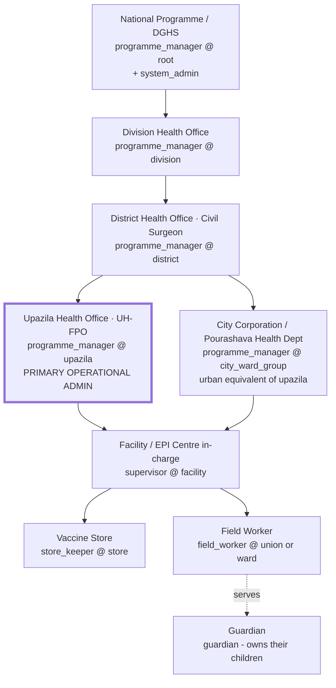

**Read the two boxes at the same level:** `UPZ` and `CITY`. That parallel is why "upazila" cannot be hardcoded. Both are *level-4 operational units*; only their label differs.

### 10.4 Permission matrix (role × capability), with scope semantics

Scope legend: **own** = own records · **@scope** = rows whose location is at or below the user's assigned node · **@facility** = rows attached to the assigned facility · **global** = all rows.

| Capability | guardian | field_worker | store_keeper | supervisor | programme_manager | system_admin |
|---|:--:|:--:|:--:|:--:|:--:|:--:|
| Register child | own | @scope | — | @scope | @scope | — |
| Search / view child | own | @scope | — | @scope | @scope | — |
| Record dose | — | @scope | — | @scope | — | — |
| Amend dose (notes/AEFI) | — | @scope | — | @scope | — | — |
| Void dose (with reason) | — | — | — | @scope | @scope | — |
| Merge duplicate children | — | — | — | @scope | @scope | — |
| Set child lifecycle status | — | propose | — | @scope | @scope | — |
| View defaulter list | own | @scope | — | @scope | @scope | — |
| Assign defaulter follow-up | — | — | — | @scope | @scope | — |
| Plan session / campaign | — | — | — | @scope | @scope | — |
| Receive / issue stock | — | — | @facility | @facility | @scope (view) | — |
| Record wastage | — | @facility | @facility | @facility | — | — |
| Cold-chain temperature log | — | — | @facility | @facility | view | — |
| Approve requisition | — | — | — | — | @scope | — |
| View coverage reports | own child | @scope | — | @scope | @scope | global |
| Export data (CSV/PDF) | own | — | @facility | @scope | @scope | global |
| Manage vaccine catalog | — | — | — | — | — | global |
| Invite / manage users | — | — | — | — | @scope, roles ≤ own | global |
| Grant `system_admin` | — | — | — | — | — | global |
| Change system settings | — | — | — | — | — | global |
| Read full audit log | own actions | own actions | own actions | @scope | @scope | global |
| Break-glass out-of-scope read | — | — | — | — | with reason, logged | global |

**Three rules that make this matrix safe:**
1. **No self-elevation.** A `programme_manager` may only grant roles at or below their own, within their own scope. Enforce in a trigger, not in the UI.
2. **Break-glass is a feature, not a hole.** Cross-scope reads happen legitimately (a child from another district shows up at a session). Allow it, require a reason, log it loudly, and put it on a review screen (`FR-76`). Systems that forbid it get worked around; systems that log it stay honest.
3. **Scope is time-bounded.** Assignments carry `valid_from`/`valid_to` so transfers expire on their own (`FR-09`).

### 10.5 What this fixes in the current code

| Today | After |
|---|---|
| `auth_role() = 'admin'` grants nationwide read of every child | Policy adds `and child.location_path <@ any(auth_scopes())` |
| One `admin` role for five real jobs | Five jobs, one role, distinct scopes |
| Role picked by `order by role limit 1` (`BUG-01`) | Highest **active** assignment, deterministic, tested |
| Workers see every child in the country | Workers see their catchment |
| No way to express "district officer" | `programme_manager @ district` |

---

## 11. Geographic Hierarchy Design

This is the centrepiece recommendation. Get it right once and everything downstream is cheap.

### 11.1 Correcting the level list

The levels proposed in the brief need one correction and two additions:

| Proposed | Assessment |
|---|---|
| Division | ✅ Correct — level 1 |
| District (Zila) | ✅ Correct — level 2 |
| Upazila | ✅ Correct — level 3 (rural) |
| **Thana** | ⚠️ **Not a separate level below upazila.** In Bangladesh a *thana* is a police jurisdiction. Historically upazilas were thanas; in metropolitan areas, thanas exist *instead of* upazilas. Modelling Thana as a child of Upazila will produce an empty level everywhere and a wrong one in cities. **Treat it as an alternate label at level 3, not a level 4.** |
| Union | ✅ Correct — level 4 (rural). Its urban counterparts are the **City Corporation / Pourashava**, which sit at level 3–4 with their own wards. |
| Ward | ✅ Correct — level 5, in both rural unions and urban corporations, but they are different kinds of ward; carry the type |
| Village | ✅ Useful as level 6 (rural), optional. Its urban counterpart is *mahalla*. |
| **Missing: City Corporation / Pourashava** | Add — without it, urban Bangladesh cannot be represented |
| **Missing: Facility / EPI centre / outreach site** | Add — but as a **separate entity**, not a level. See §11.4. |

### 11.2 Recommended hierarchy

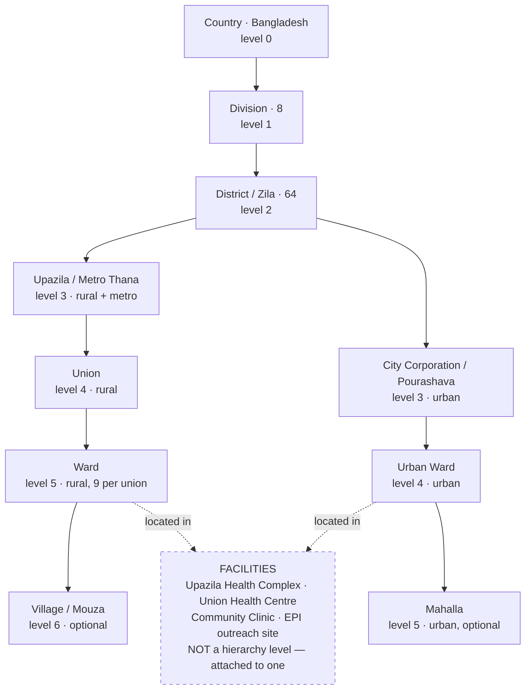

**Note the asymmetry.** The rural and urban branches have different depths and different level semantics at the same depth. Any design that assumes a fixed number of levels, or that "level 4 = union", breaks in Dhaka. The design below does not care.

### 11.3 Recommended schema

```sql
-- One extension, and the hierarchy problem is solved rather than simulated.
create extension if not exists ltree;

create type location_level as enum (
  'country','division','district','upazila','city_corporation',
  'union','urban_ward','ward','village','mahalla'
);

create table locations (
  id           uuid primary key default gen_random_uuid(),
  parent_id    uuid references locations(id) on delete restrict,
  level        location_level not null,
  name_bn      text not null,
  name_en      text not null,
  -- Official statistical geocode (BBS). The join key to census data, the
  -- denominator source, and any national system we will ever exchange data with.
  geo_code     text unique,
  -- Materialised path: 'bd.dhaka.gazipur.kaliakair.union_x.ward_5'
  path         ltree not null,
  is_urban     boolean not null default false,
  -- Boundaries change: upazilas split, unions are redrawn. A location is never
  -- deleted or edited in place; it is closed and a successor is opened.
  valid_from   date not null default current_date,
  valid_to     date,
  centroid     point,            -- enough for a choropleth; PostGIS only if real mapping arrives
  created_at   timestamptz not null default now()
);

create index locations_path_gist  on locations using gist (path);
create index locations_parent_idx on locations (parent_id);
create index locations_level_idx  on locations (level) where valid_to is null;
```

**Why `ltree` and not the alternatives:**

| Option | Verdict |
|---|---|
| **Adjacency list alone** (`parent_id`) | Simple to maintain, but "all descendants of Gazipur" is a recursive CTE per query — and **recursive CTEs cannot be used efficiently inside an RLS policy** evaluated per row. Fatal for §11.6. |
| **`ltree` materialised path** (recommended) | `path <@ 'bd.dhaka.gazipur'` is a single **GiST-indexed** containment test. Constant-ish cost, usable inside RLS, trivially readable in logs. Ships with Postgres and is available on Supabase. |
| **Closure table** | Also index-friendly and fully relational; costs one row per ancestor-descendant pair (~6× locations — fine) and more write complexity. **Acceptable fallback if `ltree` is unavailable.** |
| **Nested sets** | Reject. O(n) writes on insert. Wrong for a table that gets edited. |
| **`parent_id` + denormalised `division_id, district_id, upazila_id, …` columns** | Reject. Assumes fixed depth, breaks on the urban branch, and every new level is a migration. |

**Keep the adjacency list too.** `parent_id` is the editing model (referential integrity, cascading rules); `path` is the query model, maintained by a trigger. Both, not either.

### 11.4 Facilities and catchments — the part people get wrong

**A facility is not a level of the hierarchy.** A facility is *located in* a place and *serves* a set of places, and those two sets are different. An EPI outreach site sits in one ward but serves three. A community clinic serves parts of two unions. If you model facilities as hierarchy nodes, you will be unable to express that, and every coverage number attributed to a facility will be wrong.

```sql
create type facility_type as enum (
  'upazila_health_complex','union_health_centre','community_clinic',
  'city_corporation_centre','ngo_clinic','outreach_site','hospital'
);

create table facilities (
  id           uuid primary key default gen_random_uuid(),
  code         text not null unique,               -- e.g. 'FAC-000123'
  name_bn      text not null,
  name_en      text not null,
  type         facility_type not null,
  location_id  uuid not null references locations(id),   -- where it IS
  is_store     boolean not null default false,           -- holds vaccine stock?
  is_active    boolean not null default true,
  geo          point,
  created_at   timestamptz not null default now()
);

-- Where it SERVES. Many-to-many, because catchments do not respect boundaries.
create table facility_catchments (
  facility_id  uuid not null references facilities(id) on delete cascade,
  location_id  uuid not null references locations(id)  on delete restrict,
  is_primary   boolean not null default true,
  primary key (facility_id, location_id)
);
```

### 11.5 The denominator table — what turns a registry into an information system

```sql
create table population_estimates (
  location_id  uuid not null references locations(id),
  year         int  not null check (year between 2000 and 2100),
  age_band     text not null,        -- 'surviving_infants','0_11m','12_23m','live_births'
  estimate     int  not null check (estimate >= 0),
  source       text not null,        -- 'BBS census 2022','projection','microplan headcount'
  primary key (location_id, year, age_band)
);
```

Four columns and a primary key. With it:

- **Population coverage** becomes computable and comparable across areas.
- **Zero-dose children** becomes estimable: `target − children_with_any_dose`.
- **Vaccine forecasting** becomes arithmetic instead of guesswork (`target × doses_per_child × (1 + wastage_factor)`).
- **Equity analysis** becomes possible: which unions are furthest below the district mean.

Without it, none of those exist. **This is the highest value-per-line-of-code table in the entire proposed design.**

### 11.6 Scope-aware RLS — the payoff

Denormalise the path onto the hot tables and keep it in sync by trigger; then scope becomes one indexed containment test.

```sql
alter table children add column location_id   uuid references locations(id);
alter table children add column location_path ltree;    -- denormalised, trigger-maintained
create index children_location_path_gist on children using gist (location_path);

create table user_assignments (
  id          uuid primary key default gen_random_uuid(),
  user_id     uuid not null references profiles(id) on delete cascade,
  role        app_role not null,
  location_id uuid references locations(id),
  facility_id uuid references facilities(id),
  valid_from  date not null default current_date,
  valid_to    date,
  granted_by  uuid references profiles(id),
  created_at  timestamptz not null default now(),
  check (location_id is not null or facility_id is not null)
);

-- The scopes of the current user, as paths. STABLE, so Postgres evaluates it once
-- per statement rather than once per row — the same InitPlan discipline already
-- applied in 20260725101000_rls_perf.sql.
create or replace function public.auth_scopes() returns ltree[]
language sql stable security definer set search_path = public as $$
  select coalesce(array_agg(l.path), '{}')
    from user_assignments ua
    join locations l on l.id = ua.location_id
   where ua.user_id = auth.uid()
     and ua.valid_from <= current_date
     and (ua.valid_to is null or ua.valid_to >= current_date)
$$;
revoke execute on function public.auth_scopes() from anon;

-- The policy the whole design exists for.
drop policy children_select on children;
create policy children_select on children for select using (
  guardian_id = (select auth.uid())
  or exists (select 1 from guardians g
              where g.id = children.guardian_id and g.user_id = (select auth.uid()))
  or (
       (select auth_role()) in ('field_worker','store_keeper','supervisor',
                                'programme_manager','system_admin')
       and location_path <@ any ((select auth_scopes()))
     )
);
```

Every screen, every report, every export inherits catchment scoping from that one predicate. No application code changes. That is the argument for putting authorization in the database, made concrete — and it is the same argument the project already won once with `auth_role()`.

**Performance note.** `<@ any(array)` over a GiST index on `location_path` is index-usable and stays fast as the tree grows. Wrapping `auth_scopes()` in `(select …)` is what makes Postgres treat it as an InitPlan — the exact optimisation `20260725101000_rls_perf.sql` already applies elsewhere. Be consistent with that idiom.

### 11.7 Migration plan (non-breaking, 3 steps)

| Step | Action | Risk |
|---|---|---|
| 1 | Create `locations`, `facilities`, `facility_catchments`, `population_estimates`, `user_assignments`. Seed the hierarchy from official geocode data down to union/ward. Add **nullable** `location_id` to `children`, `facilities`, `inventories`, `vaccination_records`. Nothing breaks. | None |
| 2 | Backfill: assign existing demo data to one upazila; assign every existing user an assignment mirroring their current role at root scope, so behaviour is unchanged. Add the path trigger. | Low |
| 3 | Flip RLS policies to scope-aware, narrow root-scope assignments to real ones, set `location_id` `NOT NULL` on `children`. Add the pgTAP test: *"a `programme_manager @ upazila A` cannot read a child in upazila B."* | Medium — gated by the test |

Seeding note: the full national hierarchy to ward level is a large dataset. For the defense, seed **one division fully and the rest to district level** — the model is what is being graded, not the row count. Say so explicitly rather than letting an examiner discover it.

---

## 12. Database Improvement Recommendations

### 12.1 Missing entities, ranked

| Priority | Entity | Purpose | Unlocks |
|:--:|---|---|---|
| **1** | `locations` | Administrative hierarchy | Everything in §11 |
| **1** | `facilities`, `facility_catchments` | Service delivery points and who they serve | `FR-29`, `FR-40`, facility reporting |
| **1** | `population_estimates` | Coverage denominator | `FR-58`, zero-dose, forecasting |
| **1** | `user_assignments` | Role × scope | §10, scoped RLS |
| **1** | `guardians` | Guardian as a domain record, not a login | `BS-02`, `FR-14/15` |
| **2** | `stock_transactions` | Immutable stock ledger | `FR-41/42/43`, wastage, recall |
| **2** | `sessions`, `session_tally` | Immunization session and its tally | `FR-66/67`, session-based wastage |
| **2** | `defaulter_followups` | Tracing task with an outcome | `BS-04`, `FR-34–38` |
| **2** | `child_status_history` | Lifecycle transitions with reason | `BS-06` |
| **3** | `notification_preferences` | Per-guardian channel and opt-out | `FR-51` |
| **3** | `message_templates` | Versioned, localised message bodies | `FR-55` |
| **3** | `aefi_cases` | Adverse-event case with severity and outcome | `BS-12` |
| **3** | `cold_chain_equipment`, `temperature_logs` | Cold-chain monitoring | `FR-45` |
| **3** | `job_runs` | Scheduled-job observability | `NFR-19`, `REC-02` |
| **3** | `campaigns` | Supplementary immunization activities | `FR-68` |
| **4** | `consents` | Consent capture and withdrawal | `BS-09` |
| **4** | `data_quality_flags` | Verification and correction workflow | `BS-11` |

### 12.2 Corrections to existing tables

| Table | Change | Why |
|---|---|---|
| `children` | `+ location_id`, `location_path ltree`, `facility_id`, `status`, `status_changed_at`, `birth_registration_no`, `merged_into_id`, `deleted_at` | `BS-01/05/06`, `BUG-12` |
| `children` | `guardian_id` → `references guardians(id)` | `BS-02` |
| `children` | drop `guardian_contact`, or make `guardians.phone` authoritative and this a legacy mirror | `BUG-11` — two sources of truth for the reminder number |
| `children` | partial unique index on `(birth_registration_no)` where not null; functional index on `(lower(unaccent(full_name)), date_of_birth)` for duplicate detection | `BS-05` |
| `vaccination_records` | `+ facility_id`, `session_id`, `inventory_id` (FK, replacing free-text `batch_number`), `source` enum, `voided_at`, `void_reason`, `location_path` | `FR-29/30/32/33`, `BUG-05` |
| `vaccination_records` | index on `(child_id, vaccine_id, dose_number)` exists via unique; add `(administered_date)` and `(facility_id, administered_date)` for reporting | `NFR-06` |
| `schedules` | `+ recalculated_at`, `+ source` (`routine`/`catch_up`/`campaign`); allow regeneration | `BUG-02/03` |
| `schedules` | index `(status, due_date)` exists — add `(child_id, status)` for the parent view and `(location_path, status, due_date)` gist+btree for defaulter lists | `FR-34` |
| `inventories` | `+ facility_id` (NOT NULL), `doses_per_vial`, `vvm_stage`; `stock_quantity` becomes a **derived** balance or a cached column reconciled against the ledger | `FR-40/41/44`, `BUG-04` |
| `inventories` | unique key becomes `(facility_id, vaccine_id, batch_number)` | Same batch can exist in two stores |
| `notifications` | `+ child_id`, batch key `(child_id, channel, send_date)` replacing per-schedule key; `+ template_id`, `+ provider_status` | `BUG-08`, `FR-52/53` |
| `profiles` | `+ default_location_id`; keep `contact`, but add `email`/`phone` as distinct typed columns | `BUG-06` |
| `user_roles` | superseded by `user_assignments`; retain `staff_code` generation (it is good) keyed to the assignment | §10 |
| `audit_log` | `+ prev_hash`, `+ hash` (chain), `+ scope_path`, `+ request_id`; partition by month | `NFR-08`, retention |
| `app_settings` | `+ scope_location_id nullable` so lead time and grace period can differ by area | `BUG-10` |
| `vaccines` | `+ code_system`, `+ code_value`, `+ doses_per_vial`, `+ open_vial_hours`, `+ grace_period_days`, `+ min_age_days`, `+ max_age_days` | `FR-31/44`, `BUG-10` |

### 12.3 Normalisation, integrity and index review

**Normalisation.** The model is broadly 3NF and the two most important normalisation decisions were already made correctly: `vaccine_doses` separated from `vaccines` (§8.1 item 2 — genuinely the right call), and credentials delegated to `auth.users`. Remaining issues are **duplication of truth**, not normal-form violations:

- `guardian_contact` vs `profiles.contact` (`BUG-11`) — resolve to one owner.
- `vaccination_records.batch_number` duplicating `inventories.batch_number` as text (`BUG-05`) — replace with an FK.
- `inventories.stock_quantity` will duplicate the ledger sum once `stock_transactions` exists — keep it as an explicitly-labelled cached balance with a reconciliation check, or drop it and compute. **Recommendation:** keep it, maintained by trigger, plus a nightly reconciliation job that alerts on divergence. A live balance that requires summing a ledger is a performance trap at scale.

**Referential integrity.**
- `children.guardian_id … on delete restrict` — correct, keep.
- `vaccination_records.child_id … on delete restrict` — correct, and accidentally the strongest data-protection rule in the schema.
- `schedules.child_id … on delete cascade` — reconsider once soft delete exists; a cascade that silently destroys clinical context is the wrong default for health data.
- `notifications.schedule_id … on delete cascade` — acceptable.
- **Add:** `check (administered_date >= (select date_of_birth from children …))` is not expressible as a CHECK; enforce in the dose trigger. A dose before birth is currently insertable.

**Soft delete strategy — recommendation.** Do not add `deleted_at` everywhere. Adopt a three-tier rule and write it in the handbook:

| Tier | Tables | Rule |
|---|---|---|
| **Never deleted** | `vaccination_records`, `audit_log`, `stock_transactions` | Append-only. Corrections are new rows (`void` + re-record), never mutations. |
| **Soft deleted** | `children`, `guardians`, `facilities`, `locations`, `vaccines` | `deleted_at`/`valid_to`; excluded by a default view or a policy predicate. Merged children use `merged_into_id`. |
| **Hard deleted** | `notifications` (after retention), `schedules` of a soft-deleted child | Purged by a retention job. |

**Index review.** Current indexes are sensible and deliberately minimal — the `where adverse_event is not null` partial index in particular shows good judgement. Additions needed for the proposed model:

| Index | For |
|---|---|
| `gist(children.location_path)` | Scoped RLS — **the single most important new index** |
| `gist(locations.path)` | Hierarchy queries |
| `(schedules.status, due_date) include (child_id)` | Defaulter list (already have the base index) |
| `(vaccination_records.facility_id, administered_date)` | Facility/period reporting |
| `(vaccination_records.inventory_id)` | Recall traceability |
| `(stock_transactions.inventory_id, occurred_at)` | Balance computation |
| `(notifications.status, scheduled_for)` | Exists — keep |
| BRIN on `audit_log.at` after partitioning | Cheap time-range scans on an append-only table |

**Anti-recommendation.** Do **not** add indexes speculatively for the rest. The current restraint is correct; add each one with the query that justifies it, as the codebase already does in its migration comments.

### 12.4 Reporting model rebuild

Replace `v_coverage` and `v_dropout` with a layered read model:

1. **`v_child_status`** — one row per child: current age in days, doses due for age, doses received, up-to-date flag, zero-dose flag, location path, facility. This is the workhorse; nearly every report derives from it.
2. **`v_coverage_by_area`** — grouped by location level and period, joined to `population_estimates`, emitting **both** registry and population coverage, each with its numerator and denominator visible.
3. **`v_dropout`** — one pass, conditional aggregation, WHO formula:
   ```sql
   select v.code,
          count(*) filter (where r.dose_number = 1)             as dose1,
          count(*) filter (where r.dose_number = v.total_doses) as doseN,
          (count(*) filter (where r.dose_number = 1)
           - count(*) filter (where r.dose_number = v.total_doses))::numeric
            / nullif(count(*) filter (where r.dose_number = 1), 0) as dropout_rate
     from vaccines v
     left join vaccination_records r on r.vaccine_id = v.id
    group by v.code, v.total_doses;
   ```
   One scan instead of a self-cross-join (`BUG-09`), and it now emits the indicator rather than only its inputs.
4. **`mv_coverage_monthly`** — materialised, `(period, location_id, vaccine_id, dose_number)`, refreshed nightly. This is the time dimension `BS-10` is missing, and it is what makes trends and comparisons cheap.
5. **`v_data_quality`** — per area: median entry lag, records missing facility, sessions with no tally, implausible dates.

**Concurrency note:** use `refresh materialized view concurrently` (requires a unique index on the matview) so the nightly refresh does not lock out the dashboard. The current `mv_daily_doses` refresh takes an `ACCESS EXCLUSIVE` lock — invisible on seed data, a nightly outage at scale.

---

## 13. System Workflow Analysis & Diagrams

### 13.1 Workflow audit summary

| Workflow | Exists | Missing steps | Severity |
|---|:--:|---|:--:|
| Sign-up / sign-in | ✅ | MFA for elevated scopes; scope selection when a user holds several | Medium |
| Staff onboarding | ✅ | Scope assignment; time bounds; supervisor approval; deactivation on transfer | High |
| Child registration | ⚠️ | Duplicate check; guardian without account; location capture; BRN; catch-up path; offline | **Critical** |
| Guardian claims a child | ❌ | Entire flow | High |
| Dose administration | ❌ (UI) | Entire worker flow: search → verify → validate → record → batch → decrement stock → print/update card | **Critical** |
| Dose correction / void | ❌ | Reason, approval, audit, re-derivation of dependent schedule | High |
| Schedule re-derivation | ❌ | On catalog change; on late dose; on catch-up | High |
| Defaulter tracing | ❌ | List → assign → visit → outcome → status write-back → escalate | **Critical** |
| Reminder dispatch | ⚠️ | Channel routing, opt-out, batching, receipts, overdue cadence, stop on lifecycle | High |
| Stock receipt / issue | ⚠️ | Requisition → approve → dispatch → receive → FEFO issue → wastage → reconcile | High |
| Cold-chain excursion | ❌ | Log → alert → quarantine batch → decide → dispose/return | Medium |
| Recall | ❌ | Identify batch → find recipients + holders → notify → quarantine | High |
| AEFI | ⚠️ | Report → notify supervisor → investigate → outcome → batch signal | Medium-high |
| Session planning & tally | ❌ | Plan → assign → conduct → tally → reconcile against records | Medium-high |
| Report generation | ⚠️ | Period selection, geographic filter, verification, sign-off, distribution | Medium |
| Duplicate merge | ❌ | Detect → review → merge → audit | High |
| Offline sync | ❌ | Queue → conflict rule → replay → surface failures | **Critical (field)** |
| Incident response | ❌ | Runbook exists as prose only; no on-call, no drill | Medium |

**Cross-cutting deficiencies in every existing workflow:**
- **No approval steps.** Every privileged action is immediate and unilateral. Void, merge, requisition and role grant all need a second pair of eyes at some threshold.
- **No exception paths.** Every flow models the happy path. What happens when the vaccine is out of stock mid-session? When the guardian refuses? When the child is the wrong age? Undefined.
- **No escalation.** Nothing ever reaches a supervisor by itself.
- **No compensation.** No workflow can be undone; corrections are ad hoc.

### 13.2 Registration workflow (proposed)

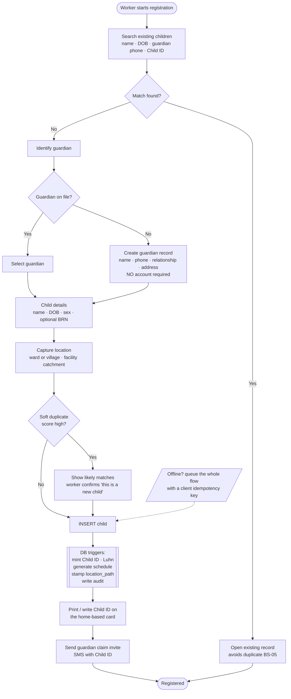

### 13.3 Vaccination (dose administration) workflow (proposed)

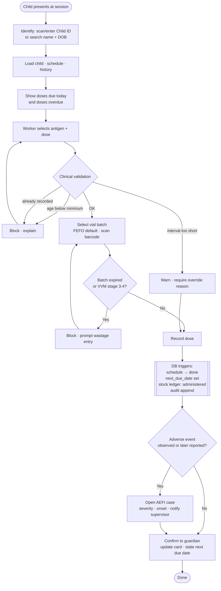

### 13.4 Authentication & authorization flow (proposed, scope-aware)

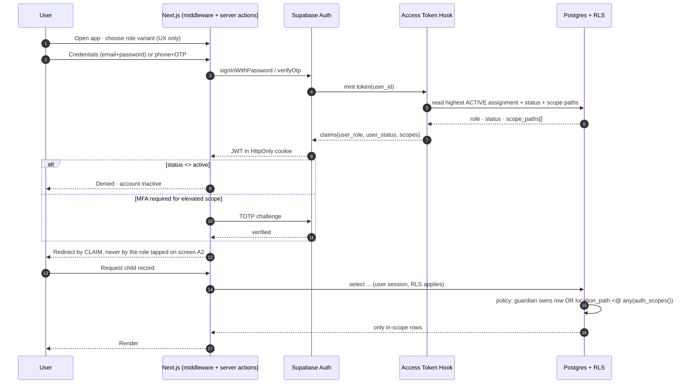

### 13.5 Vaccine distribution & cold chain (proposed)

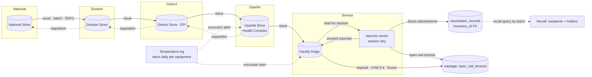

Every arrow above is a `stock_transactions` row. That is the whole design: **movements are facts, balances are opinions derived from facts.**

### 13.6 Defaulter tracing workflow (proposed — the missing core loop)

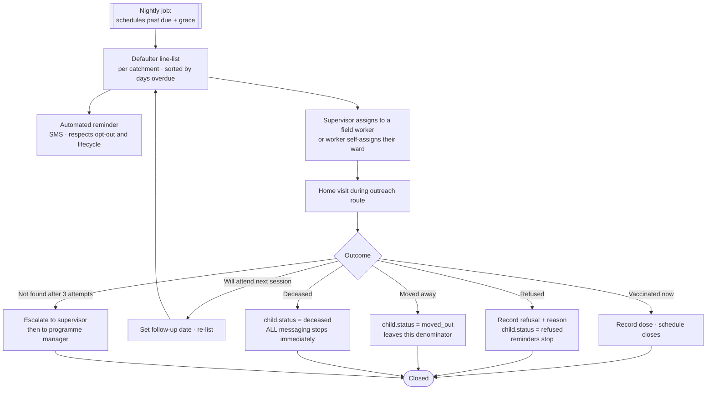

### 13.7 End-to-end business process

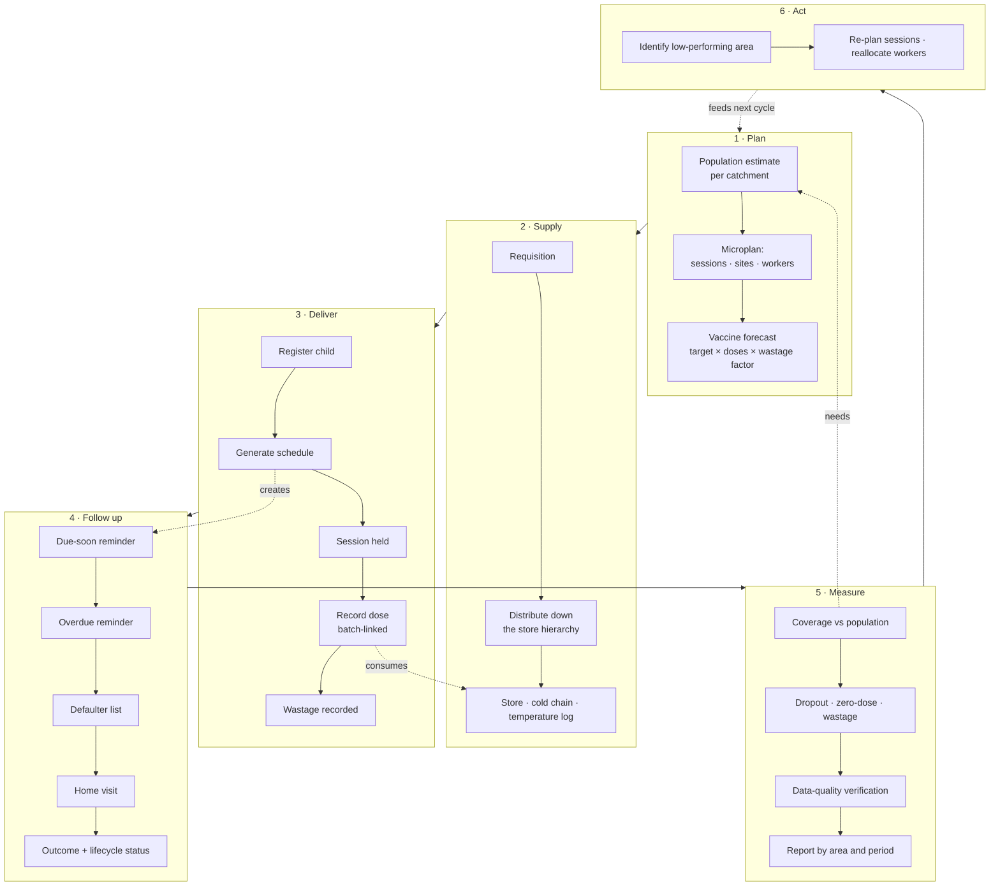

**This diagram is the argument of the whole report.** VaxTrace today implements the shaded middle of stage 3 and half of stage 4. Stages 1, 2, 5 and 6 all require geography and denominators. Show this slide in the defense.

### 13.8 User journeys

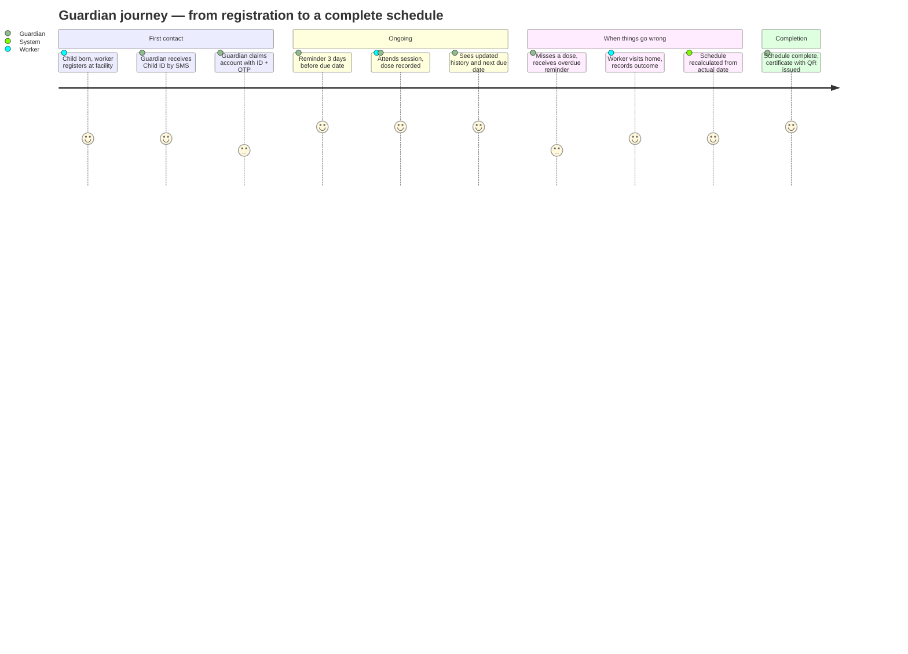

---

## 14. Architecture Recommendations

### 14.1 Target architecture

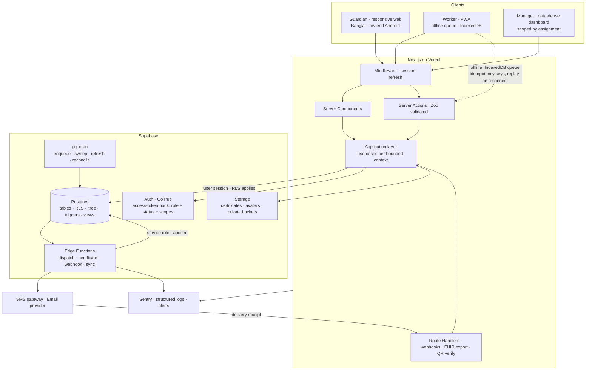

### 14.2 Architectural decisions to add

| ADR | Decision | Rationale |
|---|---|---|
| **ADR-011** | Bangla-only in v1; `locale` column retained as a seam | Reflects the 2026-07-20 decision; removes the documentation drift |
| **ADR-012** | No charting library; hand-rolled CSS/SVG charts | Already the implemented reality; ~40 KB saved on a 3G budget; record it rather than leaving it as unexplained drift |
| **ADR-013** | **Geography as `ltree` in one `locations` table**, adjacency for editing, path for querying | §11.3; closure table named as the fallback |
| **ADR-014** | **Authorization = role × scope**, scope enforced in RLS via path containment | §10, §11.6 |
| **ADR-015** | **Facilities and sessions pulled forward from ADR-005's deferral** | The seam's real trigger was "the first report someone acts on", not "the second clinic" |
| **ADR-016** | **Stock as an immutable ledger**, balance cached and reconciled nightly | `BUG-04`; movements are facts, balances are derived |
| **ADR-017** | **Offline-first PWA for the worker session workflow only**, not for the whole app | Bounds the complexity to the three operations that need it |
| **ADR-018** | **Coverage reported against population denominators**, registry coverage shown separately and labelled | `BS-07`; the difference between a registry and an information system |
| **ADR-019** | **Break-glass cross-scope access permitted, logged, reviewed** — not forbidden | Forbidden access gets worked around; logged access stays honest |

### 14.3 What must not change

Keep the modular monolith. Keep RLS as the authorization boundary. Keep domain invariants in the database. Keep migrations that explain themselves. Keep the discipline of refusing dependencies. These are the reasons this codebase is defensible, and none of the recommendations above require giving any of them up — §11.6 in particular is that philosophy applied to a harder problem.

### 14.4 Scaling posture

| Stage | Children | Bottleneck | Action |
|---|---|---|---|
| Demo | 10² | none | as-is |
| One upazila | 10⁴ | `v_dropout` (`BUG-09`) | one-pass rewrite |
| One district | 10⁵ | coverage aggregation on read | `mv_coverage_monthly` |
| One division | 10⁶ | reminder fan-out; RLS per-row cost | batch per child; verify GiST plans; `(select …)` InitPlan discipline |
| National | 10⁷ | `schedules` and `vaccination_records` volume | partition by year; read replica for reporting; archive closed cohorts |

Nothing on that path requires a different architecture — which is exactly the claim the handbook makes in §11 and, with the fixes above, the claim survives.

---

## 15. Security Recommendations

### 15.1 Assessment of what exists

| Control | State |
|---|---|
| RLS deny-by-default on every table | ✅ Strong |
| Policy tests as a merge gate | ✅ Strong (3 pgTAP suites) |
| Role in a server-stamped JWT, never client-set | ✅ Strong |
| Account status enforced at the policy layer via `auth_role()` returning NULL | ✅ Elegant — a system-wide deny from one function |
| Column-level grants limiting self-service updates | ✅ Strong and unusual |
| Trigger functions revoked from `anon`/`authenticated` | ✅ Correct — and correctly re-applied when a later migration missed one |
| Immutable identifiers enforced by trigger, not convention | ✅ Strong |
| Private storage bucket with per-user folder policy | ✅ Correct |
| Refusal to expose a definer RPC for convenience | ✅ Excellent judgement |

This is a better security posture than most production systems. The findings below are about **scope, identity and operations**, not about the policy layer's correctness.

### 15.2 Findings

| ID | Finding | Severity | Fix |
|---|---|:--:|---|
| ~~**SEC-01**~~ | ~~**Authorization has no geographic scope.** Any `admin` reads every child nationally.~~ **✅ CLOSED 2026-07-26** — every policy on `children`, `schedules`, `vaccination_records` and `inventories` now tests `location_path <@ any(auth_scopes())`; proven by [`rls_scope.test.sql`](../supabase/tests/rls_scope.test.sql) | ~~Critical~~ | §11.6 scoped RLS + pgTAP negative test |
| ~~**SEC-02**~~ | ~~**Role resolution picks the lowest privilege and contradicts its own comment** (`BUG-01`); multi-role users are mis-authorized~~ **✅ CLOSED** — explicit `role_rank()` / `app_role_rank()`, tested both directions | ~~High~~ | `order by` an explicit privilege rank; test both directions |
| ~~**SEC-03**~~ | ~~**MFA not enforced** for any account despite §9.2~~ **✅ CLOSED** — `mfa_satisfied()` enforced in RLS on role grants, system settings, the denominator and the full audit trail; enrolment screen ships; application-layer redirect makes the failure explainable rather than an empty screen | ~~High~~ | TOTP required for `supervisor` and above |
| ~~**SEC-04**~~ | ~~**No rate limiting** on OTP, sign-in, invitation or the manual reminder run~~ **✅ CLOSED for the in-product actions** — `consume_rate_limit()` caps the manual reminder run (4/hour) and break-glass (10/hour), and logs every exhaustion to the audit trail. Sign-in and OTP stay with GoTrue's limiter by choice: a second limiter that disagrees with the first is worse than one | ~~High~~ | Platform limits + per-user throttle on sensitive actions; the manual "run reminders" button is an SMS-cost amplifier |
| **SEC-05** | **No PII scrubbing in logs/errors verified.** Server actions return Bangla error strings (good), but no logging policy is enforced | High | Structured logger with a field allowlist; Sentry `beforeSend` scrubber; a CI grep for obvious leaks |
| **SEC-06** | **Audit log is not tamper-evident** and the service role can rewrite it | Medium-high | `prev_hash`/`hash` chain; nightly verification job; alert on break |
| **SEC-07** | **`mv_daily_doses` protection relies on application discipline** (`GAP-14`) | Medium | Verify PostgREST grants explicitly; revoke from `authenticated`; serve via an RLS-protected wrapper view |
| **SEC-08** | **No consent record, no retention execution, no subject access** (`BS-09`) | Medium-high | `consents` table; documented retention; export endpoint |
| **SEC-09** | **Single environment** — migrations reach production untested (`GAP-10`) | Medium | Staging project + branch preview databases |
| **SEC-10** | **No secret scanning / dependency scanning in CI** despite §9.8 | Medium | gitleaks + `pnpm audit` + Dependabot as merge gates |
| **SEC-11** | **`CRON_SECRET` is a static shared secret** on the dispatcher with no rotation policy | Medium | Rotate on a schedule; document; consider JWT-signed invocation |
| ~~**SEC-12**~~ | ~~**No break-glass logging** for legitimate cross-scope access (becomes relevant with SEC-01's fix)~~ **✅ CLOSED** — `break_glass_access` requires a written reason, expires after 4 hours, is rate-limited, cannot be self-reviewed (no update policy for the grantee) and cannot be deleted at all | ~~Medium~~ | `FR-76` |
| **SEC-13** | **No backup restore drill.** PITR may be off on the free tier; nobody has proven a restore works | Medium-high | Enable PITR; run one documented restore drill; screenshot it for the defense |
| **SEC-14** | **Guardian phone numbers are the reminder channel and the account recovery channel** — SIM reassignment is a real account-takeover vector in this context | Medium | Partly closed: `contact_verified_at` is cleared and an audit row written on any phone/email change, and the account security screen surfaces the unverified state. Re-verification on claim lands with the guardian claim flow (§21.2) |

### 15.3 Data protection posture (minimum viable, for a healthcare capstone)

1. **Classification** — the handbook's four-tier table (§9.1) is fine; enforce it by making PHI columns explicit in a comment and grepping for them in log statements.
2. **Consent** — captured at registration, with purpose (record-keeping vs SMS contact) separable, withdrawable, timestamped.
3. **Minimisation** — do not collect NID unless a use case demands it. Currently none does. Say no.
4. **Retention** — notifications purged after 12 months; audit archived after 3 years; child records retained per health policy (state the number).
5. **Subject rights** — a guardian can export their child's record (`FR-74`); a documented process for correction (which already exists as amendment + audit).
6. **DPIA** — one page: what data, why, who sees it, how long, what could go wrong, what mitigates it. An examiner asking "have you thought about privacy?" is answered by handing this over.

---

## 16. UI/UX Improvement Plan

The prior [`admin-uiux-audit.md`](admin-uiux-audit.md) already did rigorous work on the Admin role and much of it landed. This section does not repeat it; it addresses what that audit could not: the other two roles, and the screens the new architecture demands.

### 16.1 Screen inventory — current vs required

| Role | Designed (Figma) | Implemented | Required by this report | Net new |
|---|:--:|:--:|:--:|:--:|
| Auth | 5 | 5 | 6 (+ scope selector for multi-assignment users) | 1 |
| Guardian/Parent | 6 | 0 (stub) | 8 | **8** |
| Worker | 6 | 2 | 12 | **10** |
| Manager/Admin | 8–9 | 9 | 16 | **7** |
| Shared | 4 | partial | 5 | 1 |
| **Total** | **29** | **16** | **47** | **+31** |

### 16.2 Required new screens

**Guardian (8)** — Home (children + next due) · Child history (timeline) · Upcoming schedule · Digital card / certificate with QR · Notification preferences & opt-out · Claim a child (Child ID + OTP) · Find nearest session · Profile.

**Worker (12)** — Console with today's session · **Record dose** (`GAP-01`) · Child search · Child detail · Register child (exists) · **My catchment child list (offline-capable)** · **Defaulter route / tracing list** · Follow-up outcome capture · Session tally · Stock at my facility · Wastage entry · **Sync status & queue**.

**Manager (16)** — the 9 existing, plus: Coverage by area (with denominator) · Zero-dose list · Defaulter assignment board · Session & campaign planner · Stock ledger and requisitions · Cold-chain / temperature log · Data-quality dashboard · AEFI case list.

**Shared (5)** — Error/empty/loading states (exists) · Help · **Job health** (`NFR-19`) · Duplicate review queue · Break-glass access review.

### 16.3 The screen that changes the defense

**Coverage by Area.** One screen: a location tree on the left, a table on the right with columns *Registered · Target Population · Doses Given · Registry Coverage · Population Coverage · Dropout · Zero-dose*, filterable by antigen and period, drillable from division to ward. Every number carries its N. Every cell is clickable to the underlying children.

That single screen demonstrates geography, denominators, scoped access, aggregation and drill-down simultaneously. If only one new screen gets built, build that one.

### 16.4 Cross-cutting UX findings

| ID | Finding | Fix |
|---|---|---|
| UX-01 | **No offline affordance.** A worker cannot tell whether their entry is saved or queued. | Persistent sync-status chip: *Synced · N queued · Offline*. Never a silent failure. |
| UX-02 | **No shared component kit** (carried over from the prior audit, still open) | `AdminTable`, `Toolbar`, `StatusPill` from a single registry, `ConfirmDialog`, `EmptyState`, `Skeleton`, `Toast` — build once, all 47 screens become configuration |
| UX-03 | **Terminology drift across roles** (prior audit) worsens with 6 roles | One glossary, one status registry, one copy source; enforce by lint on string literals (`NFR-14`) |
| UX-04 | **Data-density mismatch.** The same table component serves a manager on a 1440px display and a worker on a 5-inch phone in sunlight. | Two presentations of the same data: dense table (desktop) and card list (mobile). Not a media query on a table — a different component. |
| UX-05 | **No confirmation on irreversible acts** (prior audit; now includes void, merge, wastage) | `ConfirmDialog` + typed confirmation for merges + audit + toast |
| UX-06 | **Bengali screen-reader and numeral handling unverified** | One NVDA/TalkBack pass in Bangla; `lang="bn"`; Bengali numerals everywhere via `format.ts` |
| UX-07 | **Empty vs zero ambiguity** (prior audit, solved on the Children screen) | Apply the same rule to every coverage figure: `—` for no denominator, `০%` for a real zero |
| UX-08 | **No progressive disclosure in the dose flow.** A worker needs three taps, not a form. | Child → doses due today shown as large tappable cards → confirm. Optimise for one-handed use standing at a session table. |
| UX-09 | **No print styles for the artefacts that matter** — the immunization card, the session tally, the defaulter route list are all printed in real programmes | Print stylesheet for those three; a defaulter list that prints is a defaulter list that gets used |
| UX-10 | **Figma is behind the code** for Admin, and has nothing for the new screens | Reverse-sync: bring the implemented Admin screens back into Figma, then design the 31 new ones against the same tokens |

### 16.5 Accessibility baseline (non-negotiable)

Text label inside every status pill, never colour alone · visible focus rings on all interactive elements · `aria-label` on every icon-only control · keyboard-navigable tables and row menus · minimum 44×44 px touch targets for the worker flows · contrast verified in both themes (already done for status colours) · form errors associated with inputs via `aria-describedby` · one screen-reader pass in Bangla per release.

---

## 17. Future Roadmap

### 17.1 Phased plan

| Phase | Window | Theme | Contents | Success test |
|---|---|---|---|---|
| **P0 — Defect sweep** | Week 1 | Credibility | `BUG-01`, `BUG-06`, `BUG-09` first; then 02–05, 07–12 | All twelve closed with a regression test each |
| **P1 — Structural** | Weeks 1–3 | *The five decisions* | `locations` + `ltree`; `facilities` + `sessions`; `population_estimates`; `user_assignments` + scoped RLS; `stock_transactions` | pgTAP: a manager in upazila A cannot read a child in upazila B; coverage renders with a real denominator |
| **P2 — Core loops** | Weeks 4–6 | Make the product work | Dose recording UI; child search; guardian-without-account + claim; defaulter tracing loop; notification routing/opt-out/batching; child lifecycle | A dose can be recorded, a defaulter traced and closed, a guardian claims a child — live |
| **P3 — Field reality** | Weeks 7–8 | Offline & parent | Worker PWA (3 operations); parent module B1–B6; digital card with QR | Demo: Wi-Fi off, record a dose, Wi-Fi on, it syncs |
| **P4 — Programme depth** | Weeks 9–11 | Depth for the defense | Coverage-by-area screen; zero-dose; wastage & FEFO; AEFI workflow; session tally; data-quality dashboard | Every §8.1 programme function has a screen |
| **P5 — Production hardening** | Weeks 12–13 | Ops | Staging env; E2E per role; MFA; rate limits; Sentry + alerts; PITR + restore drill; job health; load test at 1M rows | §18 checklist green |
| **P6 — Interoperability** | Post-defense | Integration | FHIR `Immunization` export; GIS choropleth; requisition flow; campaign module | An external system reads a child record |
| **P7 — Intelligence** | 12–24 mo | Analytics | Dropout-risk model to prioritise tracing; forecast accuracy tracking | Measured lift in tracing yield vs random order |

### 17.2 On "AI-powered analytics"

Only one AI feature is worth building here, and it is not a chatbot: **dropout-risk scoring to order the defaulter list.** Features are already in the data — days overdue, doses missed to date, distance to facility, sibling history, area's historical dropout, season. A logistic regression or gradient-boosted tree over a few thousand rows, evaluated with AUC-PR and calibration, prioritises a worker's route. It is honest ML, defensible statistically, and its value is measurable (tracing yield per visit).

**Say no to:** an LLM chatbot for parents in v1 (hallucination risk on medical advice is unacceptable and the population it serves is least able to detect it) · image-based vaccine verification · "AI insights" panels that restate a SQL aggregate in a sentence.

---

## 18. Production Readiness Checklist

Score honestly. `☐` = not done, `◐` = partial, `☑` = done.

### Architecture & code
- ☑ Documented architecture with ADRs
- ☑ Domain invariants enforced in the database
- ☐ Bounded contexts reflected in the folder structure (currently route-grouped, not context-grouped)
- ◐ No unexplained doc/code drift → **REC-01**
- ◐ Geography, facility, denominator entities present *(all three exist; `sessions` and the stock ledger outstanding)*

### Data
- ☑ Migrations as the single schema source, reviewed as code
- ☑ Constraints and check constraints on every invariant expressible as one
- ◐ Soft-delete strategy documented and applied *(three-tier rule applied to `children`, `vaccination_records` and `locations`; `guardians` outstanding)*
- ☐ Duplicate detection and merge
- ☐ Reporting read model with a time dimension
- ☐ Reconciliation job for cached balances
- ☐ Partitioning plan for `audit_log` and `vaccination_records`

### Security
- ☑ RLS deny-by-default, policy-tested
- ☑ Immutable identifiers, hardened function grants
- ☑ Scope-aware authorization *(`location_path <@ any(auth_scopes())`, negative-tested)*
- ☑ MFA for elevated roles *(TOTP; enforced in RLS on the privileged surfaces)*
- ◐ Rate limiting *(in-product actions capped; sign-in/OTP delegated to GoTrue by choice)*
- ☐ Secret + dependency scanning in CI
- ☐ Tamper-evident audit chain
- ☐ Consent, retention, subject access
- ☑ Break-glass access logged, expiring and reviewed
- ☐ Penetration/self-assessment against OWASP with evidence

### Reliability & operations
- ◐ Managed platform with documented SLOs (claimed, unmeasured)
- ☐ Staging environment
- ☐ PITR enabled **and a restore drill executed**
- ☐ Scheduled-job health visible and alerting
- ☐ Runbooks for: dispatcher backlog, cron stopped, bad migration, data breach
- ☐ On-call/escalation defined (even if it is one person and a phone)

### Observability
- ☐ Structured logging with correlation ids
- ☐ Error tracking (Sentry) with PII scrubbing
- ◐ Scheduled-job health visible in-product (`job_runs` + `v_job_health`); alerting still absent
- ☐ Three live alerts: auth-failure spike, dead-letter growth, cron non-execution
- ☐ Uptime check on a health endpoint

### Quality
- ◐ Unit tests (4 files, 53 tests) and pgTAP policy tests (4 files)
- ☐ ≥70% coverage on domain logic
- ☐ One E2E journey per role
- ☐ Load test at representative volume (1M schedule rows)
- ☐ Accessibility audit (axe + one manual Bangla screen-reader pass)
- ☐ Lighthouse budget enforced in CI

### Delivery
- ☑ CI: typecheck, lint, unit, build
- ☑ Conventional commits, husky, commitlint
- ☐ Migration rollback tested
- ☐ Preview deployments per PR with an ephemeral database
- ☐ Release notes / versioning applied

### Documentation
- ☑ Engineering handbook (exceptional for a capstone)
- ☑ UI/UX audit trail
- ☑ This report
- ☐ API/data dictionary generated from the schema
- ☐ Operations runbook
- ☐ User manual in Bangla for workers

**Score at review (2026-07-25): 14 of 47 items complete or partial ⇒ ≈ 30% production ready.**
**Score after the first delivery round (2026-07-26): 22 of 49 ⇒ ≈ 45%.** Two items were added to the list rather than quietly absorbed — break-glass review and in-product job health — because a checklist that only ever shrinks is measuring the wrong thing.

That is normal for this stage and not a criticism; what matters is that the list exists and is honest. An examiner who sees a candid checklist trusts the rest of the document more than one who sees all green ticks.

---

## 19. Risk Assessment

L×I on a 1–5 scale; **Exposure = L × I**.

| ID | Risk | L | I | Exp | Mitigation | Owner |
|---|---|:--:|:--:|:--:|---|---|
| **R-01** | **Scope shock — the five structural changes are attempted at once and none finishes** | 4 | 5 | **20** | Strict sequence: `locations` → scope RLS → facilities → denominators → ledger. Each ships behind a passing test before the next starts. Ship P0 defects first for a quick, visible win. | Lead |
| **R-02** | **Defense demo has no dose recording** (`GAP-01`) | 4 | 5 | **20** | Build it in week 1 regardless of everything else. It is one day. | FE |
| **R-03** | Migration to scoped RLS locks everyone out or silently opens access | 3 | 5 | 15 | Three-step non-breaking migration (§11.7); negative pgTAP test as the gate; staging first | DB |
| **R-04** | Reminder cost/deliverability — no SMS contract; the manual run button can burn budget | 4 | 3 | 12 | Provider adapter already abstracted; per-run cap; email fallback; batching (`BUG-08`) cuts volume ~3× | Notif |
| **R-05** | Offline sync introduces duplicate or lost clinical records | 3 | 5 | 15 | Client-generated idempotency keys; append-only clinical model; explicit conflict rule; a failure queue a human can see | Lead |
| **R-06** | Geographic reference data is unavailable or inconsistent | 3 | 3 | 9 | Seed one division fully, the rest to district; state the limitation openly; design does not depend on completeness | DB |
| **R-07** | `v_dropout` (`BUG-09`) melts the demo if seed data is scaled up for realism | 3 | 4 | 12 | One-pass rewrite — under an hour | DB |
| **R-08** | Data leak via missing scope (`SEC-01`) discovered by an examiner | 3 | 5 | 15 | §11.6 + the negative test; be first to name the finding | Security |
| **R-09** | Documentation drift undermines credibility (§2.4) | 4 | 2 | 8 | Errata + two ADRs; half a day | PM |
| **R-10** | Single environment: a bad migration takes down the demo | 3 | 4 | 12 | Staging project; `supabase db reset` rehearsal before the defense; a tested restore | DevOps |
| **R-11** | Bus factor of one | 4 | 4 | 16 | The handbook is already excellent mitigation; add runbooks and a 1-page "how to run everything" | All |
| **R-12** | Over-scoping features the report itself recommends | 3 | 3 | 9 | Every recommendation carries a priority; P4–P7 are explicitly post-defense | PM |
| **R-13** | Reminders sent to a bereaved or opted-out family (`FR-56`, `BUG-07`) | 3 | 5 | 15 | Child lifecycle + opt-out before any real SMS traffic. **Do not connect a live gateway until both exist.** | Notif |
| **R-14** | Ethical/privacy challenge in the defense with no prepared answer | 3 | 4 | 12 | §15.3 DPIA one-pager; consent design; break-glass logging | Lead |

**The two risks to act on this week: R-01 and R-02.** Both are mitigated by sequencing, not by effort.

---

## 20. Final Recommendations

### 20.1 What to do, in order

**Week 1 — earn the right to be believed.**
1. Fix `BUG-01` (role resolution), `BUG-06` (email sent to phone numbers), `BUG-09` (cartesian dropout view). Three small changes, three regression tests, disproportionate credibility.
2. Build **dose recording** in the worker UI. The system's core verb cannot remain unimplemented.
3. Reconcile the handbook (`REC-01`) and add ADR-011/012.

**Weeks 1–3 — the five decisions.** `locations` + `ltree` → scoped RLS with a negative pgTAP test → `facilities` + `sessions` → `population_estimates` + rewritten coverage → `stock_transactions`. Strictly in that order; each behind a passing test.

**Weeks 4–6 — close the loops.** Guardian-without-account + claim; child search; defaulter tracing end to end; notification routing, opt-out and batching; child lifecycle status.

**Weeks 7–8 — field reality.** Worker PWA for three operations; the parent module; the QR immunization card.

**Weeks 9–13 — depth and hardening.** Coverage-by-area screen; zero-dose; wastage; AEFI; data quality; then the §18 checklist.

### 20.2 The five sentences to say in the defense

1. *"VaxTrace enforces authorization in the database, not the application — every policy is a test and a merge gate."* (True today, and rare.)
2. *"The system is organised around a geographic hierarchy, so a coverage number always belongs to a place and a population, never to a registry counting itself."* (True after week 3.)
3. *"Roles are separated from scope, so the same six roles describe a national programme and a single ward without changing a line of policy."*
4. *"Stock movements are immutable facts and balances are derived from them, which is what makes wastage measurable and a recall executable."*
5. *"A worker can record a dose with no network, and it reconciles safely when the network returns."*

Each of those is a defensible engineering claim backed by a table, a policy, or a demo — not a feature list.

### 20.3 The honest summary

VaxTrace is engineered better than its scope. The craftsmanship is real: the migrations reason about their own decisions, the security model is enforced where it cannot be bypassed, and the project has already demonstrated the rarest habit in software — going back and auditing its own work, then fixing what it found.

The gap is domain, not code. It was built as a registry for a clinic and is being presented as an information system for a programme. The distance between those is one dimension — **place** — plus one number — **the denominator** — plus one loop — **defaulter tracing**. Add those three and every other recommendation in this document becomes an increment rather than a rewrite.

That is a three-week distance. It is worth walking.

---

## 21. Delivery Log

This section is the difference between a review and a plan that happened. Each round records what was built, what it closed, and — the part that matters — what was deliberately *not* built and why.

### 21.1 Round 1 — authentication, authorization and geography (2026-07-26)

Sequenced ahead of everything else because every other recommendation in this report reads or writes data that these rules govern: building the defaulter list before scope exists means building it twice.

**Migrations**

| File | Closes |
|---|---|
| [`20260726100000_defect_sweep.sql`](../supabase/migrations/20260726100000_defect_sweep.sql) | `BUG-01` `BUG-02` `BUG-03` `BUG-05` `BUG-09` `BUG-10` `BUG-12`, `FR-31` `FR-32` `FR-33` |
| [`20260726110000_geography_and_scope.sql`](../supabase/migrations/20260726110000_geography_and_scope.sql) | `BS-01` `SEC-01`, `FR-06` `FR-09` `FR-10` `FR-19` `FR-76`, `NFR-10`, decisions **D1**, **D2** (partial), **D3** (schema), **D4** |
| [`20260726120000_auth_hardening_and_ops.sql`](../supabase/migrations/20260726120000_auth_hardening_and_ops.sql) | `SEC-03` `SEC-04` `SEC-12` `SEC-14` (partial), `GAP-08` `GAP-11`, `FR-08`, `NFR-19` (partial), `REC-02` |

**Application**

New: account security / TOTP enrolment · admin user detail with role × scope assignment · administrative geography browser · facilities with catchments · population denominator · break-glass review · job-health card on settings. `lib/auth.ts` gained the claims model; `lib/roles.ts` was split out client-safe.

**Verification**

`pnpm typecheck` · `pnpm lint` · `pnpm build` all clean. `pnpm test` 53 passing (was 43): the new [`roles.test.tsx`](../apps/web/tests/roles.test.tsx) parses the migration and asserts the TypeScript rank and role-mapping tables still mirror `app_role_rank()` and `app_role_to_user_role()`, so a drift between the two copies breaks CI rather than production. [`rls_scope.test.sql`](../supabase/tests/rls_scope.test.sql) adds 9 pgTAP assertions with the negative case first.

> **Honest limitation.** The pgTAP suite has not been executed in this round: it needs a running local Supabase (`supabase start`), and no Docker daemon was available in the environment the work was done in. The SQL is written and reviewed but **unproven**, and it must be run before anyone repeats the SEC-01 claim in a defense. The TypeScript checks above *were* executed. This distinction is the whole point of §18 being honest.

**Decisions taken while building, worth defending**

1. **The legacy `user_role` enum was kept.** `app_role` is authoritative for scope; `user_role` remains the coarse capability gate that every existing policy and route guard reads, derived from `app_role` by the access-token hook. Replacing both in the migration that introduces scope would have changed two variables at once, and left no way to tell which one broke.
2. **Scope paths are not JWT claims.** An assignment can be edited at any moment; a token lives until it expires. `auth_scopes()` reads the table on every query instead — slightly more work per statement, and never a stale authorization decision. The report's §13.4 sequence diagram shows `scopes` in the claims; the SQL in §11.6 does not, and the SQL is what was built.
3. **Every child always has a location.** A registrar's most specific posting, else the guardian's default, else the country root. "Location unknown" is a real state in every registry that works; a NULL that silently removes the row from every scoped query is not.
4. **Existing access was preserved exactly.** Every staff account was back-filled with an assignment at the root, so `<@ 'bd'` matches every child and nobody's effective access changed on deploy. Narrowing real users to real scopes is a data operation, and it is what the negative test proves.
5. **MFA is enforced in RLS on privileged surfaces, not on reading child records.** Emptying the children table for an un-enrolled worker looks like data loss, not like a security control, and the worker cannot fix it from the screen they are staring at. Enrolment is enforced at the application boundary, which is the layer that can explain itself.
6. **Sign-in and OTP rate limiting was left to GoTrue.** A second limiter that disagrees with the first is worse than one. What was added is a limiter on the authenticated in-product actions GoTrue knows nothing about — the manual reminder run and break-glass.
7. **`geo_code` was left NULL.** It is the join key to census data. A plausible-looking wrong geocode joins silently to the wrong census row; a NULL does not. Loading the official BBS/DGHS list is a data task, recorded rather than faked.
8. **The hierarchy is seeded to district nationally, and deeper only where the demo needs it.** All 8 divisions and all 64 districts are administrative fact and ship in the migration; Gazipur's upazilas, two Kaliakair unions with their statutory nine wards, and one city-corporation branch give the tree real depth on both the rural and urban sides. The remaining ~490 upazilas load from the official reference file. Say this out loud in the defense — the model is what is being graded, not the row count.

### 21.2 Carried forward

Unchanged in priority from §17.1, with the round-1 dependencies now removed:

| Next | Why it is next |
|---|---|
| `guardians` + claim flow (`BS-02`), child lifecycle (`BS-06`), duplicate detection and merge (`BS-05`) | Resolves `BUG-11`'s two sources of truth and is a prerequisite for `FR-56` (reminders must stop for a bereaved family) |
| Notification rebuild — routing, opt-out, batching (`BUG-06` `BUG-07` `BUG-08`) | Blocked on `guardians` for the authoritative phone number. **Do not connect a live SMS gateway before this and the child lifecycle both exist.** |
| Stock ledger (`BUG-04`, **D5**), `sessions` + tally | Completes `FR-29`'s `session_id` and makes wastage, FEFO and recall real |
| `v_coverage_by_area`, zero-dose, `mv_coverage_monthly` (**D3** reporting half, `BS-10`) | The denominator table exists; the views that divide by it do not |
| Dose recording + child search in the worker UI (`GAP-01` `GAP-04`) | The product's core verb, still unimplemented in the role that performs it |
| Handbook errata + ADR-011…019 (`REC-01`) | Nine of these ADRs now describe shipped code rather than proposals |

### 21.3 Known gaps in what was delivered

Stated here rather than discovered later:

- **pgTAP unexecuted** — see the note above. This is the largest single caveat on round 1.
- **Guardian phone+OTP sign-in (`FR-01`)** remains unproven. It needs an SMS provider; the typed `profiles.phone` column and the verification-invalidation trigger are the groundwork, not the feature.
- **`vaccination_records.session_id`** is absent until `sessions` lands, so `FR-29` is half closed.
- **Clinical validation is per-row.** Postgres does not increment the command counter between rows of a single multi-row `INSERT`, so the interval, dose-order and same-day checks are skipped for a bulk load (the seed file, a future importer) that cannot see its own sibling rows. Every interactive path — one row per statement — is fully checked. The age, provenance, batch and date-of-birth checks hold under bulk load too. This is documented in the migration at the point it matters.
- **Catalog re-derivation is a full pass** over active children. Catalog edits are admin-only and rare, so the cost is paid when someone changes clinical policy; at national volume this wants a background job rather than a statement trigger.

---

## Appendix A — Diagram Index

| # | Diagram | Section |
|---|---|---|
| 1 | Current ERD (as built) | §2.2 |
| 2 | Administrative hierarchy | §10.3 |
| 3 | Geographic hierarchy (rural + urban branches) | §11.2 |
| 4 | Registration workflow | §13.2 |
| 5 | Vaccination (dose administration) workflow | §13.3 |
| 6 | Authentication & authorization sequence | §13.4 |
| 7 | Vaccine distribution & cold chain | §13.5 |
| 8 | Defaulter tracing workflow | §13.6 |
| 9 | End-to-end business process | §13.7 |
| 10 | Guardian user journey | §13.8 |
| 11 | Target system architecture | §14.1 |
| 12 | Proposed full ERD | Appendix B |
| 13 | Deployment architecture | Appendix B.2 |

## Appendix B — Proposed Full ERD

### B.1 Target data model

```mermaid
erDiagram
  locations            ||--o{ locations            : "parent_of"
  locations            ||--o{ facilities           : "hosts"
  locations            ||--o{ population_estimates : "has_target"
  locations            ||--o{ children             : "resides_in"
  locations            ||--o{ user_assignments     : "scopes"
  facilities           ||--o{ facility_catchments  : "serves"
  locations            ||--o{ facility_catchments  : "served_by"
  facilities           ||--o{ inventories          : "stores"
  facilities           ||--o{ sessions             : "hosts"
  facilities           ||--o{ vaccination_records  : "site_of"
  facilities           ||--o{ cold_chain_equipment : "houses"

  profiles             ||--o{ user_assignments     : "holds"
  profiles             ||--o{ guardians            : "may_be"
  profiles             ||--o{ vaccination_records  : "administers"
  profiles             ||--o{ audit_log            : "acts"

  guardians            ||--o{ children             : "guardian_of"
  guardians            ||--o{ notification_prefs   : "configures"
  guardians            ||--o{ consents             : "gives"

  children             ||--o{ schedules            : "has"
  children             ||--o{ vaccination_records  : "receives"
  children             ||--o{ child_status_history : "transitions"
  children             ||--o{ defaulter_followups  : "traced_by"
  children             ||--o{ notifications        : "about"

  vaccines             ||--o{ vaccine_doses        : "defines"
  vaccines             ||--o{ schedules            : "scheduled_in"
  vaccines             ||--o{ vaccination_records  : "recorded_in"
  vaccines             ||--o{ inventories          : "stocked_as"

  inventories          ||--o{ stock_transactions   : "moved_by"
  inventories          ||--o{ vaccination_records  : "sourced_dose"

  sessions             ||--o{ vaccination_records  : "produces"
  sessions             ||--o{ session_tally        : "summarised_by"

  vaccination_records  ||--o{ aefi_cases           : "may_trigger"

  cold_chain_equipment ||--o{ temperature_logs     : "monitored_by"

  schedules            ||--o{ notifications        : "triggers"
  message_templates    ||--o{ notifications        : "renders"

  campaigns            ||--o{ sessions             : "comprises"
```

### B.2 Deployment architecture

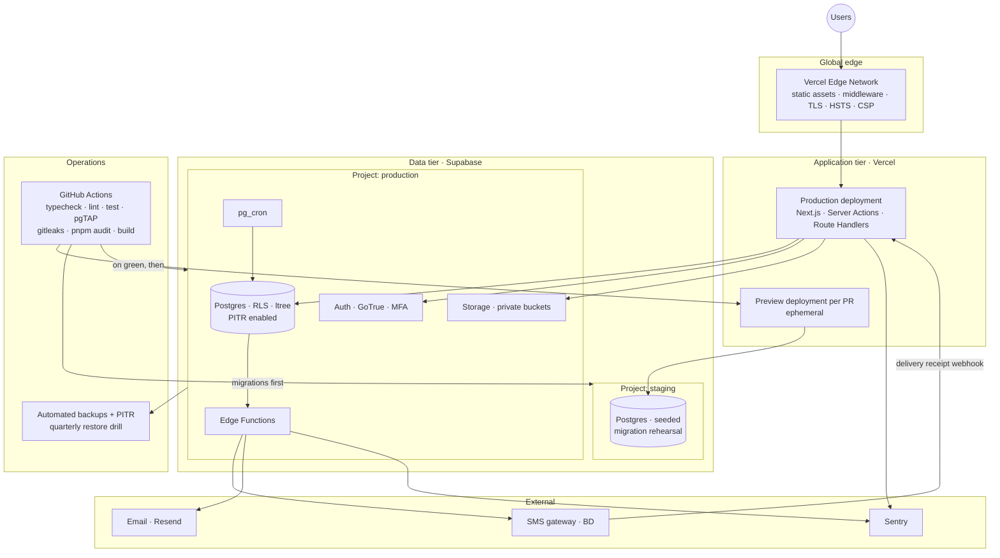

## Appendix C — Requirements Traceability Matrix

Condensed: new requirements → the finding that motivates them → the phase that delivers them.

| Requirement | Motivated by | Phase | Verify |
|---|---|:--:|:--:|
| FR-06…FR-10 (role × scope, MFA, multi-capacity) | BS-01, BUG-01, SEC-01/02/03 | P1 | T |
| FR-14…FR-21 (guardians, claim, dedup, merge, lifecycle, location, BRN, catch-up) | BS-02, BS-05, BS-06, BS-01 | P1–P2 | T/D |
| FR-26…FR-33 (dose UI, re-derivation, intervals, facility, batch FK, validation, void, historical) | GAP-01, BUG-02/03/05, BS-03 | P0–P2 | T |
| FR-34…FR-38 (defaulter loop, zero-dose, escalation) | BS-04 | P2 | D |
| FR-39…FR-47 (per-facility stock, ledger, FEFO, wastage, open vial, cold chain, recall, requisition) | BUG-04, BUG-05, BS-03 | P1–P4 | T/D |
| FR-48…FR-56 (routing, opt-out, batching, receipts, overdue, templates, lifecycle stop) | BUG-06/07/08, GAP-06/07 | P2 | T |
| FR-57…FR-65 (denominator coverage, WHO dropout, filters, comparison, certificate, QR, worker analytics, map) | BS-07, BS-10, BUG-09, GAP-05 | P1–P4 | A/D |
| FR-66…FR-68 (sessions, tally, campaigns) | BS-03, §8.1 | P4 | D |
| FR-69…FR-72 (offline) | BS-08 | P3 | T/D |
| FR-73…FR-76 (consent, export, retention, break-glass) | BS-09, SEC-08/12 | P2–P5 | I/T |
| NFR-03/04 (field latency & payload) | BS-08, §8.3 | P3 | A |
| NFR-06 (reporting at scale) | BUG-09 | P0 | A |
| NFR-10 (scope isolation proven) | SEC-01 | P1 | T |
| NFR-17/18/19 (DR drill, observability, job health) | SEC-13, GAP-13 | P5 | I |

## Appendix D — Glossary

| Term | Meaning |
|---|---|
| **AEFI** | Adverse Event Following Immunization |
| **Catchment** | The set of places a facility is responsible for serving — not necessarily an administrative boundary |
| **Cold chain** | The temperature-controlled chain from manufacturer to child |
| **Defaulter** | A child whose scheduled dose is overdue beyond the grace period |
| **Denominator** | The estimated target population a coverage rate is divided by |
| **Dropout rate** | (dose 1 − dose N) ÷ dose 1 × 100 — measures failure to complete a series |
| **EPI** | Expanded Programme on Immunization — the routine childhood immunization programme |
| **FEFO** | First-Expiry-First-Out — issue the batch that expires soonest |
| **`ltree`** | Postgres extension for hierarchical label paths with GiST-indexed containment |
| **Microplanning** | The bottom-up plan of sessions, sites, staff and supplies per catchment |
| **Open-vial policy** | Rules governing how long a multi-dose vial may be used after opening |
| **Outreach session** | Immunization held away from a fixed facility, at a community site |
| **RLS** | Row-Level Security — Postgres per-row access rules; VaxTrace's authorization layer |
| **Scope** | The set of rows a user may act on, defined by a location node and/or facility |
| **VVM** | Vaccine Vial Monitor — the heat-exposure indicator on a vial label |
| **Wastage rate** | (doses issued − doses administered) ÷ doses issued × 100 |
| **Zero-dose child** | A child who has received no dose of a first-dose antigen — the flagship global equity indicator |

---

*End of document — VXT-SAR-001 v1.0*
